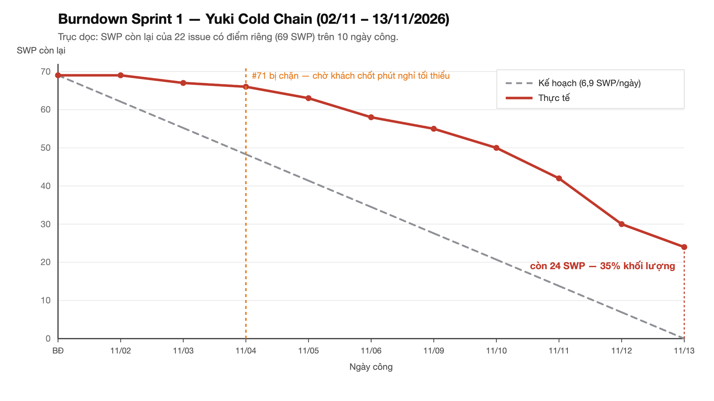

# Báo cáo tiến độ

**Iteration:** Sprint 1 · **Khoảng thời gian giả lập:** 02/11/2026 – 15/11/2026 (10 ngày công: 02–06/11 và 09–13/11)

**Ngày viết báo cáo:** 17/11/2026 — hai ngày sau khi Sprint 1 đóng, một ngày sau khi Sprint 2 bắt đầu (16/11).

Board: <https://github.com/users/vandt-0395-01/projects/1> · Đội phát triển giả lập: 2 BE · 1 FE · 1 QA (320 giờ mỗi sprint). PM/BrSE là PL, không tính vào đội

Có hai loại số trong báo cáo này. **Số đếm được** (trạng thái, SWP, giờ, vai, iteration) lấy trực tiếp từ
trường `Status`, `SWP`, `Hours`, `Role`, `Iteration` của GitHub Project qua GraphQL. **Ngày đóng từng issue,
đường burndown và các tỷ lệ tiến độ (~80 %, ~85 %, giờ thực)** là kịch bản mô phỏng: Project không lưu ngày
và không có trường tiến độ. Các tỷ lệ đó là ước của tổ trưởng trong buổi điểm tin, không phải số đo từ hệ thống.

---

## 1. Trạng thái

Sprint 1 có **33 item**, nhưng chỉ **22 item có điểm riêng** (69 SWP · 346,4 giờ). 11 item còn lại là
**issue vật chứa** — điểm của chúng là tổng của sub-issue, nên nếu cộng cả vào thì đếm hai lần. Bảng
đầu tiên tính trên 22 item đó; bảng thứ hai liệt kê đủ 33 item để đối chiếu với board.

### 1.1 — 22 item có điểm riêng

| Trạng thái | Số issue | SWP | Giờ kế hoạch | Tỷ lệ SWP |
|---|---:|---:|---:|---:|
| Done | 16 | 45,0 | 226,5 | **65,2 %** |
| In Progress | 4 | 17,0 | 80,3 | 24,6 % |
| Blocked | 1 | 4,0 | 27,6 | 5,8 % |
| Todo (chưa khởi động) | 1 | 3,0 | 12,0 | 4,3 % |
| **Tổng** | **22** | **69,0** | **346,4** | **100 %** |

### 1.2 — Cả 33 item của Sprint 1 (gồm vật chứa)

| Trạng thái | Số item |
|---|---:|
| Done | 21 |
| In Progress | 6 |
| Blocked | 1 |
| Todo | 5 |

### 1.3 — Theo vai (SWP, chỉ 22 item có điểm riêng)

| Vai | Done | In Progress | Blocked | Todo | Nhận | Năng lực sprint | Mức nạp |
|---|---:|---:|---:|---:|---:|---:|---:|
| BE | 14 | 6 | 4 | — | 158,4 giờ | 160 giờ | **99 %** |
| FE | 14 | — | — | 3 | 72,8 giờ | 80 giờ | 91 % |
| QA | 8 | 5 | — | — | 67,2 giờ | 80 giờ | 84 % |
| PM (thời gian của PL) | 9 | 6 | — | — | 48,0 giờ | — | — |

Năng lực đội phát triển một sprint là **BE 160 + FE 80 + QA 80 = 320 giờ**. 48 giờ việc PM là thời gian của PL
(PM/BrSE), tách riêng, **không cộng vào 320** và không có mức nạp so với năng lực đội.

Mức nạp BE 99 % là con số đáng lo nhất của bảng này — nó có nghĩa là sprint được xếp với **0 giờ dự phòng**
cho phía BE. Mọi việc phát sinh ở BE đều phải đẩy một việc khác ra khỏi sprint, và đó đúng là chuyện đã xảy ra.

### 1.4 — Epic nào đóng, epic nào dở

Trạng thái epic **suy ra từ con**, không gán tay — cha không thể xong trước con.

| Epic | Nội dung | Trạng thái |
|---|---|---|
| E9 | Ngưỡng nhiệt 3 dải có phiên bản (bẫy ①) | **Done** — toàn bộ 20 SWP của epic nằm trong Sprint 1 và đóng hết |
| E3 | Đơn xuất, phân bổ lô, chặn 日付逆転 | In Progress |
| E4 | Lập tuyến và công bố tuyến | In Progress |
| E5 | Cảnh báo nhiệt | In Progress |
| E6 | Hồ sơ HACCP | In Progress |
| E7 | Phi chức năng, quyền, bất biến dữ liệu | In Progress |
| E8 | Truy xuất nguồn gốc | In Progress |
| E10 | Giới hạn giờ lái xe 2024 | In Progress — **có 1 issue bị chặn** |
| E1 | Kiểm hàng nhập | Todo |
| E2 | Tồn kho và FEFO | Todo |

Đóng trọn được E9 là kết quả đáng kể: đây là epic mang **bẫy ①** — ngưỡng nhiệt do khách tự công bố,
có phiên bản, tra theo **mốc thời gian đo** chứ không theo thời điểm người dùng bấm. Sau sprint này
không còn đường nào trong hệ thống đọc ngưỡng mà bỏ qua số hiệu phiên bản.

### 1.5 — Sáu issue tồn sang Sprint 2

| # | Issue | Vai | SWP | Trạng thái | Tình trạng thật |
|---|---|---|---:|---|---|
| [#71](https://github.com/vandt-0395-01/lab5-coldchain-B120395/issues/71) | E10-I2 bộ đếm lái liên tục 4 giờ | BE | 4 | **Blocked** | dừng ở ngày 3 sau ~8 giờ; chưa viết được luật reset |
| [#134](https://github.com/vandt-0395-01/lab5-coldchain-B120395/issues/134) | E7-I3-S1 mã hoá tệp đính kèm | BE | 6 | In Progress | ~85 %, chờ đổi gói hạ tầng |
| [#133](https://github.com/vandt-0395-01/lab5-coldchain-B120395/issues/133) | E7-I2-S1 RPC từ chối sai vai | QA | 5 | In Progress | ~80 %, còn dựng bộ token 4 vai |
| [#82](https://github.com/vandt-0395-01/lab5-coldchain-B120395/issues/82) | E10-I13 chốt 2 điểm bộ ngưỡng giờ lái | PM | 3 | In Progress | đã gửi khách, chưa có trả lời |
| [#108](https://github.com/vandt-0395-01/lab5-coldchain-B120395/issues/108) | E7-I6 mức ưu tiên 8 NFR | PM | 3 | In Progress | khách trả lời 3/8 |
| [#136](https://github.com/vandt-0395-01/lab5-coldchain-B120395/issues/136) | E8-I2-S1 hai loại khoá tra cứu A-1 | FE | 3 | Todo | chưa khởi động |

**Tồn: 24 SWP.** Trong đó #133 và #134 đã đi gần hết nên phần còn lại ước khoảng 15 giờ; #71 chưa làm
được giờ nào có ích (27,6 giờ còn nguyên); #136 còn nguyên 12 giờ; hai issue PM không tốn thêm giờ của
đội mà chỉ chờ khách.

---

## 2. Burndown

Số liệu thô: [`images/burndown.csv`](images/burndown.csv) · hình vẽ: [`images/burndown.svg`](images/burndown.svg)

| Ngày | BĐ | 02/11 | 03/11 | 04/11 | 05/11 | 06/11 | 09/11 | 10/11 | 11/11 | 12/11 | 13/11 |
|---|---:|---:|---:|---:|---:|---:|---:|---:|---:|---:|---:|
| Kế hoạch | 69,0 | 62,1 | 55,2 | 48,3 | 41,4 | 34,5 | 27,6 | 20,7 | 13,8 | 6,9 | 0,0 |
| Thực tế | 69,0 | 69,0 | 67,0 | 66,0 | 63,0 | 58,0 | 55,0 | 50,0 | 42,0 | 30,0 | **24,0** |
| Đóng trong ngày | — | 0 | 2 | 1 | 3 | 5 | 3 | 5 | 8 | 12 | 6 |

### Đường thực tế lệch ở đâu, và vì sao

**Ba ngày đầu gần như phẳng (69 → 66).** Hai lý do, cả hai đều lường trước được:

1. Issue vai QA bắt buộc **phải đỏ trên code trước khi sửa**. Bài kiểm viết xong ngày 1–2 nhưng chưa
   đóng được issue nào, vì đóng là khi bài kiểm xanh. Burndown theo SWP không nhìn thấy công đó.
2. Phần lớn việc vai PM là **soạn câu hỏi rồi chờ khách trả lời**. Project có 8 item `Role = PM`:
   7 ở Sprint 1, 1 ở Sprint 2. Trong 7 item Sprint 1 có **6 là câu hỏi gửi khách** (`#54`, `#82`,
   `#97`, `#106`, `#107`, `#108` — 4 đã chốt, 2 còn chờ) và 1 là việc bổ sung mã (`#118`), không
   phải hỏi khách. Ngày 03/11 là 文化の日 bên Nhật nên phía khách nghỉ, trượt mất một ngày của
   vòng hỏi–đáp.

**Ngày 3 xuất hiện vạch chặn.** `#71` dừng lại vì **RFP không nêu số phút tối thiểu mỗi đoạn nghỉ** (休憩).
Đối chiếu bản 改善基準告示 chính thức là một phần việc định nghĩa xong của `#82`, nên **chưa có trong RFP → cần hỏi khách**.
Viết luật reset bộ đếm 4 giờ mà không có số đó thì là đoán, nên đội dừng thay vì đoán. Đây là lựa chọn
đúng, nhưng nó khoá 4 SWP suốt 7 ngày còn lại.

**Ba ngày cuối dốc đứng (50 → 24, đóng 26 SWP).** Đây không phải đội tăng tốc mà là **dấu hiệu xếp
sprint sát trần**: phần lớn việc BE và FE phụ thuộc lẫn nhau nên cùng chín vào cuối. Cụ thể, `#4`
(form phiên bản ngưỡng, 4 ô C-1…C-4) phải đợi `#9` (bộ phân giải ngưỡng theo mốc đo) xong mới nối được;
`#9` đóng ngày 12/11 thì `#4` mới đóng được ngày 13/11, và phải làm gấp mất **24 giờ so với 13,8 giờ ước** —
vượt 74 %. Giờ cứu `#4` lấy từ đúng chỗ đáng lẽ dành cho `#136`, nên `#136` không khởi động được.

**Kết sprint còn 24/69 SWP — hụt 35 % khối lượng cam kết.** Nói thẳng: Sprint 1 không đạt.

---

## 3. Rủi ro trễ

| # | Rủi ro | Issue | Ảnh hưởng tới mốc nào | Hành động | Ai làm, khi nào |
|---|---|---|---|---|---|
| R1 | RFP không nêu **số phút nghỉ tối thiểu mỗi đoạn 休憩**, và việc đối chiếu bản 改善基準告示 chính thức chưa làm xong (thuộc `#82`) → cần hỏi khách. Không có số này thì luật reset bộ đếm lái 4 giờ không viết được. `#71` chặn trực tiếp `#80` (E10-I11, 3 SWP). Câu hỏi `#82` còn phủ hai điểm CẦN XÁC NHẬN của bộ ngưỡng giờ lái, nên chưa chốt thì ảnh hưởng rộng hơn một dây phụ thuộc. Đây là phần ràng buộc **pháp lý lao động**, không phải lỗi hiển thị. | #71, #82 | `#80` bị chặn trực tiếp; việc chốt bộ ngưỡng giờ lái nói chung chậm theo. Tác động lên mốc nghiệm thu lập tuyến và E4 **[CẦN XÁC NHẬN]** — chưa lần theo hết phụ thuộc | Gọi điện thay vì chờ thư. Quá hạn thì có thể tạm dùng **30 phút liền mạch** làm phương án chạy thử **[CẦN XÁC NHẬN]** — đây là đề xuất của đội, chưa đối chiếu văn bản 告示; ghi rõ là giả định trong PREMISE và đưa vào danh sách yêu cầu thay đổi — không để issue treo sang sprint thứ ba | PM — có câu trả lời **trước 20/11/2026**, tức trước nửa đầu Sprint 2 |
| R2 | **Vòng hỏi–đáp với khách là đường găng thật**, không phải việc phụ. Project có 8 item vai PM, các issue này phải chờ khách; Sprint 1 đã trượt 1 ngày vì 文化の日 03/11. Sprint 2 có **勤労感謝の日 23/11**, cùng kiểu | #82, #108 | Mọi epic có issue PM mở: E6, E7, E10 | Gửi trọn bộ câu hỏi còn mở **trước 20/11** để vòng trả lời không rơi vào ngày nghỉ; mỗi câu hỏi kèm phương án mặc định để khách chỉ cần gật hoặc sửa | PM — gửi **trước 20/11/2026** |
| R3 | Mã hoá dữ liệu ở trạng thái nghỉ cần **đổi gói Supabase** — nằm ngoài tầm quyết của đội phát triển | #134, #105 | E7; đây là hạng mục an toàn dữ liệu cá nhân, không hoãn sang giai đoạn sau được | Chốt ngân sách hạ tầng. Nếu chưa duyệt kịp thì tách phần mã hoá tệp đính kèm ở tầng ứng dụng ra làm trước, phần mã hoá CSDL chờ | PM + hạ tầng — **trước 19/11/2026** |
| R4 | **Sprint xếp sát trần**: BE nhận 158,4 giờ trên 160 giờ năng lực (99 %), năng lực đội phát triển là 320 giờ (BE 160 + FE 80 + QA 80). Không còn chỗ cho việc phát sinh, nên một issue vượt ước là lập tức đẩy một issue khác ra | toàn Sprint 1 | Lặp lại ở Sprint 2 thì tồn tiếp tục dồn | Hạ mức nạp BE Sprint 2 xuống **không quá 85 %** (≈136 giờ), phần dôi để dành cho tồn và việc phát sinh | PM — **trước 19/11/2026**. Buổi lập kế hoạch Sprint 2 đã họp ngày 16/11 và **không chốt được việc này** vì con số 320 giờ chỉ lộ ra ở vòng review chéo ngày 17/11; phải họp bù ngay trong tuần |
| R5 | **Lỗi xếp sprint do chính đội gây ra**: ba issue cha `#40` (E3-I3), `#85` (E5-I3), `#92` (E5-I10) nằm ở Sprint 1 nhưng sub-issue duy nhất của chúng lại ở Sprint 2. Cha không thể xong trước con, nên ba dòng này không bao giờ đóng được trong Sprint 1 | #40, #85, #92 | Không mất giờ công (điểm của cha là tổng của con nên không lọt vào 69 SWP), nhưng làm bảng trạng thái sai lệch và khó đọc | Chuyển ba issue cha sang Sprint 2 cho khớp con. Thêm bước kiểm tự động khi lập sprint: **cha và con phải cùng iteration** | PM — **trước 18/11/2026** |
| R6 | **Hai chỗ ước hụt lộ ra trong sprint**, đều cùng một kiểu: phần việc không nhìn thấy lúc ước. `#4` vượt 74 % vì phải đợi `#9`; `#133` vượt vì phải dựng bộ token thật cho 4 vai mới gọi thẳng RPC được, phần dựng đó không có trong ước | #4, #133 | Ước của 85 issue Sprint 2 có thể mang cùng sai số | Rà lại các issue Sprint 2 có chữ "chứng minh" hoặc "kiểm" trong tiêu đề, cộng thêm phần dựng dữ liệu và tài khoản thử; rà các issue FE phụ thuộc một issue BE chưa đóng | PM + BrSE — **trước 19/11/2026**, cùng buổi họp bù với R4 |
| R7 | **Cơ cấu đội lệch so với backlog**: theo từng vai, BE cần 9,8 sprint, QA 5,0, FE chỉ 3,1. Giờ không điều phối được giữa các vai, nên BE là nút thắt | toàn backlog | Tiến độ cả dự án bị BE quyết định; FE rảnh trong khi BE quá tải | Xem lại cơ cấu đội (thêm BE hoặc đổi thứ tự việc để FE/QA đỡ BE) và báo khách cùng con số này | PM — trước **20/11/2026** |

### Nói rõ về quy mô còn lại

Sprint 2 trên board hiện mang **85 issue có điểm riêng, 359 SWP / 2 125,5 giờ**. Cộng thêm phần tồn từ
Sprint 1 (6 issue, 24 SWP, 119,9 giờ), đội phát triển (BE+FE+QA) còn **2 215,8 giờ** việc. Chia cho năng lực
320 giờ mỗi sprint thì là **khoảng 6,9 sprint nữa**, không phải một sprint.

Con số 6,9 giả định điều phối được giờ giữa các vai, mà thực tế **không**. Tính theo từng vai:

| Vai | Giờ còn lại (gồm tồn) | Năng lực mỗi sprint | Số sprint |
|---|---:|---:|---:|
| BE | 1 562,1 | 160 | **9,8** (nút thắt) |
| QA | 402,7 | 80 | 5,0 |
| FE | 251,0 | 80 | 3,1 |

Việc PM (10,3 giờ của Sprint 2 và 19,3 giờ tồn) là thời gian của PL, không nằm trong bảng. Kết luận cần báo
khách: **cơ cấu đội hiện tại lệch so với backlog này.** BE mất khoảng 9,8 sprint trong khi FE chỉ cần 3,1,
nên làm đúng 6,9 sprint là không đạt được nếu giữ nguyên cơ cấu (xem R7).

"Sprint 2" ở đây là **phần tồn chưa chia đợt**, không phải một sprint đã lập kế hoạch. Nói là làm xong
trong hai tuần tới thì sai. Phần chia đợt thật phải làm ở buổi họp bù trước 19/11, sau khi chốt xong
R4 (hạ mức nạp) và R5 (xếp lại cha–con).
