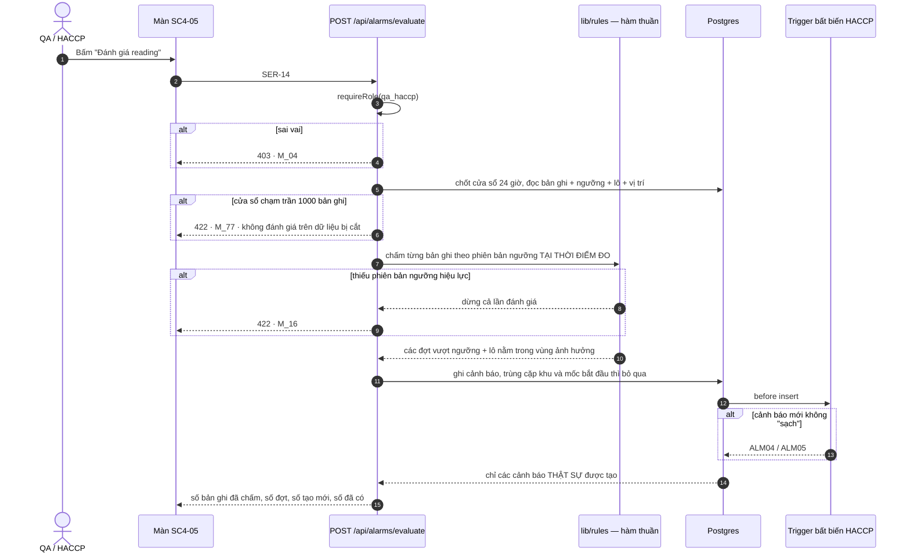

# DD-ALM-001 — Đánh giá vượt ngưỡng nhiệt và sinh cảnh báo

> Biểu mẫu: **BM-2-901-53 v01** — Detail Design (Chart + Description) · SUN ASTERISK VIETNAM CO., LTD · ISO/IEC 27001:2013 & ISO 9001:2015

---

## 1. History of change

| No | Version | Action | Mục / Bước | Nội dung thay đổi | Ngày | Người sửa | Approve |
|---|---|---|---|---|---|---|---|
| 1 | 0.1.0 | Add new | — | Khởi tạo | 2026-11-16 | PL | |

---

## 2. Sequence diagram



**Hai chi tiết trong sơ đồ không được bỏ:** cửa sổ do **máy chủ chốt**, client không gửi mốc nào
lên — người dùng không chọn được khoảng thời gian để lấy ra kết quả mình muốn; và **trigger đứng
trên đường INSERT**, vì đây là đường ghi nghiệp vụ duy nhất không đi qua RPC service-role nên hàng
rào phải ở tầng bảng chứ không chỉ ở tầng API.

---

## 3. Description

Quét bản ghi nhiệt trong một cửa sổ thời gian, chấm từng bản ghi theo **phiên bản ngưỡng có hiệu
lực tại thời điểm đo của chính bản ghi đó**, gom các bản ghi vượt ngưỡng liên tiếp cùng một khu
thành **đợt vượt ngưỡng**, rồi ghi mỗi đợt thành một **cảnh báo** kèm đủ số liệu bằng chứng và danh
sách lô nằm trong vùng ảnh hưởng (`FR-TEMP-02`, `DR-TEMP-01`). Gọi vào: vai QA / HACCP từ nút
"Đánh giá reading" của SC4-05; vai Quản trị mở màn được nhưng máy chủ từ chối (`NFR-SEC-02`).

Chạy xong, mỗi đợt vượt ngưỡng có đúng một cảnh báo ở trạng thái `open` và **không có đường nào
đóng nó êm thấm**. HACCP là ràng buộc cứng (`BR-HACCP-01`, bẫy ⑥): cảnh báo chỉ ra khỏi hàng đợi
khi có người ghi nội dung xử lý và đóng bằng tay qua `SER-15`. Không tự đóng, không hết hạn, không
bỏ qua.

---

## 4. Detail function

### 4.1. Chốt cửa sổ đánh giá và đọc dữ liệu nguồn

| Trường | Giá trị |
|---|---|
| Input | Không có thân yêu cầu. Nguồn duy nhất là `temperature_readings` |
| Output | Tập bản ghi trong cửa sổ + ngưỡng + lô + vị trí → bước 4.2 |

**Error**

| Điều kiện lỗi | Xử lý | Status code |
|---|---|---|
| Vai gọi vào không phải QA / HACCP | Từ chối trước khi chạm dữ liệu, màn hiện `M_04` | 403 |
| Không đọc được bản ghi, hoặc mốc thời gian của bản ghi mới nhất không hợp lệ | Ghi log, dừng xử lý, màn hiện `M_05` | 500 |
| Cửa sổ chạm trần số bản ghi một lần đọc | Dừng xử lý, **không** đánh giá trên dữ liệu đã bị cắt, màn hiện `M_77` | 422 |

**Detail**

| No | Nội dung xử lý |
|---|---|
| 1 | Lấy `event_time` lớn nhất đang có trong `temperature_readings` làm **mốc cuối** cửa sổ, **mốc đầu = mốc cuối − 24 giờ**. Không lấy đồng hồ máy chủ: cùng một tập dữ liệu phải cho cùng kết quả ở mọi lần chạy. Logger chạy đều thì mốc cuối trùng thời điểm bấm, đúng như SC4-05 mục `6bis` diễn đạt |
| 2 | Chưa có bản ghi nào → trả kết quả rỗng, không sinh cảnh báo. Đây **không** phải lỗi |
| 3 | Đọc bản ghi có `event_time` trong cửa sổ, **lấy cả hai đầu**, sắp tăng dần, giới hạn **1000 dòng** |
| 4 | Đọc về đủ 1000 dòng → dừng với `422` kèm `M_77`: ở mức trần không phân biệt được "đúng 1000 bản ghi" với "đã bị cắt bớt", mà chấm thiếu thì bỏ sót cả một đợt vượt ngưỡng. Dùng `M_77` chứ **không** dùng `M_76`: đây là lỗi của *dữ liệu đầu vào quá dày*, việc cần làm là thu hẹp khoảng thời gian, không phải đi báo quản trị hệ thống |
| 5 | Đọc kèm trong cùng nhịp: toàn bộ `temp_policies`, các `lots` có `status` khác `scrapped`, và `locations` để tra khu. Mọi thao tác chạy bằng **phiên người dùng** nên RLS vẫn là lớp chặn thật |

### 4.2. Chấm bản ghi theo phiên bản ngưỡng, gom đợt, chọn lô bị ảnh hưởng

| Trường | Giá trị |
|---|---|
| Input | Tập bản ghi + toàn bộ phiên bản ngưỡng + lô kèm khu tra từ `locations` |
| Output | Danh sách đợt vượt ngưỡng kèm `first_at`, `last_at`, `peak_c`, `duration_minutes`, `affected_lot_ids` → bước 4.3 |

**Error**

| Điều kiện lỗi | Xử lý | Status code |
|---|---|---|
| Không có phiên bản ngưỡng nào hiệu lực cho một dải nhiệt tại ngày đo | **Dừng cả lần đánh giá**, không sinh cảnh báo nào, màn hiện `M_16` kèm tên dải và ngày thiếu. **Không dùng số ngưỡng mặc định** | 422 |
| Một dòng dữ liệu hỏng (giá trị nhiệt không phải số hữu hạn, mốc thời gian sai) | Dừng cả lần đánh giá — **không bỏ qua lặng lẽ dòng hỏng**, ghi log, màn hiện `M_05` | 500 |

**Detail**

| No | Nội dung xử lý |
|---|---|
| 1 | Đổi `event_time` của bản ghi sang **ngày theo giờ Nhật (JST)** — đây là mốc tra phiên bản ngưỡng, **không** phải thời điểm chạy đánh giá |
| 2 | Chọn dòng `temp_policies` của đúng dải nhiệt có `effective_from` **≤ ngày đo** và lớn nhất; `effective_to` trống hoặc **> ngày đo**; cùng `effective_from` thì lấy số hiệu phiên bản lớn hơn. Ghi phiên bản đã chọn vào `temp_policy_id` để tra ngược được đã chấm bằng bộ số nào |
| 3 | Ngưỡng 3 dải là **chính sách do khách tự công bố, có phiên bản** — không số nào nằm trong mã nguồn, không có giá trị mặc định để lùi về (`BR-TEMP-01`, [ADR-005](../../architecture/ADR-005-versioned-temperature-policy.md)). 常温 / 冷蔵 / 冷凍 **không có số chuẩn ngành**; tra theo ngưỡng hôm nay áp ngược là hồ sơ HACCP cũ tự đổi kết luận sau lưng người đã ký |
| 4 | So với biên: lớn hơn biên trên → vượt trên; nhỏ hơn biên dưới → vượt dưới; còn lại **ĐẠT**. **Đúng biên là ĐẠT** — dải 冷蔵 công bố `0,0–5,0` °C thì `5,0` không sinh cảnh báo, `5,1` mới sinh. `min_c` hoặc `max_c` trống = không giới hạn phía đó |
| 5 | Sắp theo (khu, thời gian) rồi gom các bản ghi vượt ngưỡng **liên tiếp cùng một khu** thành một đợt. **Ba thứ cắt chuỗi:** một bản ghi ĐẠT nằm giữa · đổi khu · đổi chiều vi phạm. Cắt chuỗi là thành hai cảnh báo riêng, không gộp |
| 6 | `first_at` / `last_at` là mốc bản ghi đầu và cuối chuỗi; `duration_minutes` = hiệu hai mốc, **không cộng thêm một chu kỳ lấy mẫu** (4 bản ghi cách 15 phút ra 45 phút, một bản ghi đơn lẻ ra 0 phút); `peak_c` là giá trị **xa ngưỡng nhất theo chiều của chuỗi**; dải nhiệt và phiên bản ngưỡng lấy theo **bản ghi đầu chuỗi** |
| 7 | Lô bị ảnh hưởng: ghép lô với khu qua `location_id` → `locations` (không tra ra khu thì loại, không đoán), giữ lô thoả **cả ba** điều kiện — cùng khu với đợt · `status` khác `scrapped` · `received_at` **≤** `last_at`. Lô nhập kho **sau** khi sự cố kết thúc thì chưa từng nằm trong vùng vượt ngưỡng. Sắp theo mã lô. Hệ thống chỉ **liệt kê**, chưa tự chuyển lô sang cách ly → `GAP-02` |

### 4.3. Ghi cảnh báo — chống sinh trùng và bất biến ở đường tạo mới

| Trường | Giá trị |
|---|---|
| Input | Danh sách đợt vượt ngưỡng đã kèm lô ảnh hưởng |
| Output | Các dòng `temperature_alarms` thật sự được tạo + số đợt đã có từ trước → trả về màn |

**Error**

| Điều kiện lỗi | Xử lý | Status code |
|---|---|---|
| RLS từ chối ghi (phiên không phải vai QA / HACCP) | Dừng, màn hiện `M_04` | 403 |
| Lỗi ghi khác của CSDL | Ghi log kèm mã lỗi, dừng, màn hiện `M_05` | 500 |
| Cảnh báo mới gửi lên ở trạng thái khác `open` | Tầng bảng chặn, giao dịch hỏng — `ALM04` | 500 |
| Cảnh báo mới gắn sẵn `handling_note`, `reviewed_by`, `first_reviewed_at` hoặc `closed_at` | Tầng bảng chặn, giao dịch hỏng — `ALM05` | 500 |

**Detail**

| No | Nội dung xử lý |
|---|---|
| 1 | Chỉ gửi lên **tám cột bằng chứng**: khu, dải nhiệt, `temp_policy_id`, `first_at`, `last_at`, `peak_c`, `duration_minutes`, `affected_lot_ids`. Không gửi cột nào thuộc khâu xử lý |
| 2 | Cảnh báo định danh theo cặp **khu + `first_at`**; trùng thì **bỏ qua**, không ghi đè. Vì vậy bấm đánh giá nhiều lần trên cùng dữ liệu luôn cho cùng kết quả |
| 3 | Số đợt đã có từ trước = số đợt tìm thấy − số cảnh báo thật sự tạo mới. Màn in cả hai con số để phân biệt "không có gì mới" với "không chạy được" |
| 4 | Trigger bất biến HACCP chạy **cả `insert` lẫn `update`**, ép cảnh báo chào đời ở `open` và để trống toàn bộ cột xử lý |

**Vì sao trigger phải phủ cả đường tạo mới** — lỗ hổng mức **Cao** tìm được thật ở LAB-2. `SER-14`
ghi bằng chính phiên người dùng nên `temperature_alarms` **buộc phải** mở quyền tạo mới cho vai QA,
trong khi trigger ban đầu chỉ gắn vào đường sửa: một tài khoản QA **hợp lệ** gọi thẳng CSDL tạo
được ngay một cảnh báo `closed`, `handling_note` trống, `reviewed_by` gắn tên người khác — hồ sơ
HACCP có cảnh báo "đã xử lý" mà chưa ai xử lý, `ALM03` không bao giờ chạy. Cách vá: trigger chạy cả
`insert`; muốn đóng thì phải đi qua đường sửa, nơi `ALM01`–`ALM03` đã chặn đúng. **Phủ một nửa
đường ghi là không phủ** — nền của quyết định ở
[ADR-001](../../architecture/ADR-001-business-rules-at-table-level.md).

### 4.4. Vòng đời trạng thái cảnh báo

| Trường | Giá trị |
|---|---|
| Input | Mã cảnh báo + hành động (`OPEN` / `ACKNOWLEDGE` / `CLOSE`) + nội dung xử lý, qua `SER-15` |
| Output | Cảnh báo đã cập nhật trạng thái và dấu vết xử lý |

| Hành động | Từ trạng thái | Sang trạng thái | Ai được làm | Bắt buộc kèm |
|---|---|---|---|---|
| `OPEN` | `open` · `acknowledged` | giữ nguyên | QA / HACCP | — (kèm ghi chú là lỗi) |
| `ACKNOWLEDGE` | `open` | `acknowledged` | QA / HACCP | ghi chú tuỳ chọn |
| `CLOSE` | `open` · `acknowledged` | `closed` | QA / HACCP | **bắt buộc** nội dung xử lý |

**Error**

| Điều kiện lỗi | Xử lý | Status code |
|---|---|---|
| Đóng cảnh báo mà nội dung xử lý trống hoặc chỉ khoảng trắng | Từ chối, trạng thái giữ nguyên, màn hiện `M_50`. Lách được tầng này thì tầng bảng vẫn chặn bằng `ALM03` | 400 |
| Nội dung xử lý quá 2 000 ký tự, hoặc `OPEN` kèm ghi chú | Từ chối, màn hiện `M_02` | 400 |
| Cảnh báo đã `closed` | Từ chối, màn hiện `M_51` (`ALM01` ở tầng bảng) | 409 |
| Xác nhận lại cảnh báo đã `acknowledged`, hoặc người khác vừa đổi trạng thái đúng cảnh báo này | Từ chối, nạp lại dòng, không ghi đè người thao tác trước | 409 |
| Không tìm thấy cảnh báo | Từ chối, không tạo mới | 404 |

**Detail**

| No | Nội dung xử lý |
|---|---|
| 1 | `OPEN` chỉ ghi nhận "đã mở xem": ghi `first_reviewed_at` và **dừng đồng hồ SLA**, giữ nguyên trạng thái; gọi lần hai không làm gì |
| 2 | `first_reviewed_at` ghi ở **hành động đầu tiên bất kỳ**, kể cả xác nhận hay đóng thẳng, và **không bao giờ ghi đè** giá trị đã có |
| 3 | `reviewed_by` và `closed_at` do máy chủ ghi từ phiên đăng nhập và đồng hồ máy chủ; client gửi lên không được nhận |
| 4 | Lệnh cập nhật có điều kiện theo **trạng thái hiện tại**, và theo `first_reviewed_at` còn trống khi ghi mốc xem đầu. Không khớp = có người vừa thao tác → trả 409, không ghi đè |
| 5 | Đóng cảnh báo là **một chiều**: từ `closed` không có đường quay lại, kể cả để sửa chính nội dung xử lý. Vai Quản trị đọc được toàn bộ nhưng không gọi được `SER-14` lẫn `SER-15` (`NFR-SEC-02`) |

---

## 5. Other Notes

**Function này KHÔNG làm gì:** không nhận tệp của thiết bị ghi nhiệt (`FR-TEMP-01`), không dựng hồ
sơ điều tra lệch chuẩn (`FR-TEMP-04`), không tự chuyển lô sang cách ly (→ `GAP-02`), không sinh hàng
đợi kiểm tính đầy đủ hồ sơ HACCP mà `BR-HACCP-01` đòi (→ `GAP-24`).

**Chạy lại không cập nhật cảnh báo cũ — hệ quả cố ý.** Cảnh báo đã tồn tại giữ nguyên `last_at`,
`peak_c`, `duration_minutes` và `affected_lot_ids` như lúc tạo; có bản ghi mới kéo dài cùng đợt thì
cảnh báo cũ **không** được tính lại. Đây là cái giá của bằng chứng bất biến — nhưng phải nói rõ cho
khách, vì người vận hành dễ chờ con số tự cập nhật.

**Hai con số chưa phải của khách.** Ngưỡng tra theo **dải nhiệt**, không theo từng mã hàng (đúng
ADR-005) — Yuki cần ngưỡng riêng chặt hơn cho một mã hàng là đổi mô hình dữ liệu. **SLA 15 phút**
suy từ baseline "11% cảnh báo xác nhận trễ quá 15 phút"; bản thật phải là cấu hình **có phiên bản,
có ngày hiệu lực** giống ngưỡng nhiệt — vì vậy `M_52` nhận số phút làm tham số thay vì in cứng.

**Điểm CẦN XÁC NHẬN với khách** (đánh số theo [`docs/scope.md`](../../../docs/scope.md) mục 6):

| # | Điểm | Giả định đang dùng |
|---|---|---|
| 16 | Mốc chọn phiên bản ngưỡng khi chấm một bản ghi | Theo **thời điểm đo**. **CHẶN BÁO GIÁ** — sai mốc là sai toàn bộ hồ sơ |
| 15 | SLA xác nhận cảnh báo | 15 phút, prototype để hằng số trong mã nguồn |
| *(ngoài danh sách)* | Độ dài cửa sổ, trần số bản ghi một lần chạy, mức dung sai để coi là một đợt phải xử lý | 24 giờ · 1000 bản ghi · **mọi** bản ghi ngoài ngưỡng đều sinh cảnh báo, kể cả một điểm đơn lẻ 0 phút. RFP không nêu số nào — **phải bổ sung vào danh sách hỏi khách** |

**Luật nghiệp vụ nằm trong hàm thuần** (`lib/rules/temperature-reading-evaluation.ts` và
`lib/rules/temperature-policy-resolution.ts`): nhận dữ liệu, trả quyết định, không chạm CSDL, không
đọc đồng hồ hệ thống. Kiểm chứng:

```bash
npm run verify:alarms           # 288 bản ghi → 2 đợt, biên đúng không sinh, chạy lại không trùng
npm run verify:alarm-integrity  # 7 phép, đi thẳng PostgREST bằng tài khoản QA thật
```

Bộ thứ hai chạy **đỏ** trên bản chưa có migration `0015` — chứng minh được lỗ hổng ở mục 4.3 từng
có thật và nay đã bịt, gồm cả phép **đối chứng** rằng đường ghi hợp lệ của `SER-14` vẫn chạy sau
khi vá.
