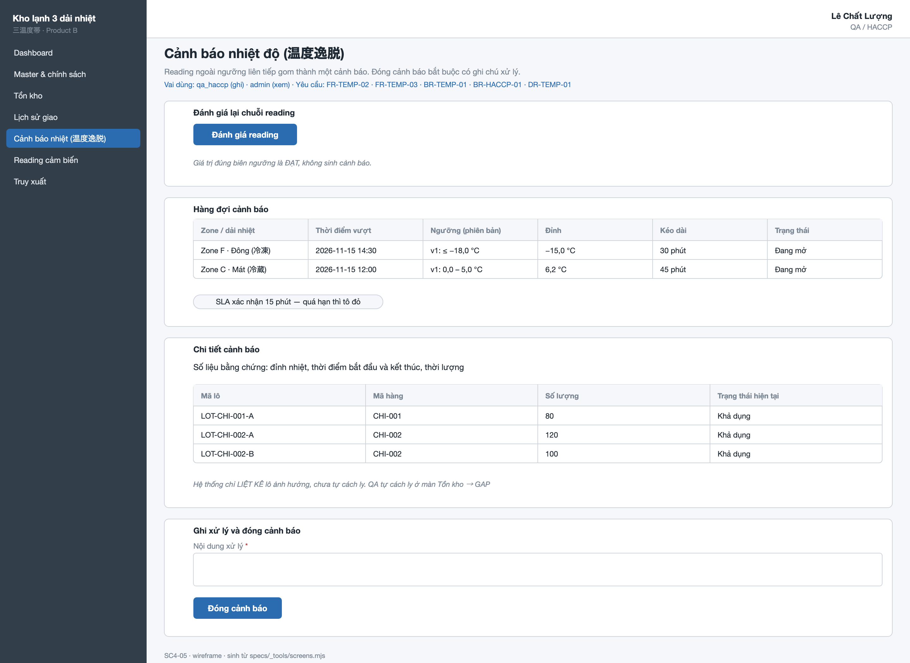
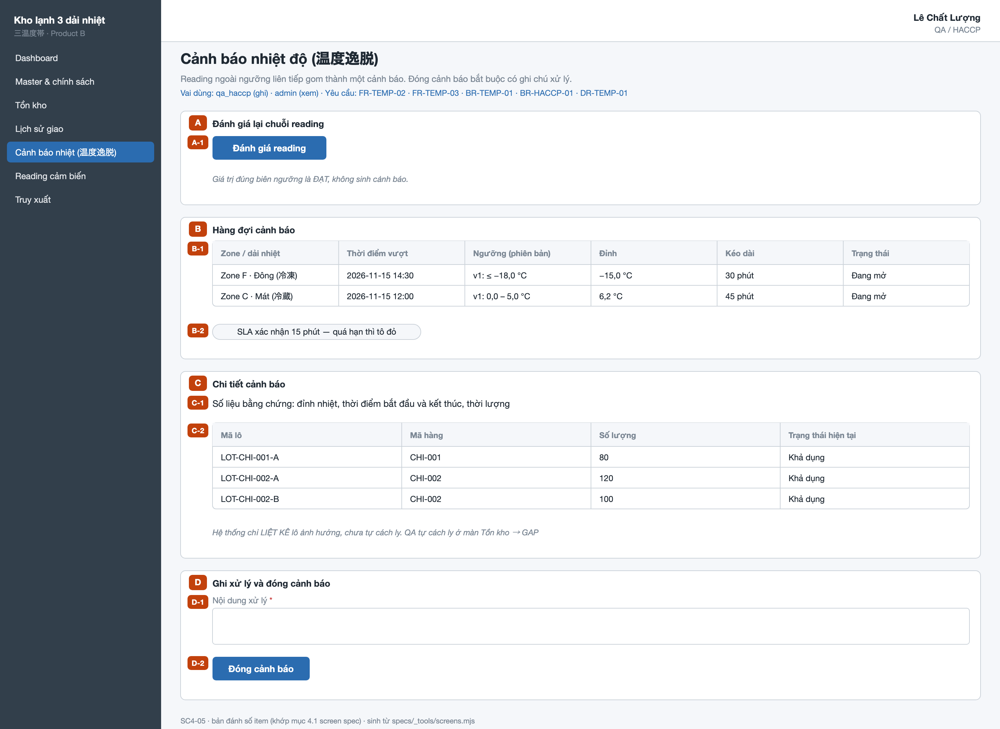

# SC4-05 — Cảnh báo nhiệt độ (温度逸脱)

> Biểu mẫu: **BM-2-901-51 v2.1** — Screen Specification · SUN ASTERISK VIETNAM CO., LTD · ISO/IEC 27001:2013 & ISO 9001:2015

---

## 1. History of change

| No | Version | Action | Nội dung thay đổi | Ngày | Người sửa | Approve |
|---|---|---|---|---|---|---|
| 1 | 0.1.0 | Add New | Khởi tạo | 2026-11-16 | PL | |
| 2 | 0.2.0 | Updated | Sửa theo vòng review chéo: thêm bảng truy vết yêu cầu, sửa mã lỗi gán sai, sửa tên trường API | 2026-11-16 | PL | |

---

## 2. Layout

**Design:** wireframe dựng từ [`specs/_tools/screens.mjs`](../../_tools/screens.mjs) — sửa file đó
rồi chạy `node specs/_tools/render-wireframes.mjs`, đừng sửa tay file ảnh.

Ảnh hiện trạng prototype để đối chiếu: [`../assets/_prototype/SC4-05_current.png`](../assets/_prototype/SC4-05_current.png)

---

## 3. Description

Màn để **vai QA / HACCP** biến các bản ghi nhiệt độ thành **bằng chứng HACCP**: quét bản ghi trong
cửa sổ thời gian, gom đoạn vượt ngưỡng liên tiếp thành cảnh báo, xem số liệu bằng chứng và danh
sách lô nằm trong vùng ảnh hưởng, rồi ghi xử lý và đóng cảnh báo. Vai **Quản trị** xem được, không
ghi được.

Điểm phải nắm: đây là màn duy nhất sinh ra hồ sơ mà cơ quan kiểm tra sẽ đọc, nên **mọi số liệu
trên màn đều do máy tính ra và người dùng không sửa được**. Người dùng chỉ đóng góp đúng một thứ:
nội dung xử lý. Mọi bất biến của màn này đều có hàng rào ở tầng bảng, không chỉ ở tầng API — lý do
ở [ADR-001](../../architecture/ADR-001-business-rules-at-table-level.md).

Đi tới: từ Dashboard và từ menu QA. Đi ra: màn Tồn kho (SC4-02) để cách ly tay lô bị ảnh hưởng,
màn Master và ngưỡng nhiệt (SC4-07) để tra phiên bản ngưỡng đã dùng để chấm.

---

## 3bis. Yêu cầu màn này thực hiện

Mã yêu cầu lấy từ [`docs/01_requirements-extract.md`](../../../docs/01_requirements-extract.md).
Màn này gánh dòng *Hàng đợi cảnh báo nhiệt độ* của bảng màn ở
[`docs/scope.md`](../../../docs/scope.md) mục 3.

| Mã yêu cầu | Nội dung (trích ngắn) | Màn đáp ứng ở mục nào |
|---|---|---|
| `FR-TEMP-02` (P0) | Chấm từng bản ghi theo chính sách hiệu lực của mã hàng / khu; lưu thời điểm đầu, cuối, đỉnh nhiệt, thời lượng, phiên bản ngưỡng và danh sách lô bị ảnh hưởng | 4.2 (`ALM02`), 4.3 B-1/C-1/C-2, 5 (A-1), 6 (chấm lại không sinh trùng) |
| `FR-TEMP-03` (P0) | Hiện cảnh báo chưa xác nhận, ghi thời điểm xem đầu tiên trong 15 phút, review quá hạn đánh dấu rõ **và vào báo cáo quản lý** | 4.3 B-2 (`M_52`), 5 (khởi tạo bước 3, B-1 mở chi tiết). **Một phần** — vế "vào báo cáo quản lý" thuộc màn báo cáo (`FR-RPT-01`), đã khai ngoài phạm vi ở `docs/scope.md` mục 3 |
| `BR-TEMP-01` | Ngưỡng 3 dải nhiệt quản lý theo phiên bản; giao dịch quá khứ giữ phiên bản dùng lúc đánh giá | 4.3 B-1, 5 (A-1 bước 2, và dòng thiếu phiên bản → `M_16`), 6 |
| `DR-TEMP-01` | Thực thể bản ghi và sự kiện nhiệt độ | 4.3 B-1, C-1, C-2 (`temperature_alarms`, `temp_policies`) |
| `BR-HACCP-01` | Kiểm đủ bản ghi theo nhịp Yuki: logger 15 phút, mỗi lần nhập/xuất, vệ sinh mỗi ca, khách và tài xế mỗi lượt, **review cảnh báo**; thiếu bản ghi thì sinh hàng đợi, không tự đóng | 5 (B-1, D-2), 6 (ba bất biến `ALM01`–`ALM03`). **Một phần** — màn chỉ phủ nhịp *review cảnh báo*; xem ghi chú dưới bảng |
| `NFR-SEC-02` | Quyền tối thiểu theo vai; tách người lập và người duyệt | 3, 5 (vai Quản trị mở màn với A-1 và D-2 vô hiệu hoá) |

Bốn nhịp còn lại của `BR-HACCP-01` khai ngoài phạm vi ở `docs/scope.md` mục 3 (hàng đợi
completeness HACCP) nhưng **không có dòng nào trong [sổ gap](../../database/gap-list.md)**.
`BR-HACCP-01` chạm bẫy ⑥, mà [`PREMISE.md`](../../PREMISE.md) mục 1 cấm xếp một yêu cầu chạm bẫy
thành lựa chọn phạm vi — nên đây là điểm **PM phải quyết**, không phải chỗ spec tự chốt.

Hai yêu cầu nhiệt độ còn lại **không thuộc màn này**: `FR-TEMP-01` (nhận tệp CSV của thiết bị ghi
nhiệt) và `FR-TEMP-04` (hồ sơ điều tra lệch chuẩn) — `docs/scope.md` mục 3 xếp màn import là mô
phỏng và màn hồ sơ điều tra là ngoài phạm vi, phần thay thế chính là ô ghi xử lý D-1 của màn này.

Bảng này là **nguồn đúng** về mã yêu cầu của màn. Ảnh wireframe sinh từ
[`specs/_tools/screens.mjs`](../../_tools/screens.mjs) còn in bộ mã cũ, trong đó có ba mã **không
tồn tại** trong RFP; `screens.mjs` phải sửa theo bảng này rồi render lại ảnh.

---

## 4. View

**Đánh ID:** section là chữ (`A`–`D`), item trong section là số. Tham chiếu dạng `{section}-{số}`.

### 4.1 Danh sách item

Bảng item sinh tự động cùng nguồn với ảnh annotated, nên số callout trên ảnh và ID ở đây không bao
giờ lệch: [`../assets/SC4-05_items.md`](../assets/SC4-05_items.md).

### 4.2 Validation

| ID | Type | Min | Max | Default | Ghi chú |
|---|---|---|---|---|---|
| D-1 | String | 1 ký tự | 2 000 ký tự | | Nội dung xử lý. Trống hoặc chỉ khoảng trắng mà vẫn bấm đóng → `M_50`. Quá 2 000 ký tự → `M_02` |
| D-2 | — | — | — | | Chỉ bật khi cảnh báo đang ở `open` hoặc `acknowledged`. Cảnh báo đã `closed` thì vô hiệu hoá → `M_51` |

**Item KHÔNG có validation, và đó là cố ý:** C-1 và C-2 là số liệu bằng chứng, màn không cho nhập
nên không có gì để validate. Hàng rào thật nằm ở tầng bảng (`ALM02`), xem mục 6.

**Validation ở tầng dữ liệu — không phải ở màn, nhưng màn phải hiển thị được kết quả:**

| Luật | Mã lỗi CSDL | Thông báo trên màn |
|---|---|---|
| Cảnh báo đã đóng là bất biến | `ALM01` | `M_51` |
| Số liệu bằng chứng (`zone`, `band`, `temp_policy_id`, `first_at`, `last_at`, `peak_c`, `duration_minutes`, `affected_lot_ids`) không sửa được | `ALM02` | Không có đường đi từ màn — xem mục 6 |
| Đóng cảnh báo bắt buộc có nội dung xử lý | `ALM03` | `M_50` |
| Cảnh báo chỉ được **tạo** ở trạng thái `open` | `ALM04` | Không có đường đi từ màn — xem mục 6 |
| Cảnh báo mới không được gắn sẵn `handling_note`, `reviewed_by`, `first_reviewed_at`, `closed_at` | `ALM05` | Không có đường đi từ màn — xem mục 6 |

### 4.3 Data Mapping

| ID | Data Source | API ID | API URL | Key / Param | Ghi chú |
|---|---|---|---|---|---|
| A-1 | API | `SER-14` | `POST /api/alarms/evaluate` | không có thân yêu cầu | Cửa sổ đánh giá do máy chủ chốt, client không gửi lên |
| B-1 | CSDL | — | — | `temperature_alarms` | Đọc bằng phiên người dùng, RLS lọc |
| B-1 | Suy ra | — | — | `temp_policies.version`, `min_c`, `max_c` | Cột "Ngưỡng" hiện **số hiệu phiên bản kèm giá trị**, lấy theo `temp_policy_id` của chính cảnh báo |
| B-2 | Suy ra | — | — | `created_at`, `first_reviewed_at` | Đồng hồ SLA 15 phút. Quá hạn mà chưa xử lý thì tô đỏ và đếm vào `M_52` |
| C-1 | CSDL | — | — | `peak_c`, `first_at`, `last_at`, `duration_minutes` | Chỉ đọc |
| C-2 | CSDL | — | — | `temperature_alarms.affected_lot_ids` → `lots` | Mỗi phần tử tra sang `lots` lấy mã hàng, số lượng, trạng thái hiện tại |
| D-1, D-2 | API | `SER-15` | `POST /api/alarms/{alarmId}/review` | thân yêu cầu: **action** (`OPEN` / `ACKNOWLEDGE` / `CLOSE`) và `note` | Tên trường trong thân yêu cầu là camelCase, khác tên cột CSDL. `reviewed_by` và `closed_at` **do máy chủ ghi từ phiên**, client không gửi lên |

Mã API tra ở [`../../_common/api-list.md`](../../_common/api-list.md) — không tự khai API mới ở đây.

---

## 5. Event

| ID | Given (Pre-condition) | When (Trigger/Action) | Then (Result) | Note |
|---|---|---|---|---|
| **Initializing Process（初期処理）** | | | | |
| - | Vai là QA / HACCP hoặc Quản trị | Mở màn hình | 1. Nạp hàng đợi cảnh báo vào B-1, mới nhất lên trước 2. Mỗi dòng hiện ngưỡng kèm **số hiệu phiên bản** đã dùng để chấm 3. Tính đồng hồ SLA cho B-2; còn cảnh báo quá hạn chưa xử lý → hiện `M_52` kèm số lượng 4. C và D để trống cho tới khi chọn một cảnh báo | Vai khác bị proxy chặn trước khi tới màn |
| - | Vai là Quản trị | Mở màn hình | A-1 và D-2 hiển thị ở trạng thái vô hiệu hoá | Phân tách nhiệm vụ có chủ ý: Quản trị xem hồ sơ, không tạo và không đóng |
| **Standard Process（通常処理）** | | | | |
| A-1 | Vai là QA / HACCP | Bấm "Đánh giá reading" | 1. Gọi `SER-14` 2. Máy chủ quét bản ghi trong cửa sổ, chấm từng bản ghi theo **phiên bản ngưỡng hiệu lực tại thời điểm đo của chính bản ghi đó** 3. Gom bản ghi ngoài ngưỡng **liên tiếp cùng khu** thành một cảnh báo; bản ghi đúng biên ngưỡng là ĐẠT nên **cắt chuỗi**, không sinh cảnh báo 4. Cảnh báo mới sinh ra ở trạng thái `open`, không gắn sẵn dấu vết xử lý 5. Nạp lại B-1 | Chấm lại cùng chuỗi bản ghi **không** sinh cảnh báo trùng — xem mục 6 |
| B-1 | Hàng đợi đã có dữ liệu | Chọn một dòng cảnh báo | 1. C-1 hiện đỉnh nhiệt, thời điểm đầu, thời điểm cuối, thời lượng 2. C-2 liệt kê lô nằm trong vùng ảnh hưởng kèm trạng thái hiện tại 3. D-1 mở ra nếu cảnh báo chưa đóng | C-1 và C-2 **chỉ đọc** |
| B-1 | Đã chọn một cảnh báo lần đầu | Mở xem chi tiết | 1. Gọi `SER-15` với action `OPEN` 2. Máy chủ ghi mốc xem đầu tiên và **dừng đồng hồ SLA** 3. Mở xem lần thứ hai trở đi không ghi đè mốc cũ | Mốc xem đầu tiên là bằng chứng "QA đã thấy cảnh báo lúc nào" |
| D-2 | Cảnh báo đang mở, D-1 đã có nội dung | Bấm "Đóng cảnh báo" | 1. Gọi `SER-15` với action `CLOSE` 2. Máy chủ ghi người xử lý từ phiên và thời điểm đóng từ đồng hồ máy chủ 3. Trạng thái chuyển `closed`, D-1 và D-2 khoá lại vĩnh viễn 4. Nạp lại B-1 | Từ đây cảnh báo là bất biến (`ALM01`) |
| C-2 | Cảnh báo có lô trong vùng ảnh hưởng | Xem danh sách lô | Mỗi lô hiện trạng thái hiện tại; lô còn ở trạng thái khả dụng thì **vẫn nằm trong tồn phân bổ được** | Hệ thống chỉ liệt kê, chưa tự cách ly → `GAP-02`, xem mục 6 |
| **Error Handling（エラー制御）** | | | | |
| D-2 | D-1 trống hoặc chỉ có khoảng trắng | Bấm "Đóng cảnh báo" | 1. Hiện `M_50` 2. Không gọi API, trạng thái cảnh báo **giữ nguyên** | Bỏ qua được lớp này thì tầng bảng vẫn chặn bằng `ALM03` |
| D-2 | Người khác vừa đóng đúng cảnh báo này | Bấm "Đóng cảnh báo" | 1. Hiện `M_51` 2. Nạp lại cảnh báo ở trạng thái đã đóng, không ghi đè nội dung xử lý của người kia | Hai người thao tác đồng thời: cập nhật có điều kiện theo trạng thái hiện tại |
| D-1 | Nội dung xử lý dài quá 2 000 ký tự | Bấm "Đóng cảnh báo" | Hiện `M_02`, chỉ rõ số ký tự đang vượt | |
| A-1 | Có bản ghi thuộc dải nhiệt chưa có phiên bản ngưỡng hiệu lực tại ngày đo | Bấm "Đánh giá reading" | 1. **Không** sinh cảnh báo nào 2. Hiện `M_16` kèm tên dải nhiệt và thời điểm thiếu phiên bản, dẫn sang SC4-07 | **Không dùng số ngưỡng mặc định.** `M_16` là mã riêng cho đúng tình huống này, không mượn mã lỗi đọc dữ liệu |
| A-1 | Vai là Quản trị | Gọi thẳng `SER-14` | Máy chủ trả về từ chối, màn hiện `M_04` | Không chỉ ẩn nút — máy chủ kiểm lại vai |
| bất kỳ | Phiên hết hạn | Thao tác bất kỳ | Hiện `M_03`, đẩy về màn đăng nhập | |

Mã thông báo tra ở [`../../_common/error-codes.md`](../../_common/error-codes.md) — không tự chế mã mới ở đây.

---

## 6bis. Trường do máy sinh — luật sinh

Biểu mẫu tả rất kỹ ô người nhập nhưng không có chỗ cho ô máy điền. Mục này bù vào, vì thiếu nó
thì dev buộc phải tự đoán.

| Trường | Luật sinh |
|---|---|
| Cửa sổ quét của `SER-14` | **24 giờ tính ngược từ bản ghi đo mới nhất trong bảng**, KHÔNG phải từ thời điểm bấm. Hai mốc trùng nhau khi bộ ghi chạy đều, nhưng lệch hẳn khi bộ ghi ngừng — lúc đó hệ thống vẫn chấm lại cửa sổ cũ thay vì trả cửa sổ rỗng. Bảng rỗng thì không đánh giá. Cửa sổ đọc về **đủ 1000 bản ghi trở lên** thì **báo lỗi chứ không đánh giá thiếu** (`M_77`): ở mức đó không phân biệt được "đúng 1000" với "bị cắt", mà đánh giá trên dữ liệu bị cắt sẽ bỏ sót đoạn vượt ngưỡng |
| `affected_lot_ids` | Lọc lô theo **ba điều kiện cùng lúc**: cùng `zone` với cảnh báo · trạng thái **khác** `scrapped` · `received_at` **≤** thời điểm kết thúc đoạn vượt ngưỡng. Sắp theo mã lô. Nghĩa là lô nhập **sau** khi sự cố kết thúc thì không bị tính |
| `first_at` · `last_at` · `peak_c` · `duration_minutes` | Suy từ chuỗi bản ghi vượt ngưỡng **liên tiếp**. Một bản ghi đạt ở giữa là cắt chuỗi, thành hai cảnh báo |
| `reviewed_by` · `first_reviewed_at` · `closed_at` | Máy chủ ghi từ phiên đăng nhập. Client gửi lên bị chặn (`ALM05`) |

---

## 6. Other Notes

**Ba bất biến làm nên giá trị pháp lý của màn này:**

| # | Bất biến | Vì sao |
|---|---|---|
| 1 | Số liệu bằng chứng do máy tính ra, người dùng không sửa được (`ALM02`) | Hồ sơ HACCP mà sửa được đỉnh nhiệt hay thời lượng thì không còn là bằng chứng |
| 2 | Đóng cảnh báo bắt buộc có nội dung xử lý (`ALM03`) | "Đã đóng" mà không ai viết đã làm gì thì cơ quan kiểm tra đọc ra là chưa xử lý |
| 3 | Cảnh báo đã đóng là bất biến (`ALM01`) | Không viết lại lịch sử sau khi sự việc đã khép |

**Ngưỡng luôn đi kèm số hiệu phiên bản — không in con số rời.** Mỗi bản ghi được chấm theo phiên
bản ngưỡng **có hiệu lực tại thời điểm đo của chính bản ghi đó**, không phải ngưỡng hôm nay áp
ngược. Vì vậy hai cảnh báo cùng một khu, cách nhau vài tháng, có thể được chấm theo hai bộ số khác
nhau — và chỉ hiển thị kèm số hiệu phiên bản thì người đọc hồ sơ mới hiểu vì sao. Chi tiết ở
[ADR-005](../../architecture/ADR-005-versioned-temperature-policy.md).

**Giá trị đúng biên ngưỡng là ĐẠT.** Dải Mát ngưỡng `0,0`–`5,0` °C thì `5,0` °C không sinh cảnh
báo, `5,1` °C mới sinh. Một bản ghi đạt nằm giữa hai bản ghi vượt sẽ **cắt chuỗi** thành hai cảnh
báo riêng, không gom làm một. Đây là một dấu `>` hay `≥` trong luật trung tâm của hồ sơ HACCP.

**Chấm lại không sinh cảnh báo trùng — và cũng không cập nhật cảnh báo cũ.** Cảnh báo định danh
theo cặp khu và thời điểm bắt đầu, nên bấm A-1 nhiều lần trên cùng dữ liệu luôn cho cùng kết quả.
Hệ quả phải biết: cảnh báo đã tồn tại **giữ nguyên** số liệu bằng chứng lúc tạo; nếu sau đó có bản
ghi mới kéo dài cùng đợt vượt ngưỡng, thời lượng và đỉnh nhiệt của cảnh báo cũ **không** được tính
lại. Đây là hệ quả cố ý của việc giữ bằng chứng bất biến, không phải thiếu sót.

### `ALM04` / `ALM05` — luật phải phủ cả đường tạo mới lẫn đường sửa

Hai mã này **không phải thiết kế trên giấy**. Chúng sinh ra từ một lỗ hổng mức Cao tìm được thật ở
LAB-2, ngay trên màn này: trigger bất biến HACCP ban đầu chỉ gắn vào đường **sửa**. Mà đường ghi
của A-1 phải ghi bằng chính phiên người dùng, nên bảng `temperature_alarms` buộc phải mở quyền
tạo mới cho vai QA. Hệ quả: một tài khoản vai QA **hợp lệ** gọi thẳng vào CSDL, bỏ qua ứng dụng,
**tạo được ngay một cảnh báo ở trạng thái đã đóng**, `handling_note` để trống, `reviewed_by` gắn
tên người khác. Hồ sơ HACCP có một cảnh báo "đã xử lý" mà chưa ai xử lý, và `ALM03` không bao giờ
chạy.

Ràng buộc thiết kế rút ra, áp cho mọi bất biến của màn này:

| Yêu cầu | Nội dung |
|---|---|
| Phủ đủ thao tác | Trigger chạy cả khi **tạo mới** lẫn khi **sửa**. Phủ một nửa đường ghi là không phủ |
| Cảnh báo chào đời phải "sạch" | Chỉ sinh ra ở `open` (`ALM04`), không gắn sẵn `handling_note`, `reviewed_by`, `first_reviewed_at`, `closed_at` (`ALM05`) |
| Đóng cảnh báo chỉ qua đường sửa | Muốn đóng thì phải đi qua `SER-15`, nơi `ALM01`–`ALM03` đã chặn đúng |
| Mỗi bất biến một mã riêng | Để bài kiểm chứng minh được đúng luật đó bắn, không phải một lỗi bất kỳ |

Vì không có đường đi nào từ màn hình tới `ALM02`, `ALM04`, `ALM05`, ba mã này **không có thông báo
trong `_common/error-codes.md`** — và đúng là không nên có. Chúng là hàng rào cho đường ghi thẳng
vào CSDL, không phải lỗi người dùng gặp. Nền của quyết định ở
[ADR-001](../../architecture/ADR-001-business-rules-at-table-level.md).

### Hệ thống chưa tự cách ly lô bị ảnh hưởng → `GAP-02`

Thiết kế đúng: lô nằm trong vùng ảnh hưởng **tự chuyển sang cách ly** ngay khi cảnh báo phát sinh,
QA xác nhận giải phóng sau. Prototype chỉ **liệt kê** lô ở C-2; QA phải tự sang màn Tồn kho (SC4-02)
cách ly tay từng lô.

Khoảng trống nằm giữa lúc cảnh báo phát sinh và lúc QA thao tác: trong quãng đó lô vẫn ở trạng thái
khả dụng và **có thể bị phân bổ cho một đơn xuất**. Mức Trung bình, chi tiết ở
[`../../database/gap-list.md`](../../database/gap-list.md) → `GAP-02`.

### SLA xác nhận 15 phút là **giả định**, không phải con số khách nêu

RFP chỉ cho một số baseline: "11% cảnh báo xác nhận trễ quá 15 phút". Từ đó suy ra ngưỡng 15 phút —
khách **chưa từng phát biểu** đây là SLA của họ. Prototype để con số này thành hằng số trong mã
nguồn. Bản thật phải là **cấu hình có phiên bản, có ngày hiệu lực**, đúng như ngưỡng nhiệt: đổi SLA
ở giữa kỳ mà không có phiên bản thì mọi cảnh báo cũ bị chấm lại theo số mới, và hồ sơ HACCP cũ đổi
kết luận sau lưng người đã ký. Vì vậy câu thông báo `M_52` nhận số phút làm tham số (`{sla}`) thay
vì in cứng "15 phút" — màn in ra đúng số của cấu hình đang hiệu lực.

**Điểm CẦN XÁC NHẬN với khách — ảnh hưởng trực tiếp tới màn này** (đánh số theo
[`docs/scope.md`](../../../docs/scope.md) mục 6):

| # | Điểm | Giả định đang dùng |
|---|---|---|
| 15 | SLA xác nhận cảnh báo nhiệt: bao nhiêu phút kể từ lúc phát sinh thì coi là trễ | 15 phút, suy từ baseline S1-03. Prototype để hằng số trong mã nguồn; bản thật nên là cấu hình có phiên bản |
| 16 | Mốc chọn phiên bản ngưỡng khi chấm một bản ghi | Theo **thời điểm đo**, không theo thời điểm ghi nhận |
| 6 | Nhiệt ngoài ngưỡng lúc nhập: chặn hẳn hay nhận vào cách ly | Nhận vào cách ly, không cho vào tồn khả dụng. Liên quan vì C-2 hiện trạng thái lô |

**Thiếu phiên bản ngưỡng thì dừng hẳn, bằng một mã riêng.** Khi một dải nhiệt chưa có phiên bản
ngưỡng hiệu lực tại thời điểm đo, màn không sinh cảnh báo nào và hiện `M_16` — mã viết riêng cho
tình huống này, có câu chữ dẫn người dùng sang SC4-07 để công bố phiên bản. Không mượn `M_05`
("không đọc được dữ liệu"): đây không phải lỗi đọc dữ liệu mà là thiếu dữ liệu chính sách, hướng
xử lý khác hẳn.
