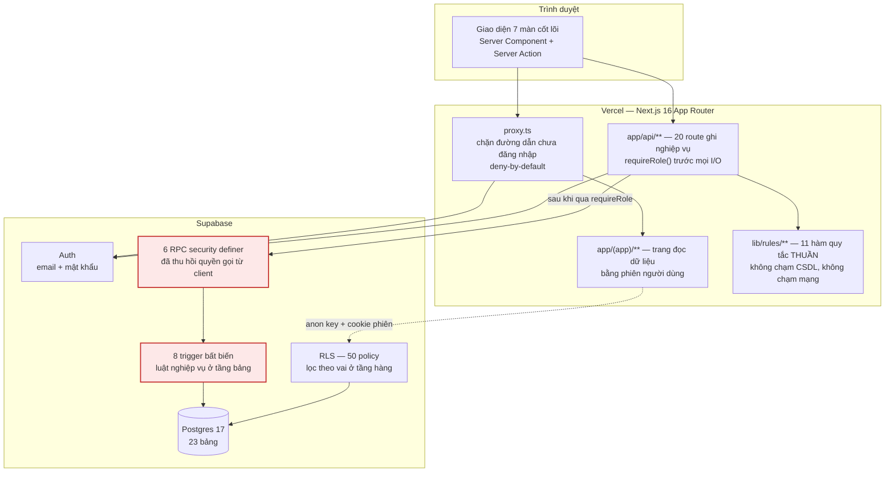
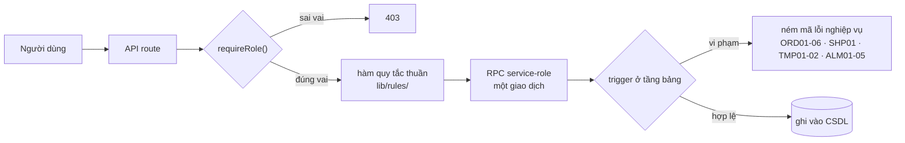
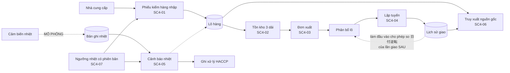
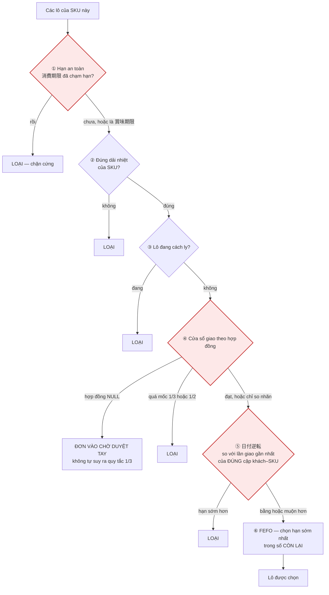
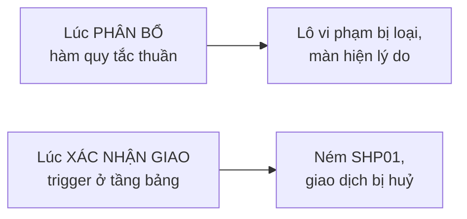
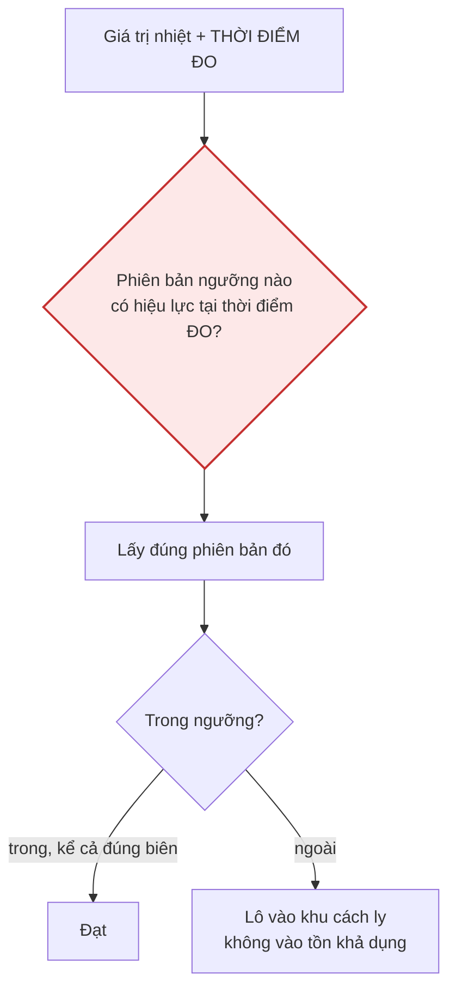
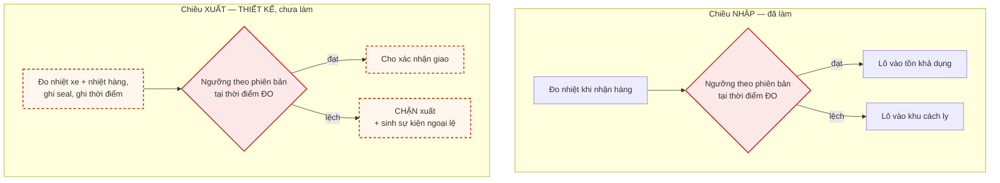
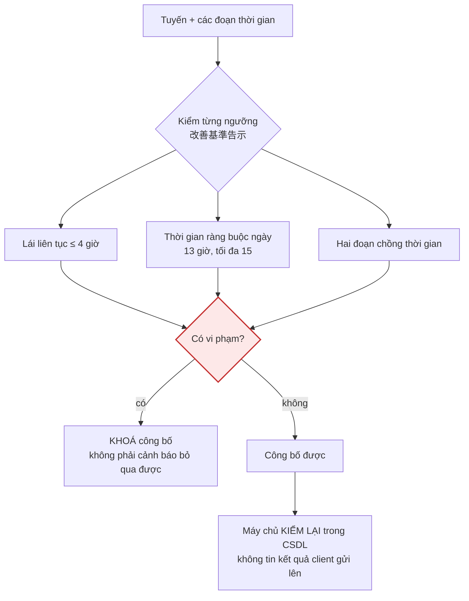

# Kiến trúc hệ thống — Product B, kho lạnh 3 dải nhiệt

> Tài liệu **tạo mới cho LAB-4**. Bộ spec-standard của công ty dừng ở mức Detail Design cho từng
> chức năng, không có biểu mẫu cho kiến trúc toàn hệ thống — xem [`_template-list.md`](../_template-list.md).

Luận điểm của tài liệu này: **nghiệp vụ kho lạnh không phải một luồng tuyến tính.** Mỗi lô hàng đi
qua một chuỗi phép loại có thứ tự cố định, và đổi thứ tự là đổi kết quả. Kiến trúc phải giữ được
các điểm rẽ nhánh đó, không được gộp thành "nhận hàng → xuất hàng".

## 1. Thành phần hệ thống



| Thành phần | Trách nhiệm | Vì sao tách ra |
|---|---|---|
| `proxy.ts` | Chặn mọi đường dẫn chưa đăng nhập, **từ chối mặc định** khi đường dẫn chưa khai báo | Một chỗ duy nhất quyết định "ai vào được đâu", dùng chung cho cả proxy lẫn menu |
| `app/api/**` | 20 route ghi nghiệp vụ. `requireRole()` là câu lệnh đầu tiên, trước mọi thao tác dữ liệu | Kiểm quyền trước khi chạm dữ liệu, không kiểm sau |
| `lib/rules/**` | 11 hàm **thuần**: nhận dữ liệu vào, trả quyết định ra. Không chạm CSDL, không chạm mạng | Quy tắc nghiệp vụ kiểm chứng được bằng unit test không cần CSDL. Đây là nơi 6 bẫy nghiệp vụ sống |
| 6 RPC `security definer` | Gói một thao tác ghi thành **một giao dịch**, khoá đúng hàng cần khoá | Chống đua: hai người cùng phân bổ một lô, hai người cùng công bố một tuyến |
| 8 trigger | Bất biến nghiệp vụ ở **tầng bảng** | Tầng API chỉ bảo vệ người đi cửa chính. Trigger chặn mọi đường ghi, kể cả đường chưa ai nghĩ tới |

**Bất biến kiến trúc — mọi thao tác ghi nghiệp vụ đi đúng một đường:**



RPC đã bị **thu hồi quyền gọi** từ `anon` và `authenticated`, nên có JWT hợp lệ trong tay cũng
không gọi thẳng được. Kiểm chứng bằng lệnh, không bằng cách đọc code:

```sql
select * from public.audit_user_executable_functions();
-- chỉ còn health_check và app_current_role; không RPC nghiệp vụ nào
```

## 2. Luồng dữ liệu chính



Hai mũi tên đứt nét là chỗ **dễ vẽ sai nhất**:

- `Lịch sử giao → Phân bổ lô`: phép so 日付逆転 đọc ngược lại lịch sử giao. Đây là vòng phản hồi,
  không phải luồng một chiều. Bỏ mũi tên này là mất bẫy ④.
- `Ngưỡng nhiệt → Kiểm hàng nhập`: ngưỡng là **dữ liệu có phiên bản**, không phải hằng số trong mã
  nguồn. Phiếu nhập cũ phải được chấm theo phiên bản hiệu lực tại thời điểm đo.

## 3. Các điểm rẽ nhánh logic — phần không được đơn giản hóa

### 3.1 Phân bổ lô: sáu phép loại có thứ tự

FEFO **không** phải quy tắc đầu tiên, cũng không phải quy tắc duy nhất. Nó là bước cuối, chạy trên
phần còn lại sau năm phép loại trước đó.



Ba ô tô đỏ là ba bẫy nghiệp vụ, và mỗi ô có một cách hiểu sai kinh điển:

| Bước | Cách hiểu sai thường gặp | Đúng phải là |
|---|---|---|
| ① Hạn an toàn | Gộp 賞味期限 và 消費期限 làm một loại hạn | 消費期限 chạm hạn thì **chặn**; 賞味期限 chỉ **cảnh báo**, vẫn phân bổ được |
| ④ Cửa sổ giao | Coi quy tắc 1/3 là hạn dùng thật của hàng | Đây là **tập quán hợp đồng**, tính từ ngày sản xuất, khác hẳn hạn trên nhãn. Hợp đồng chưa chốt thì **không tự suy ra** |
| ⑤ 日付逆転 | So hạn với **ngày hôm nay** | So với **hạn của lần giao gần nhất cho đúng cặp khách–SKU đó**. Không mượn lịch sử của khách khác hay SKU khác. Hạn **bằng** thì cho phép |

Thứ tự này cố định. Ví dụ nếu để FEFO chạy trước ⑤, hệ thống sẽ chọn lô hạn sớm nhất rồi mới phát
hiện nó vi phạm đảo ngày — và người dùng không hiểu vì sao đơn bị từ chối.

**Luật ⑤ được kiểm hai lần, ở hai thời điểm khác nhau:**



Chỉ kiểm lúc phân bổ là **chưa đủ**: hai đơn cùng cặp khách–SKU phân bổ trước khi đơn nào kịp giao
thì cả hai đều qua. Lỗ này đã được tìm ra và vá ở LAB-2 (xem [`ADR-003`](ADR-003-date-reversal-at-table-level.md)).

### 3.2 Ngưỡng nhiệt: chọn phiên bản theo thời điểm đo



Hai chỗ dễ sai: lấy ngưỡng theo **lúc bấm xác nhận** thay vì **lúc đo** (phiếu cũ bị chấm lại khi
ngưỡng đổi phiên bản), và coi giá trị **đúng biên** là vi phạm (đúng biên là đạt).

Ngưỡng của Yuki hiện là `常温 15,0–25,0` · `冷蔵 0,0–5,0` · `冷凍 ≤ −18,0`. **Ba con số này là dữ
liệu của khách, không phải hằng số của hệ thống** — công ty khác công bố dải khác.

### 3.3 Kiểm nhiệt hai chiều — nhập VÀ xuất

`BR-TEMP-02` nguyên văn đòi so dải nhiệt **"tại mọi lần nhập/xuất; lệch là chặn xác nhận, tạo
deviation, không ngoại lệ"**. Chiều nhập đã làm; **chiều xuất chưa** → `GAP-16`.



Hai chiều dùng **chung một cơ chế chọn phiên bản ngưỡng**: theo thời điểm đo, không theo lúc bấm
nút. Khác nhau ở hệ quả — nhập thì cho vào cách ly, xuất thì **chặn hẳn**, vì hàng đã lên xe mà
sai nhiệt thì không có chỗ nào để cách ly nữa.

Bảng lưu kết quả: [`predispatch_checks`](../database/COLDCHAIN_DATABASE.md) — thiết kế đã có,
prototype chưa dựng.

### 3.4 Lập tuyến: giờ lái là ràng buộc cứng



Ba ngưỡng trên là ba phép kiểm **khoá công bố**. Phút nghỉ tối thiểu KHÔNG phải ngưỡng khoá — nó chỉ là điều kiện để **reset bộ đếm lái liên tục**: nghỉ 10 phút không sinh vi phạm, nó chỉ không cắt được chuỗi lái.

Đây là ràng buộc pháp lý (vấn đề logistics 2024), không phải tiêu chí tối ưu. Hệ thống **không được**
cho công bố tuyến vi phạm kèm lời cảnh báo.

## 4. Điểm tích hợp

| Điểm | Trạng thái | Làm gì ở bản thật | Ảnh hưởng tới thiết kế |
|---|---|---|---|
| **Cảm biến nhiệt / datalogger** | **Mô phỏng** — bản ghi nạp sẵn trong dữ liệu demo | Nhận dữ liệu đẩy lên hoặc nhập CSV định kỳ | Không ảnh hưởng: luật đánh giá ngưỡng đã tách thành hàm thuần, đổi nguồn dữ liệu không đụng tới nó |
| **Hệ thống ERP** | **Chưa có** — master nhập tay ở SC4-07 | Đồng bộ hai chiều mã hàng, khách hàng, hợp đồng | Cần quyết định bên nào là nguồn sự thật cho mỗi bảng master → chưa có trong RFP, **cần hỏi khách** |
| **POD — chứng từ giao hàng** | **Mô phỏng** — gõ tay tên người nhận và các dòng bằng chứng | Chữ ký điện tử và ảnh chụp | Dữ liệu POD hiện nằm chung bảng đơn; bản thật nên tách bảng riêng vì chứa tên người nhận |
| **Đọc mã vạch khi kiểm nhập** | **Mô phỏng** — ô nhập tay | Máy quét hoặc camera | Không ảnh hưởng luật; chỉ đổi cách nhập liệu ở SC4-01 |
| **Tối ưu tuyến giao** | **Ngoài phạm vi** | Thuật toán xếp tuyến | Thiết kế hiện chỉ **kiểm** tuyến do người lập, không **đề xuất** tuyến |

## 5. Chỗ prototype làm khác thiết kế

Liệt kê đầy đủ ở [`../database/gap-list.md`](../database/gap-list.md). Ba chỗ chạm tới kiến trúc:

| Mã | Chỗ lệch | Mức |
|---|---|---|
| GAP-01 | Kiểm giờ lái chỉ trong một ngày tuyến; thiếu các ngưỡng tuần, tháng, năm của 改善基準告示 | Cao — chạm bẫy ⑥ |
| GAP-02 | Cảnh báo nhiệt chỉ **liệt kê** lô ảnh hưởng, chưa tự chuyển lô sang cách ly | Trung bình |
| GAP-03 | Tuyến đã công bố không sửa được; thiết kế đúng cho phép sửa có lý do và sinh phiên bản mới | Trung bình |

## 6. Vì sao kiến trúc này chịu được thay đổi

Ba quyết định làm hệ thống chịu được việc khách đổi quy định — chuyện chắc chắn xảy ra với hồ sơ
pháp lý thực phẩm:

1. **Quy tắc nghiệp vụ là hàm thuần.** Đổi công thức 1/3 → 1/2, hay đổi cách so 日付逆転, chỉ sửa
   một hàm và các unit test của nó, không đụng tới giao diện hay CSDL.
2. **Ngưỡng và quy tắc là dữ liệu có phiên bản, không phải hằng số.** Khách công bố ngưỡng mới thì
   thêm một phiên bản, hồ sơ cũ vẫn giữ nguyên cách chấm ban đầu — điều bắt buộc với hồ sơ HACCP.
3. **Bất biến nằm ở tầng bảng.** Thêm một màn mới, một script nhập liệu, hay một đường tích hợp ERP
   sau này cũng không lách được luật, vì luật không nằm ở tầng gọi.
