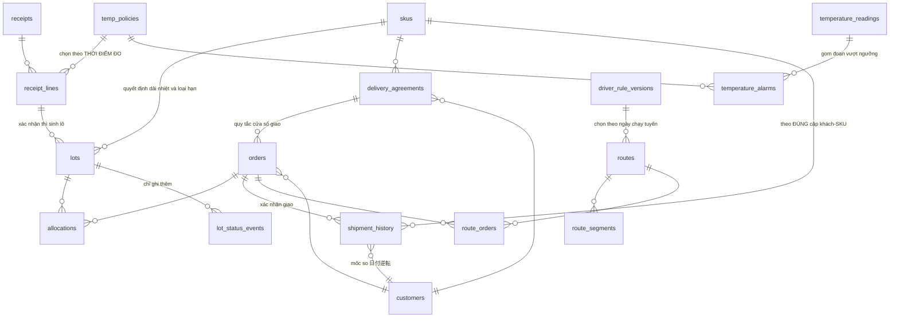

# Hệ thống kho lạnh 3 dải nhiệt — Database Design

> Biểu mẫu: **BM-2-901-50 v01** — Database Design · SUN ASTERISK VIETNAM CO., LTD · ISO/IEC 27001:2013 & ISO 9001:2015

| | |
|---|---|
| System Name | Hệ thống hỗ trợ nghiệp vụ chuỗi lạnh thực phẩm (食品コールドチェーン業務支援システム) |
| Schema | `public` |
| CHARACTER SET | UTF-8 (PostgreSQL 17) |
| Updated by | PL |
| Note | Mục 4 viết đầy đủ cho **9 bảng mang 6 bẫy nghiệp vụ** cộng 3 bảng master và 1 bảng thiết kế mới; các bảng còn lại có mặt ở mục 2 với mô tả và trạng thái. Lý do giới hạn phạm vi ghi ở cuối mục 2. |

---

## 1. Lịch sử sửa đổi

| No | Version | Action | Sheet / Bảng | Nội dung thay đổi | Ngày | Người sửa | Approve |
|---|---|---|---|---|---|---|---|
| 1 | 0.1.0 | Add new | — | Khởi tạo từ schema đang chạy ở LAB-2 | 2026-11-16 | PL | |

---

## 2. Danh sách bảng

23 bảng đã dựng + 1 bảng thiết kế chưa dựng. Cột **Trạng thái** cho biết bảng đã dựng thật ở LAB-2 hay mới chỉ có trong thiết kế.

| No | Category | Tên bảng (logic) | Tên bảng (vật lý) | Mô tả | Trạng thái |
|---|---|---|---|---|---|
| 1 | master | Mã hàng | [`skus`](#41-skus) | Mặt hàng, mang dải nhiệt, **loại hạn** và diện truy xuất | Đã dựng |
| 2 | master | Khách hàng | `customers` | Nhãn giả trong dữ liệu demo | Đã dựng |
| 3 | master | Nhà cung cấp | `suppliers` | Nhãn giả trong dữ liệu demo | Đã dựng |
| 4 | master | Vị trí kho | `locations` | Khu vực kho, mang dải nhiệt; khu `-Q` là khu cách ly | Đã dựng |
| 5 | master | Hợp đồng giao hàng | [`delivery_agreements`](#42-delivery_agreements) | **Quy tắc cửa sổ giao 1/3 – 1/2** theo cặp khách–SKU | Đã dựng |
| 6 | policy | Ngưỡng nhiệt có phiên bản | [`temp_policies`](#43-temp_policies) | Ngưỡng 3 dải do khách công bố, **có phiên bản** | Đã dựng |
| 7 | policy | Bộ ngưỡng giờ lái | [`driver_rule_versions`](#44-driver_rule_versions) | Ngưỡng 改善基準告示, có phiên bản | Đã dựng |
| 8 | nghiệp vụ | Phiếu kiểm hàng nhập | `receipts` | Đầu phiếu: nhà cung cấp, người kiểm | Đã dựng |
| 9 | nghiệp vụ | Dòng kiểm hàng nhập | [`receipt_lines`](#45-receipt_lines) | Dữ liệu nhãn, **nhiệt độ đo và thời điểm đo**, trường truy xuất | Đã dựng |
| 10 | nghiệp vụ | Lô hàng | [`lots`](#46-lots) | Đơn vị tồn kho; hạn, loại hạn, vị trí, trạng thái | Đã dựng |
| 11 | sổ | Sự kiện trạng thái lô | `lot_status_events` | **Chỉ ghi thêm.** Giải phóng, huỷ, cách ly | Đã dựng |
| 12 | nghiệp vụ | Đơn xuất | [`orders`](#47-orders) | Một đơn một SKU; trạng thái do máy chủ suy ra | Đã dựng |
| 13 | nghiệp vụ | Dòng phân bổ | `allocations` | Lô nào gán cho đơn nào, số lượng bao nhiêu | Đã dựng |
| 14 | sổ | Lịch sử giao | [`shipment_history`](#48-shipment_history) | **Chỉ ghi thêm.** Mốc so 日付逆転 cho mọi lần giao sau | Đã dựng |
| 15 | nghiệp vụ | Tuyến giao | `routes` | Ngày chạy, tài xế, xe, trạng thái, kết quả kiểm giờ lái | Đã dựng |
| 16 | nghiệp vụ | Đoạn thời gian của tuyến | `route_segments` | Lái / nghỉ / giao hàng, có thứ tự | Đã dựng |
| 17 | nghiệp vụ | Đơn trên tuyến | `route_orders` | Nối đơn với tuyến | Đã dựng |
| 18 | master | Tài xế | `drivers` | Nhãn giả | Đã dựng |
| 19 | master | Xe | `vehicles` | Nhãn giả | Đã dựng |
| 20 | nghiệp vụ | Bản ghi nhiệt | `temperature_readings` | Dữ liệu cảm biến — **mô phỏng**, nạp sẵn trong dữ liệu demo | Đã dựng |
| 21 | nghiệp vụ | Cảnh báo nhiệt | [`temperature_alarms`](#49-temperature_alarms) | Gom đoạn vượt ngưỡng; bằng chứng HACCP | Đã dựng |
| 22 | sổ | Sự kiện ngoại lệ | `exception_events` | **Chỉ ghi thêm** | Đã dựng |
| 23 | hệ thống | Hồ sơ người dùng | `profiles` | Vai của tài khoản; nguồn cho phân quyền ở tầng hàng | Đã dựng |
| 24 | nghiệp vụ | Kiểm tra trước khi xuất hàng | [`predispatch_checks`](#413-predispatch_checks--thiết-kế-prototype-chưa-có) | Nhiệt xe, nhiệt hàng, seal. **Bắt buộc theo `FR-OUT-05` (P0)** | **Chưa dựng** → `GAP-16` |

**Vì sao mục 4 chỉ viết đầy đủ 9 bảng.** Biểu mẫu BM-50 đòi mỗi bảng một mục con có đủ danh sách
cột, chỉ mục và khoá ngoại. Với 23 bảng thì phần lớn công sức rơi vào các bảng master hai cột
(`customers`, `suppliers`, `drivers`, `vehicles`) không mang quyết định thiết kế nào. Chín bảng
được viết đầy đủ là chín bảng **mang 6 bẫy nghiệp vụ** — nơi sai một cột là sai nghiệp vụ. Các
bảng còn lại đọc trực tiếp ở sơ đồ mục 3 và ở schema đang chạy.

---

## 3. ER Diagram

### 3.1 Sơ đồ rút gọn — các bảng mang bẫy nghiệp vụ

Ba quan hệ đáng chú ý nhất, vì bỏ sót cái nào là mất một bẫy:

| Quan hệ | Vì sao quan trọng |
|---|---|
| `shipment_history` → `customers` **và** `skus` | Mốc so 日付逆転 phải khoá theo **cả hai**. Thiếu một vế là so nhầm lịch sử |
| `temp_policies` → `receipt_lines` | Chọn phiên bản theo **thời điểm đo** trên dòng phiếu, không theo thời điểm ghi bản ghi |
| `delivery_agreements` → `orders` | Quy tắc cửa sổ giao đến từ hợp đồng, không phải từ hàng |

### 3.2 Sơ đồ đầy đủ 23 bảng

Sinh tự động từ schema đang chạy: [`../../docs/erd.md`](../../docs/erd.md) — 23 bảng, 40 khoá ngoại.
Sinh lại bằng `npm run db:erd`, nên sơ đồ đó không bao giờ lệch với CSDL thật.

---

## 4. Định nghĩa bảng

### 4.1. `skus`

| | | | |
|---|---|---|---|
| Tên bảng (logic) | Mã hàng | Tạo bởi / ngày | PL / 2026-11-16 |
| Tên bảng (vật lý) | `skus` | Sửa bởi / ngày | — |
| Overview | Mặt hàng. Ba cột trên bảng này quyết định cách xử lý mọi lô của nó | Note | Bẫy ①②⑤ |

| No. | Key | Tên logic | Tên vật lý | Data Type | Not Null | Default | Note |
|---|---|---|---|---|---|---|---|
| 1 | PRI | Mã hàng | `sku_id` | text | Yes | | |
| 2 | | Tên tiếng Nhật | `name_ja` | text | Yes | | |
| 3 | | Tên tiếng Việt | `name_vi` | text | Yes | | |
| 4 | | Đơn vị đóng gói | `package_unit` | text | Yes | | |
| 5 | | Dải nhiệt | `temperature_band` | enum `temp_band` | Yes | | `AMBIENT` · `CHILLED` · `FROZEN`. **Bẫy ①** |
| 6 | | Loại hạn | `expiry_type` | enum `expiry_type` | Yes | | `BEST_BEFORE` (賞味期限) · `USE_BY` (消費期限). **Bẫy ②** — quyết định nhánh xử lý, không phải nhãn hiển thị |
| 7 | | Diện truy xuất | `traceability_lane` | enum `trace_lane` | Yes | | `RICE` · `BEEF` · `INTERNAL`. **Bẫy ⑤** — chỉ hai giá trị đầu là bắt buộc theo luật |
| 8 | | Số ngày cảnh báo trước hạn | `best_before_warning_days` | integer | No | | Để trống: RFP chưa cho ngưỡng → **cần hỏi khách** |
| 9 | | Tạo lúc | `created_at` | timestamptz | Yes | `now()` | |

### 4.2. `delivery_agreements`

| | | | |
|---|---|---|---|
| Tên bảng (logic) | Hợp đồng giao hàng | Tạo bởi / ngày | PL / 2026-11-16 |
| Tên bảng (vật lý) | `delivery_agreements` | Sửa bởi / ngày | — |
| Overview | Thoả thuận giao hàng theo cặp khách–mã hàng, có ngày hiệu lực | Note | Bẫy ③ · [ADR-004](../architecture/ADR-004-delivery-window-rule-per-agreement.md) |

| No. | Key | Tên logic | Tên vật lý | Data Type | Not Null | Note |
|---|---|---|---|---|---|---|
| 1 | PRI | Mã hợp đồng | `agreement_id` | text | Yes | |
| 2 | FK | Khách hàng | `customer_id` | text | Yes | → `customers` |
| 3 | FK | Mã hàng | `sku_id` | text | Yes | → `skus` |
| 4 | | Điều kiện giao | `delivery_term` | enum `delivery_term` | Yes | `ON_TRUCK` · `AT_DOOR` |
| 5 | | **Quy tắc cửa sổ giao** | `delivery_window_rule` | enum `delivery_window_rule` | **No** | `ONE_THIRD` · `ONE_HALF` · `LABEL_DATE_ONLY`. **Để trống là có chủ ý**: đơn vào chờ duyệt tay, hệ thống KHÔNG suy ra mặc định |
| 6 | | Hiệu lực từ | `effective_from` | date | Yes | |
| 7 | | Hiệu lực đến | `effective_to` | date | No | Trống = còn hiệu lực |
| 8 | | Tạo lúc | `created_at` | timestamptz | Yes | |

**Chỉ mục / ràng buộc duy nhất**

| No. | Cột | Unique | Note |
|---|---|---|---|
| 1 | `(customer_id, sku_id, effective_from)` | Yes | **Chưa đủ** — không chặn được hai hợp đồng cùng cặp có khoảng hiệu lực chồng nhau → `GAP-05` |

### 4.3. `temp_policies`

| | | | |
|---|---|---|---|
| Tên bảng (logic) | Ngưỡng nhiệt có phiên bản | Tạo bởi / ngày | PL / 2026-11-16 |
| Tên bảng (vật lý) | `temp_policies` | Sửa bởi / ngày | — |
| Overview | Ngưỡng 3 dải nhiệt **do khách công bố**, mỗi lần đổi là một phiên bản mới | Note | Bẫy ① · [ADR-005](../architecture/ADR-005-versioned-temperature-policy.md) |

| No. | Key | Tên logic | Tên vật lý | Data Type | Not Null | Note |
|---|---|---|---|---|---|---|
| 1 | PRI | Mã | `id` | uuid | Yes | `gen_random_uuid()` |
| 2 | | Dải nhiệt | `band` | enum `temp_band` | Yes | |
| 3 | | Ngưỡng dưới °C | `min_c` | numeric | **No** | Trống = không giới hạn dưới (dùng cho 冷凍) |
| 4 | | Ngưỡng trên °C | `max_c` | numeric | **No** | Trống = không giới hạn trên |
| 5 | | Số hiệu phiên bản | `version` | integer | Yes | **Máy chủ cấp** `max+1`, client không gửi lên |
| 6 | | Hiệu lực từ | `effective_from` | date | Yes | Không được nằm trong quá khứ → mã lỗi `TMP01` |
| 7 | | Hiệu lực đến | `effective_to` | date | No | |
| 8 | | Người tạo | `created_by` | uuid | No | **Máy chủ ghi từ phiên**, client không gửi lên |
| 9 | | Tạo lúc | `created_at` | timestamptz | Yes | |

**Bất biến ở tầng bảng:** `TMP01` chặn tạo phiên bản hồi tố; `TMP02` chặn `min_c > max_c`.
Phiên bản cũ không có đường sửa hay xoá cho người dùng.

### 4.4. `driver_rule_versions`

| | | | |
|---|---|---|---|
| Tên bảng (logic) | Bộ ngưỡng giờ lái | Tạo bởi / ngày | PL / 2026-11-16 |
| Tên bảng (vật lý) | `driver_rule_versions` | Sửa bởi / ngày | — |
| Overview | Ngưỡng 改善基準告示, có phiên bản, chọn theo ngày chạy tuyến | Note | Bẫy ⑥ · [ADR-006](../architecture/ADR-006-driver-hours-blocks-route-publish.md) |

16 cột, gồm đủ các ngưỡng ngày, tuần, tháng, năm. **Prototype mới dùng ba ngưỡng trong ngày** —
lái liên tục, thời gian ràng buộc ngày, nghỉ tối thiểu; các ngưỡng còn lại đã lưu đủ số nhưng chưa
có logic kiểm → `GAP-01`, mức Cao.

| Cột đáng chú ý | Nghĩa | Prototype dùng chưa |
|---|---|---|
| `max_continuous_driving_minutes` | Lái liên tục tối đa | Có |
| `standard_daily_duty_minutes` / `max_daily_duty_minutes` | Thời gian ràng buộc ngày 13 / 15 giờ | Có |
| `min_break_minutes` | Nghỉ tối thiểu để cắt chuỗi lái liên tục | Có — **giá trị tạm, RFP không ghi số → cần hỏi khách** |
| `annual_overtime_hours` · `annual_duty_hours` · `monthly_duty_hours` · `weekly_driving_hours_2w` · `avg_driving_hours_2d` · `min_rest_hours` · `target_rest_hours` | Các ngưỡng tuần, tháng, năm và nghỉ giữa hai ngày | **Chưa** → `GAP-01` |

### 4.5. `receipt_lines`

| | | | |
|---|---|---|---|
| Tên bảng (logic) | Dòng kiểm hàng nhập | Tạo bởi / ngày | PL / 2026-11-16 |
| Tên bảng (vật lý) | `receipt_lines` | Sửa bởi / ngày | — |
| Overview | 25 cột. Mang dữ liệu nhãn, kết quả đo nhiệt và trường truy xuất pháp định | Note | Bẫy ①②⑤ |

| Cột đáng chú ý | Data Type | Note |
|---|---|---|
| `measured_temp_c` | numeric | Nhiệt độ đo khi nhận hàng |
| **`measured_at`** | timestamptz | **Thời điểm ĐO**, tách khỏi `created_at`. Đây là cột chọn phiên bản ngưỡng. Bỏ cột này là sụp cả cơ chế ở ADR-005 |
| `production_date` | date | Mốc tính quy tắc 1/3 – 1/2 — **không phải** ngày hôm nay |
| `expiry_date` + `declared_expiry_type` | date + enum | Hạn và loại hạn **đọc từ nhãn**. Chữ "declared" trong tên cột nói rõ đây là thứ người kiểm khai theo nhãn, khác với `expiry_type` trên mã hàng master. Hai cái lệch nhau thì chặn xác nhận (`BR-EXP-01`) |
| `beef_individual_id` | text | Đúng 10 chữ số. Nhận 9 số thì chặn, **không tự đệm số 0** |
| `rice_origin` + `rice_transaction_id` | text | Bắt buộc với gạo |
| `status` | text | `draft` → `confirmed`. **Máy chủ đặt**; RLS chỉ cho sửa dòng khi còn `draft`, nên client không tự nâng cấp được |

### 4.6. `lots`

| | | | |
|---|---|---|---|
| Tên bảng (logic) | Lô hàng | Tạo bởi / ngày | PL / 2026-11-16 |
| Tên bảng (vật lý) | `lots` | Sửa bởi / ngày | — |
| Overview | Đơn vị tồn kho. 17 cột | Note | Không có policy ghi cho người dùng — chỉ RPC ghi được |

| Cột đáng chú ý | Note |
|---|---|
| `expiry_date` | Chép từ dòng phiếu nhập lúc xác nhận |
| *(loại hạn)* | **Không có trên bảng này.** Lấy từ `skus` qua khoá ngoại `sku_id`. Quyết định chặn hay cảnh báo khi phân bổ. **Không nhân bản cột này xuống đây** — loại hạn là thuộc tính của **mặt hàng**, không phải của từng lô |
| `source_kind` | `ACCEPTED` hoặc `HELD` — lô sinh ra từ phần nhận hay phần giữ lại của dòng phiếu. **Trục khác với `status`**, đừng trộn |
| `production_date` | Mốc tính cửa sổ giao |
| `status` | **Đúng ba giá trị**: `available` · `quarantine` · `scrapped`. Chuyển trạng thái đi qua RPC, kiểm lại bảng chuyển hợp lệ **bên trong giao dịch** |
| `location_id` | Khu `-Q` là khu cách ly cùng dải nhiệt |

### 4.7. `orders`

| | | | |
|---|---|---|---|
| Tên bảng (logic) | Đơn xuất | Tạo bởi / ngày | PL / 2026-11-16 |
| Tên bảng (vật lý) | `orders` | Sửa bởi / ngày | — |
| Overview | Một đơn một mã hàng. 12 cột | Note | Bẫy ③④ |

| Cột đáng chú ý | Note |
|---|---|
| `agreement_id` | **Trigger ép** phải trỏ đúng hợp đồng của cặp khách–SKU và còn hiệu lực (`ORD01`–`ORD03`) |
| `status` | **Năm giá trị**: `created` · `business_review` · `allocated` · `delivered` · `cancelled`. **Máy chủ suy ra**; hợp đồng chưa chốt quy tắc thì bắt buộc `business_review` (`ORD04`), đơn không gắn hợp đồng cũng vậy (`ORD06`). Luồng huỷ đơn (`cancelled`) **chưa đặc tả** → xem sổ gap |
| `delivery_term` | Lấy từ hợp đồng, không nhận từ client |
| `created_by` | **Máy chủ ghi từ phiên** |
| `allocation_evidence` | jsonb — chứng từ giao hàng mô phỏng. **Có tên người nhận** → cân nhắc tách bảng riêng, xem `GAP-06` |

### 4.8. `shipment_history`

| | | | |
|---|---|---|---|
| Tên bảng (logic) | Lịch sử giao | Tạo bởi / ngày | PL / 2026-11-16 |
| Tên bảng (vật lý) | `shipment_history` | Sửa bởi / ngày | — |
| Overview | **Chỉ ghi thêm.** Là mốc so 日付逆転 cho mọi lần giao sau | Note | Bẫy ④ · [ADR-003](../architecture/ADR-003-date-reversal-at-table-level.md) |

| No. | Key | Tên logic | Tên vật lý | Data Type | Not Null | Note |
|---|---|---|---|---|---|---|
| 1 | PRI | Mã dòng | `shipment_line_id` | uuid | Yes | |
| 2 | | Thời điểm giao | `completed_at` | timestamptz | Yes | Dùng để tìm "lần giao gần nhất" |
| 3 | FK | Khách hàng | `customer_id` | text | Yes | **Vế 1** của mốc so sánh |
| 4 | FK | Mã hàng | `sku_id` | text | Yes | **Vế 2** của mốc so sánh |
| 5 | FK | Lô | `lot_id` | text | No | |
| 6 | | **Hạn của lô đã giao** | `expiry_date` | date | Yes | Giá trị được đem so |
| 7 | | Số lượng | `qty` | numeric | Yes | |
| 8 | | Điều kiện giao | `delivery_term` | enum | Yes | |
| 9 | FK | Đơn | `order_id` | text | No | |
| 10 | | Người ghi | `recorded_by` | uuid | No | |

**Bất biến ở tầng bảng**

| Trigger | Luật |
|---|---|
| `shipment_history_append_only` | Chặn `update` và `delete`. Sửa một dòng ở đây là sửa mốc so sánh của mọi lần giao sau |
| `shipment_history_no_date_reversal` | `SHP01` — chặn ghi lần giao có hạn sớm hơn lần giao gần nhất của **đúng cặp khách–SKU**. Có khoá theo cặp để hai lần giao đồng thời không lách qua nhau |

**Chỉ mục cần có:** `(customer_id, sku_id, completed_at desc)` — mọi lần giao đều tra bảng này.

### 4.9. `temperature_alarms`

| | | | |
|---|---|---|---|
| Tên bảng (logic) | Cảnh báo nhiệt | Tạo bởi / ngày | PL / 2026-11-16 |
| Tên bảng (vật lý) | `temperature_alarms` | Sửa bởi / ngày | — |
| Overview | Gom các bản ghi vượt ngưỡng liên tiếp thành một cảnh báo. Là bằng chứng HACCP | Note | 15 cột |

| Nhóm cột | Cột | Ai ghi |
|---|---|---|
| Bằng chứng | `zone`, `band`, `temp_policy_id`, `first_at`, `last_at`, `peak_c`, `duration_minutes`, `affected_lot_ids` | **Máy tính ra.** Bất biến sau khi tạo (`ALM02`) |
| Xử lý | `status`, `handling_note`, `reviewed_by`, `first_reviewed_at`, `closed_at` | Người xử lý, **chỉ qua đường sửa** |

**Bất biến ở tầng bảng** — trigger chạy cả `insert` lẫn `update`:

| Mã | Luật |
|---|---|
| `ALM01` | Cảnh báo đã đóng là bất biến |
| `ALM02` | Số liệu bằng chứng không sửa được |
| `ALM03` | Đóng cảnh báo bắt buộc có ghi chú xử lý |
| `ALM04` | Cảnh báo chỉ được **tạo** ở trạng thái `open` |
| `ALM05` | Cảnh báo mới không được gắn sẵn người xử lý, ghi chú hay thời điểm đóng |

`ALM04` và `ALM05` sinh ra từ một lỗ hổng tìm được thật: trigger ban đầu chỉ gắn vào đường sửa,
nên tài khoản vai QA tạo thẳng được một cảnh báo *đã đóng* không ghi chú — xem
[ADR-001](../architecture/ADR-001-business-rules-at-table-level.md).

### 4.10. `customers`

| | | | |
|---|---|---|---|
| Tên bảng (logic) | Khách hàng | Tạo bởi / ngày | PL / 2026-11-16 |
| Tên bảng (vật lý) | `customers` | Overview | Danh mục khách. Là **vế 1** của mốc so 日付逆転 và của hợp đồng giao |

| No. | Key | Tên logic | Tên vật lý | Data Type | Not Null | Note |
|---|---|---|---|---|---|---|
| 1 | PRI | Mã khách hàng | `customer_id` | text | Yes | Dữ liệu demo dùng nhãn giả |
| 2 | | Tên khách hàng | `name` | text | Yes | |

Bảng tối giản có chủ ý. Thông tin liên hệ, điểm giao, điều kiện thanh toán thuộc hệ ERP — xem
mục điểm tích hợp ở [`../architecture/architecture.md`](../architecture/architecture.md) mục 4.

### 4.11. `suppliers`

| No. | Key | Tên logic | Tên vật lý | Data Type | Not Null | Note |
|---|---|---|---|---|---|---|
| 1 | PRI | Mã nhà cung cấp | `supplier_id` | text | Yes | |
| 2 | | Tên nhà cung cấp | `name` | text | Yes | Mắt xích đầu của chuỗi truy xuất |

### 4.12. `locations`

| No. | Key | Tên logic | Tên vật lý | Data Type | Not Null | Note |
|---|---|---|---|---|---|---|
| 1 | PRI | Mã vị trí | `location_id` | text | Yes | |
| 2 | | Khu | `zone` | text | Yes | Khớp với `zone` của bản ghi nhiệt và của cảnh báo |
| 3 | | Dải nhiệt | `temperature_band` | enum `temp_band` | Yes | **Lệch dải nhiệt giữa vị trí và mã hàng thì chặn nhập** (`BR-TEMP-02`) |
| 4 | | Có phải khu cách ly | `is_quarantine` | boolean | Yes | Khu `-Q` của từng dải. Dải 常温 **chưa có** khu cách ly — điểm CẦN XÁC NHẬN số 7 |

### 4.13. `predispatch_checks` — **THIẾT KẾ, prototype chưa có**

| | | | |
|---|---|---|---|
| Tên bảng (logic) | Kiểm tra trước khi xuất hàng | Trạng thái | **Chưa dựng** → `GAP-16` |
| Overview | Ghi kết quả kiểm trước xuất: nhiệt xe, nhiệt hàng, seal, thời điểm | Note | `FR-OUT-05` (P0) · `BR-TEMP-02` |

`BR-TEMP-02` nguyên văn đòi so dải nhiệt **"tại mọi lần nhập/xuất"**. Hiện toàn bộ thiết kế và
prototype chỉ phủ chiều **nhập**. Đây là bẫy ①, nên theo [`PREMISE.md`](../PREMISE.md) mục 1 nó
**không được xếp vào sổ gap như một lựa chọn phạm vi** — phải đặc tả, và phần prototype chưa làm
ghi là *chưa làm*.

| No. | Key | Tên logic | Tên vật lý | Data Type | Not Null | Note |
|---|---|---|---|---|---|---|
| 1 | PRI | Mã phiếu kiểm | `check_id` | uuid | Yes | |
| 2 | FK | Đơn xuất | `order_id` | text | Yes | → `orders` |
| 3 | | Nhiệt độ xe °C | `vehicle_temp_c` | numeric | Yes | So với dải nhiệt của hàng trên xe |
| 4 | | Nhiệt độ hàng °C | `cargo_temp_c` | numeric | Yes | So với ngưỡng của dải nhiệt mã hàng |
| 5 | | **Thời điểm đo** | `measured_at` | timestamptz | Yes | Chọn phiên bản ngưỡng theo mốc này, **giống hệt chiều nhập** |
| 6 | FK | Phiên bản ngưỡng đã dùng | `temp_policy_id` | uuid | Yes | → `temp_policies`. Lưu lại để truy vết đã chấm theo phiên bản nào |
| 7 | | Mã niêm phong | `seal_no` | text | Yes | `FR-OUT-05` đòi ghi seal |
| 8 | | Kết quả | `result` | enum | Yes | `pass` · `fail` |
| 9 | FK | Sự kiện ngoại lệ sinh ra | `exception_event_id` | uuid | No | → `exception_events`. Chỉ có khi `result = fail` |
| 10 | | Người kiểm | `checked_by` | uuid | Yes | **Máy chủ ghi từ phiên** |

**Bất biến phải có ở tầng bảng** (chưa dựng, cần một migration mới):

| Luật | Nội dung |
|---|---|
| Chặn xuất khi không đạt | Đơn **không chuyển sang đã giao** nếu chưa có phiếu kiểm trước xuất `result = pass`. `FR-OUT-05` ghi rõ "chặn xuất", `BR-TEMP-02` ghi "không ngoại lệ" |
| Sinh sự kiện ngoại lệ | `result = fail` **bắt buộc** sinh một dòng trong `exception_events` — bảng chỉ-ghi-thêm |
| Bất biến sau khi ghi | Số liệu đo không sửa được, giống cảnh báo nhiệt (`ALM02`) |

---

---

## 5. Chỗ prototype làm khác thiết kế

Xem [`gap-list.md`](gap-list.md).
