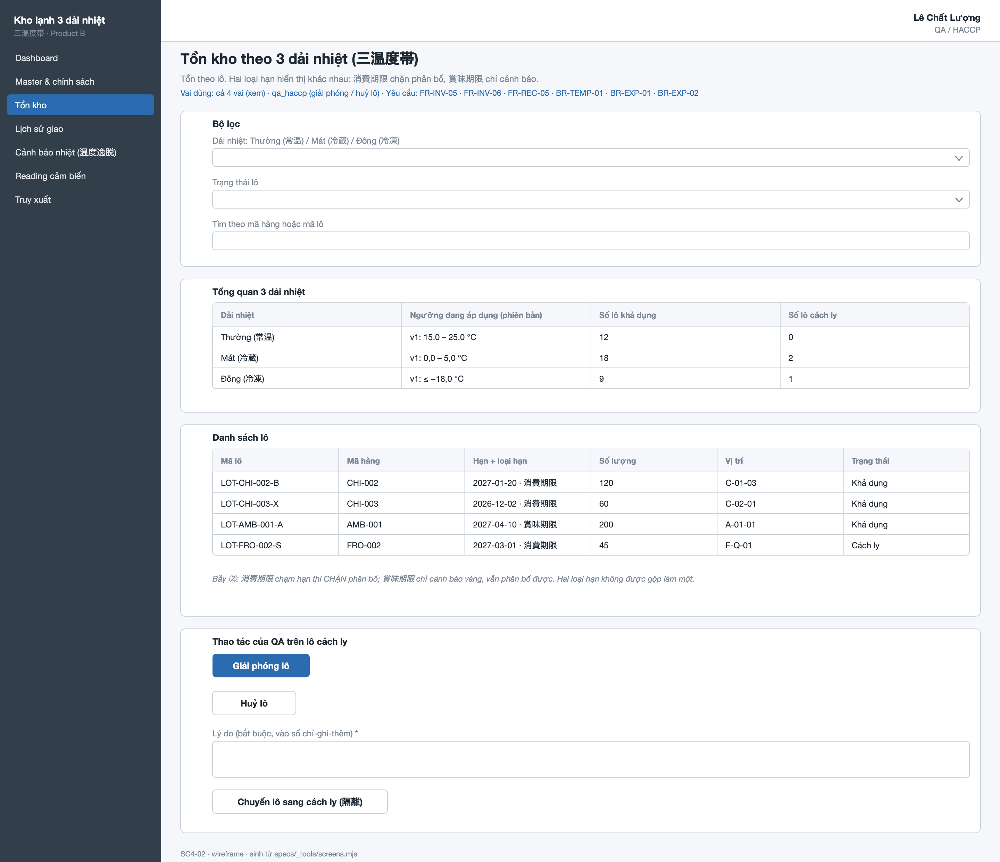
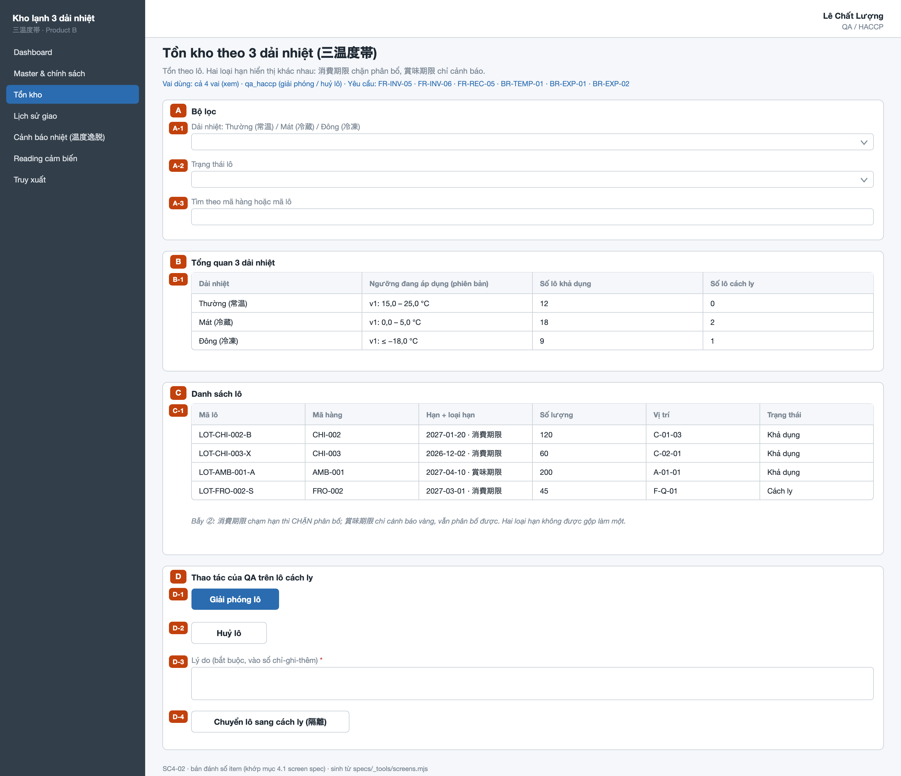

# SC4-02 — Tồn kho theo 3 dải nhiệt (三温度帯)

> Biểu mẫu: **BM-2-901-51 v2.1** — Screen Specification · SUN ASTERISK VIETNAM CO., LTD · ISO/IEC 27001:2013 & ISO 9001:2015

---

## 1. History of change

| No | Version | Action | Nội dung thay đổi | Ngày | Người sửa | Approve |
|---|---|---|---|---|---|---|
| 1 | 0.1.0 | Add New | Khởi tạo | 2026-11-16 | PL | |
| 2 | 0.2.0 | Updated | Sửa theo vòng review chéo: thêm bảng truy vết yêu cầu, sửa mã lỗi gán sai, sửa tên trường API | 2026-11-16 | PL | |

---

## 2. Layout

**Design:** wireframe dựng từ [`specs/_tools/screens.mjs`](../../_tools/screens.mjs) — sửa file đó
rồi chạy `node specs/_tools/render-wireframes.mjs`, đừng sửa tay file ảnh.

Ảnh hiện trạng prototype để đối chiếu: [`../assets/_prototype/SC4-02_current.png`](../assets/_prototype/SC4-02_current.png)

---

## 3. Description

Màn xem tồn kho theo lô, nhóm theo ba dải nhiệt, và là nơi **QA/HACCP** giải phóng hoặc huỷ lô đang
cách ly. **Cả bốn vai đọc được màn này; chỉ `qa_haccp` ghi được** — mục 5 và mục 6 nói rõ từng vai.

Hai điểm quyết định cách đọc cả màn:

- **Ngưỡng ba dải không phải hằng số.** Nó là chính sách Yuki tự công bố, lưu thành phiên bản có
  ngày hiệu lực ([ADR-005](../../architecture/ADR-005-versioned-temperature-policy.md)). Màn hiển thị
  ngưỡng thì **luôn kèm số hiệu phiên bản và ngày hiệu lực** — in con số rời là nói dối người đọc
  rằng nó cố định.
- **Hai loại hạn đi hai nhánh khác hẳn nhau.** 消費期限 chạm hạn thì lô bị **chặn phân bổ**;
  賞味期限 chỉ **cảnh báo** kèm số ngày còn lại và vẫn phân bổ được
  ([ADR-002](../../architecture/ADR-002-two-expiry-types.md)). Gộp hai loại làm một là vừa chặn nhầm
  hàng còn bán được, vừa thả hàng quá hạn an toàn ra ngoài.

Đi tới: từ Dashboard và từ menu, cả bốn vai. Đi ra: không có màn con — thao tác của QA mở hộp thoại
ngay trong màn này.

---

## 3bis. Yêu cầu màn này thực hiện

Mã yêu cầu lấy từ [`docs/01_requirements-extract.md`](../../../docs/01_requirements-extract.md).
Màn này gánh hai dòng của bảng màn ở [`docs/scope.md`](../../../docs/scope.md) mục 3: *Tra cứu tồn
kho* và *Quản lý lô & cách ly* (hai dòng đó đã được gộp làm một màn).

| Mã yêu cầu | Nội dung (trích ngắn) | Màn đáp ứng ở mục nào |
|---|---|---|
| `FR-INV-05` (P0) | Máy trạng thái khả dụng / cách ly / giải phóng / huỷ; chỉ cho chuyển trạng thái hợp lệ; lịch sử bất biến; cập nhật ngay cho phân bổ | 4.2 (bảng chuyển trạng thái), 4.3 D-1/D-2, 5 (D-1, D-2 và hai dòng xử lý lỗi), 6 (sổ `lot_status_events`) |
| `FR-INV-06` (P1) | Tìm tồn kho theo mã hàng / lô / nhà cung cấp / hạn / loại hạn / dải nhiệt / trạng thái / vị trí | 4.2 A-1…A-3, 5 (đổi bộ lọc). **Một phần** — thiết kế mới có ba khoá (dải nhiệt, trạng thái, mã hàng hoặc mã lô); khoá nhà cung cấp, hạn, loại hạn và vị trí chưa có, xem mục 6 |
| `FR-REC-05` (P0) | Hàng trượt kiểm nhiệt hoặc thiếu trường truy xuất vào cách ly; hàng cách ly không được đặt trước, không picking | 4.3 C-1 (`lots`.`status`, `locations`.`is_quarantine`), 5 (C-1, D-1, D-2), 6 |
| `BR-TEMP-01` | Ngưỡng 3 dải nhiệt quản lý theo phiên bản; giao dịch quá khứ giữ phiên bản dùng lúc đánh giá | 4.3 B-1, 5 (B-1 và dòng thiếu phiên bản), 6 bẫy ① |
| `BR-EXP-01` | Mỗi mã hàng tuyên bố 賞味期限 hoặc 消費期限, áp hai đường quyết định khác nhau | 4.2 (hai dòng luật tầng dữ liệu), 4.3 C-1 (`skus`.`expiry_type`), 5 (C-1), 6 bẫy ② |
| `BR-EXP-02` | Lô chạm hoặc quá 消費期限: chặn cả phân bổ lẫn giao, ghi sự kiện ngoại lệ bất biến | 4.2, 5 (C-1 → `M_20`, đánh dấu không phân bổ được). **Một phần** — màn này chỉ hiển thị và đánh dấu, việc chặn nằm ở SC4-03; vế ghi `exception_events` bất biến chưa màn nào thực hiện và chưa có dòng nào trong [sổ gap](../../database/gap-list.md) |
| `NFR-SEC-02` | Quyền tối thiểu theo vai; tách người lập và người duyệt | 5 (section D không hiển thị với ba vai còn lại), 6 (bảng bốn vai). **Một phần** — màn gán vai khai ngoài phạm vi ở `docs/scope.md` mục 3 |
| `NFR-AUD-01` | Sự kiện chỉ-ghi-thêm cho trạng thái, master, phê duyệt, export, đăng nhập | 6 (`lot_status_events`), → `GAP-07`. **Một phần** — màn này chỉ phủ vế trạng thái lô |

Ba yêu cầu `FR-INV-01`, `FR-INV-02`, `FR-INV-03` (sức chứa vị trí, gợi ý vị trí, nhật ký di chuyển)
**không thuộc màn này** — `docs/scope.md` mục 3 khai chúng ngoài phạm vi ở màn Put-away.

Bảng này là **nguồn đúng** về mã yêu cầu của màn. Ảnh wireframe sinh từ
[`specs/_tools/screens.mjs`](../../_tools/screens.mjs) còn in bộ mã cũ, trong đó có một mã **không
tồn tại** trong RFP; `screens.mjs` phải sửa theo bảng này rồi render lại ảnh.

---

## 4. View

**Đánh ID:** section là chữ (`A`–`D`), item trong section là số. Tham chiếu dạng `{section}-{số}`.

### 4.1 Danh sách item

Bảng item sinh tự động cùng nguồn với ảnh annotated, nên số callout trên ảnh và ID ở đây không bao
giờ lệch: [`../assets/SC4-02_items.md`](../assets/SC4-02_items.md).

### 4.2 Validation

| ID | Type | Min | Max | Default | Ghi chú |
|---|---|---|---|---|---|
| A-1 | String | — | — | trống = mọi dải | Một trong ba giá trị của enum `temp_band`. Giá trị lạ → bỏ qua bộ lọc, không báo lỗi và **không** hiện tồn sai |
| A-2 | String | — | — | trống = mọi trạng thái | Một trong các giá trị của enum `lot_status`. Xem mục 6 về nhãn "đã giữ" |
| A-3 | String | — | — | trống = không lọc | Khớp theo mã hàng (`sku_id`) hoặc mã lô (`lot_id`). Không có kết quả → bảng rỗng, không phải lỗi |
| D-3 | String | 10 | 500 | | **Bắt buộc** khi bấm D-1 hoặc D-2. Trống hoặc dưới 10 ký tự (sau khi cắt khoảng trắng) → `M_22`, không gọi API |

| D-4 | — | — | — | | Nút chuyển lô sang cách ly (隔離). Chỉ `qa_haccp`. Dùng khi cảnh báo nhiệt chỉ ra lô nằm trong vùng ảnh hưởng — hệ thống **chưa tự cách ly**, xem `GAP-02`. Bắt buộc có lý do như D-3 |

**Validation ở tầng dữ liệu — không phải ở màn, nhưng màn phải hiển thị được kết quả:**

| Luật | Nơi ép · mã lỗi | Thông báo trên màn |
|---|---|---|
| Lô dùng 消費期限 và `expiry_date` đã chạm ngày xem → chặn phân bổ | `lib/rules/expiry-type-decision.ts`, kiểm lại khi phân bổ ở SC4-03 | `M_20` |
| Lô dùng 賞味期限 → không bao giờ chặn, chỉ cảnh báo kèm số ngày còn lại | như trên | `M_21` |
| Trạng thái thật của lô phải đúng trạng thái màn đang hiển thị — có người khác đổi giữa chừng thì huỷ giao dịch | RPC `change_lot_status`, kiểm lại **sau khi khoá dòng** trong giao dịch · `LS001` | Câu của `LS001` kèm trạng thái hiện tại |
| Bảng chuyển trạng thái hợp lệ: khả dụng → cách ly; cách ly → khả dụng hoặc đã huỷ. Lô đã huỷ là trạng thái cuối | RPC `change_lot_status`, cùng giao dịch · `LS002` | Câu của `LS002` |
| Lý do bắt buộc, không rỗng | RPC `change_lot_status` ném lỗi tham số | `M_22` |
| `lot_status_events` chỉ ghi thêm — trigger `lot_status_events_append_only` chặn `update` và `delete` | Tầng bảng | — (không có đường sửa trên màn) |

`LS001` và `LS002` là **mã lỗi nghiệp vụ ở tầng CSDL**, không phải mã `M_xx`: tầng API dịch sẵn mỗi
mã thành một câu cho người dùng, màn hiển thị đúng câu đó. Ranh giới giữa hai mã lấy theo
`supabase/migrations/0006_lot_status_rpc.sql` — `LS001` là **xung đột đồng thời** (trạng thái thật
khác trạng thái lệnh kỳ vọng), `LS002` là **chuyển sai bảng trạng thái**. Tra ở
[`../../_common/error-codes.md`](../../_common/error-codes.md), không tự chế mã mới ở đây.

### 4.3 Data Mapping

**Màn này đọc bằng Server Component với phiên của người dùng, quyền đọc ở tầng hàng (RLS) lọc —
không gọi route API để đọc.** Vì vậy các ô đọc ghi nguồn là bảng CSDL; chỉ ba ô ghi (D-1, D-2, D-3)
mới có `API ID`.

| ID | Data Source | API ID | API URL | Key / Param | Ghi chú |
|---|---|---|---|---|---|
| A-1 | CSDL | — | — | `skus`.`temperature_band` | Ba giá trị của enum `temp_band`, không gõ tay |
| A-2 | CSDL | — | — | `lots`.`status` | Các giá trị của enum `lot_status` |
| A-3 | CSDL | — | — | `lots`.`lot_id`, `lots`.`sku_id` | Lọc hiển thị, không đổi kết quả chấm hạn |
| B-1 | CSDL | — | — | `temp_policies`: `band`, `min_c`, `max_c`, `version`, `effective_from` | **Phiên bản hiệu lực tại ngày xem**, giải theo `resolveTempPolicy()`. Không có phiên bản hiệu lực → hiện `—`, **cấm rơi về số mặc định** |
| B-1 | CSDL | — | — | `lots`.`status` | Đếm lô khả dụng và lô cách ly theo từng dải |
| C-1 | CSDL | — | — | `lots`: `lot_id`, `sku_id`, `expiry_date`, `qty_available`, `location_id`, `status`, `received_at` | Sắp theo `expiry_date` rồi `received_at` |
| C-1 | CSDL | — | — | `skus`: `expiry_type`, `name_vi`, `package_unit`, `best_before_warning_days` | **Loại hạn của lô đọc từ mã hàng** — bảng `lots` không có cột loại hạn riêng |
| C-1 | CSDL | — | — | `locations`.`temperature_band`, `locations`.`is_quarantine` | Khu cách ly cùng dải nhiệt |
| C-1 | CSDL | — | — | `lot_status_events`: `from_status`, `to_status`, `reason`, `at` | Lịch sử trạng thái của từng lô, chỉ đọc |
| D-1 | API | `SER-05` | `POST /api/lots/{lotId}/status` | `action = RELEASE`, `rationale` | Cách ly → khả dụng |
| D-2 | API | `SER-05` | như trên | `action = SCRAP`, `rationale` | Cách ly → đã huỷ, **không quay lại được** |
| D-3 | API | `SER-05` | như trên | `rationale` → cột `reason` | Người thao tác (`actor`) máy chủ lấy từ phiên, client không gửi lên |

Mã API tra ở [`../../_common/api-list.md`](../../_common/api-list.md) — không tự khai API mới ở đây.

---

## 5. Event

| ID | Given (Pre-condition) | When (Trigger/Action) | Then (Result) | Note |
|---|---|---|---|---|
| **Initializing Process（初期処理）** | | | | |
| - | Đã đăng nhập, vai bất kỳ trong bốn vai | Mở màn hình | 1. Đọc `temp_policies`, giải phiên bản hiệu lực tại ngày xem (JST) cho cả ba dải → B-1 2. Đọc `lots` cùng `skus` và `locations`, nhóm theo dải, sắp theo hạn 3. Đọc `lot_status_events` cho lịch sử từng lô | Không gọi API đọc — Server Component + RLS |
| B-1 | Đã giải được phiên bản ngưỡng | Dựng khối tổng quan | Mỗi dải hiện ngưỡng **kèm số hiệu phiên bản và ngày hiệu lực**, kèm số lô khả dụng và số lô cách ly | Bẫy ① — không có phiên bản thì không có con số |
| C-1 | Danh sách lô đã nạp | Chấm hạn từng dòng | 1. Lô dùng 消費期限 chạm hạn → **nhãn đỏ**, `M_20`, đánh dấu không phân bổ được 2. Lô dùng 賞味期限 → **nhãn vàng**, `M_21` kèm số ngày còn lại, vẫn phân bổ được | Bẫy ② — hai nhánh, không gộp |
| D-1, D-2, D-3 | Vai **không** phải `qa_haccp` | Mở màn hình | Ba item của section D **không hiển thị**; danh sách và bộ lọc vẫn đầy đủ | Vai Quản trị cũng nằm trong nhóm này — xem được, không thao tác được |
| **Standard Process（通常処理）** | | | | |
| A-1, A-2, A-3 | - | Đổi bộ lọc | 1. Tải lại danh sách theo bộ lọc 2. Số đếm ở B-1 tính lại theo tập đang hiển thị 3. Ngưỡng và số hiệu phiên bản **không đổi** theo bộ lọc | Bộ lọc chỉ lọc hiển thị, không đổi kết quả chấm hạn |
| C-1 | Lô đang ở trạng thái cách ly, vai là `qa_haccp` | Chọn dòng lô | Hiện D-1 và D-2 cho đúng dòng đó | Lô khả dụng và lô đã huỷ không có hai nút này |
| D-1 | Lô đang cách ly, đã nhập D-3 hợp lệ | Bấm "Giải phóng lô" | 1. Gọi `SER-05` với `action = RELEASE` 2. RPC khoá dòng lô, kiểm lại trạng thái trong giao dịch, đổi sang khả dụng 3. Ghi **một** dòng vào `lot_status_events` cùng giao dịch 4. Tải lại màn | Không có đổi trạng thái nào mà thiếu sự kiện, và ngược lại |
| D-2 | Lô đang cách ly, đã nhập D-3 hợp lệ | Bấm "Huỷ lô" | 1. Gọi `SER-05` với `action = SCRAP` 2. Lô chuyển sang đã huỷ — **trạng thái cuối**, không chuyển tiếp, không xoá cứng 3. Ghi một dòng vào `lot_status_events` | Hộp thoại phải nói rõ "không hoàn tác được" trước khi gửi |
| **Error Handling（エラー制御）** | | | | |
| D-3 | Lý do trống, hoặc dưới 10 ký tự sau khi cắt khoảng trắng | Bấm D-1 hoặc D-2 | Hiện `M_22`, **không gọi API**, lô giữ nguyên | Máy chủ kiểm lại cùng luật — màn chỉ báo sớm |
| D-1, D-2 | Vai không phải `qa_haccp` gọi thẳng API | Gửi yêu cầu | `requireRole()` trả `403`, màn hiện `M_04`, không ghi gì | Áp cho cả vai Quản trị. Ẩn nút **không phải** phân quyền |
| D-1, D-2 | Người khác vừa đổi trạng thái lô đó | Bấm D-1 hoặc D-2 | 1. RPC thấy trạng thái thực khác trạng thái kỳ vọng, huỷ giao dịch và ném `LS001` (`409`) 2. Màn hiện câu của `LS001` kèm trạng thái hiện tại và tải lại danh sách | Hai lệnh song song trên cùng lô xếp hàng ở chỗ khoá dòng, không ghi đè nhau |
| D-1, D-2 | Chuyển sai bảng trạng thái (khả dụng → đã huỷ, hoặc đi tiếp từ lô đã huỷ) | Bấm D-1 hoặc D-2 | RPC từ chối bằng `LS002` (`409`), màn hiện câu của `LS002`, không ghi sự kiện | Lô khả dụng muốn huỷ thì phải qua cách ly trước |
| B-1 | Một dải chưa có phiên bản ngưỡng hiệu lực tại ngày xem | Mở màn hình | Ô ngưỡng của dải đó hiện `—` kèm `M_16`. **Tuyệt đối không in số mặc định, không mượn phiên bản của dải khác** | Bẫy ① — thiếu dữ liệu thì nói là thiếu. `M_16` dẫn người dùng sang SC4-07 công bố phiên bản |
| C-1 | Không đọc được tồn kho | Mở màn hình | Hiện `M_05`, bảng để trống, không hiện số cũ trong bộ nhớ đệm | |
| bất kỳ | Phiên hết hạn | Thao tác bất kỳ | Hiện `M_03`, đẩy về màn đăng nhập | |

Mã thông báo tra ở [`../../_common/error-codes.md`](../../_common/error-codes.md) — không tự chế mã mới ở đây.

---

## 6. Other Notes

**Bẫy ① — ngưỡng ba dải là dữ liệu có phiên bản, không phải hằng số.**
Ngưỡng do Yuki tự công bố và là một phần hồ sơ HACCP của họ; công ty khác công bố số khác. Vì vậy:

| Chỗ | Sai | Đúng phải là |
|---|---|---|
| Hiển thị ngưỡng | In `0,0 – 5,0 °C` | In `v{số hiệu} · 0,0 – 5,0 °C · hiệu lực từ {ngày}` — số và phiên bản đi liền nhau |
| Chọn phiên bản | Lấy dòng mới nhất | Lấy dòng có `effective_from` lớn nhất **mà đã tới ngày xem** và chưa đóng |
| Không có phiên bản | Rơi về số mặc định của ngành | Hiện `—` kèm `M_16`. Không có phiên bản thì không có ngưỡng |
| Sửa ngưỡng | Sửa dòng cũ | Phiên bản cũ bất biến; đổi ngưỡng là thêm phiên bản mới ở SC4-07 |

**Bẫy ② — 消費期限 và 賞味期限 là hai nhánh, không phải hai nhãn của một thứ.**

| | 消費期限 (hạn tiêu thụ an toàn) | 賞味期限 (hạn ngon nhất) |
|---|---|---|
| Chạm hạn | **CHẶN phân bổ** | Không chặn |
| Hiển thị | Nhãn **đỏ**, `M_20` | Nhãn **vàng**, `M_21` kèm số ngày còn lại |
| Quyết định giao | Hệ thống chặn, không ai bỏ qua được trên màn | Người dùng quyết theo hợp đồng |
| Nguồn loại hạn | `skus`.`expiry_type` của mã hàng — bảng `lots` không giữ cột riêng | như trên |

Số ngày còn lại tính bằng `expiry_date` trừ ngày xem (JST), hàm thuần, không đọc đồng hồ hệ thống
bên trong luật. Ngày xem lấy một lần khi dựng màn để mọi dòng chấm trên cùng một mốc.

**Sổ `lot_status_events` là bảng chỉ ghi thêm.** Trigger `lot_status_events_append_only` chặn
`update` và `delete`; trên màn không có đường sửa hay xoá một sự kiện đã ghi. Mỗi lần giải phóng hay
huỷ ghi đúng một dòng gồm trạng thái trước, trạng thái sau, lý do, người thao tác và thời điểm — ghi
cùng giao dịch với việc đổi trạng thái lô, nên không có đổi trạng thái nào thiếu sự kiện.
→ `GAP-07` ([sổ gap](../../database/gap-list.md)): trigger chưa chặn `TRUNCATE`.

**Phân quyền — màn bốn vai đọc, một vai ghi.** Đây là điểm dễ làm sai nhất khi dựng màn:

| Vai | Đọc A, B, C | Thấy D | Ghi được |
|---|---|---|---|
| Nhân viên kho | Có | Không | Không |
| Điều phối | Có | Không | Không |
| QA / HACCP | Có | Có | **Có** |
| **Quản trị** | Có | **Không** | **Không** |

Vai Quản trị **xem được nhưng không thao tác được** — cố ý. Giải phóng và huỷ lô là phán định an
toàn thực phẩm thuộc trách nhiệm QA/HACCP; quyền quản trị hệ thống không kéo theo quyền đó. Ba lớp
cùng ép: proxy cho cả bốn vai vào màn, `requireRole(["qa_haccp"])` chặn ở `SER-05`, và RPC đổi trạng
thái chỉ `service_role` gọi được nên không ai lách qua PostgREST. Ẩn nút ở UI chỉ là lớp thứ tư,
không tính là phân quyền.

**Nhãn "đã giữ" không phải một trạng thái lô, nên không nằm trong bộ lọc A-2.** Enum `lot_status`
chỉ có ba giá trị: khả dụng, cách ly, đã huỷ. "Đã giữ" là **nguồn gốc** của lô — cột `source_kind`
nhận giá trị `HELD` khi lô sinh ra từ một dòng kiểm hàng bị giữ lại. Hai thứ này trực giao: một lô
`HELD` vẫn có thể đang cách ly hoặc đã được giải phóng. Vì vậy A-2 chỉ nhận ba giá trị của
`lot_status`; lọc theo nguồn gốc lô, nếu khách cần, là **một ô lọc riêng** ở section A. Để chung
một ô là trộn hai trục dữ liệu khác nhau — người dùng lọc "đã giữ" sẽ tưởng mình đã thấy hết lô có vấn đề.

**Điểm CẦN XÁC NHẬN với khách — ảnh hưởng trực tiếp tới màn này** (`docs/scope.md` mục 6):

| # | Điểm | Giả định đang dùng |
|---|---|---|
| 4 | 消費期限 "chạm hạn" tính tại ngày nào | Trên màn này chấm tại **ngày xem (JST)**; ở màn Đơn xuất chấm tại `max(hôm nay, ngày giao yêu cầu)`. Cùng một lô có thể "còn hạn" ở đây mà bị chặn ở SC4-03 — **phải nói trước với khách** |
| 5 | Ngưỡng số ngày cảnh báo trước 賞味期限 | Chưa đặt số: cột `best_before_warning_days` để trống, màn chỉ hiện số ngày còn lại kèm nhãn vàng. Khách chốt số thì hiện thêm mốc cảnh báo |
| 7 | Dải Thường (常温) chưa có khu cách ly | Lô 常温 cần cách ly vẫn chuyển trạng thái cách ly và bị loại khỏi tồn khả dụng, nhưng **giữ nguyên vị trí**; màn hiện `M_15` để người đọc không tưởng hàng đã được dời đi |

### Lỗi phải sửa — B-1 chưa đọc `temp_policies` (chạm bẫy ①)

Khối tổng quan B-1 của prototype mới đếm lô theo dải, **không đọc `temp_policies`**, nên không in
được ngưỡng lẫn số hiệu phiên bản. Thiết kế đúng nằm ở mục 4.3 và mục 5: mỗi dải phải hiện
`v{số hiệu} · {min}–{max} °C · hiệu lực từ {ngày}`, không có phiên bản thì hiện `—` kèm `M_16`.
Thiếu phiên bản thì toàn bộ cơ chế của [ADR-005](../../architecture/ADR-005-versioned-temperature-policy.md)
vô hình với người dùng.

Chỗ này **chạm bẫy ①**, nên theo [`PREMISE.md`](../../PREMISE.md) mục 1 nó **không được xếp vào
[sổ gap](../../database/gap-list.md)** như một lựa chọn phạm vi — đây là *lỗi phải sửa*. Vì thế nó
không mang mã `GAP-xx` nào; mục này có tiêu đề riêng để LAB-5, vốn bẻ task từ sổ gap, không bỏ sót.

**Chỗ còn lại prototype làm khác thiết kế** — không chạm bẫy nào:

| Chỗ | Hiện trạng prototype | Mức |
|---|---|---|
| A-3 tìm theo mã hàng hoặc mã lô | Prototype dùng ô chọn mã hàng, **chưa tìm theo mã lô**; bù lại có thêm bộ lọc loại hạn và khoảng hạn — hai khoá đó cũng thuộc `FR-INV-06`, tức ở chỗ này prototype phủ rộng hơn thiết kế | Thấp |

Bốn khoá tra cứu còn lại của `FR-INV-06` — nhà cung cấp, hạn, loại hạn, vị trí — chưa có trong
thiết kế màn này (prototype đã có hai khoá về hạn); xem dòng `FR-INV-06` ở mục 3bis.
