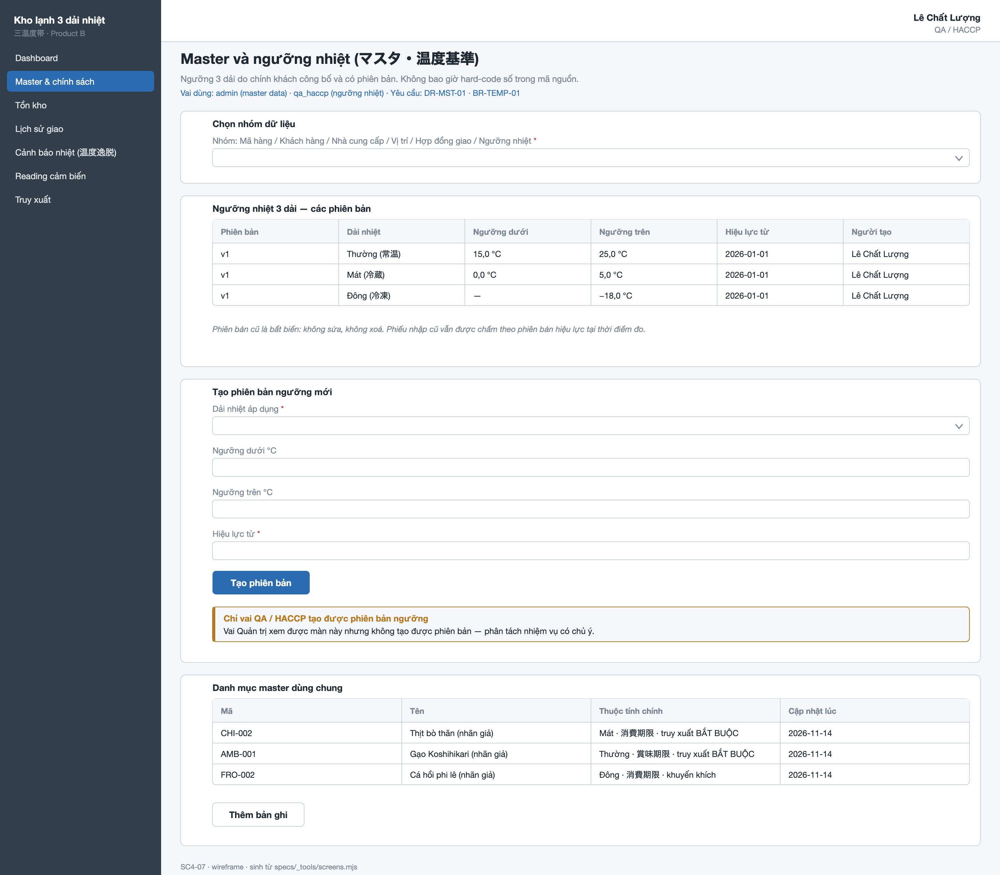
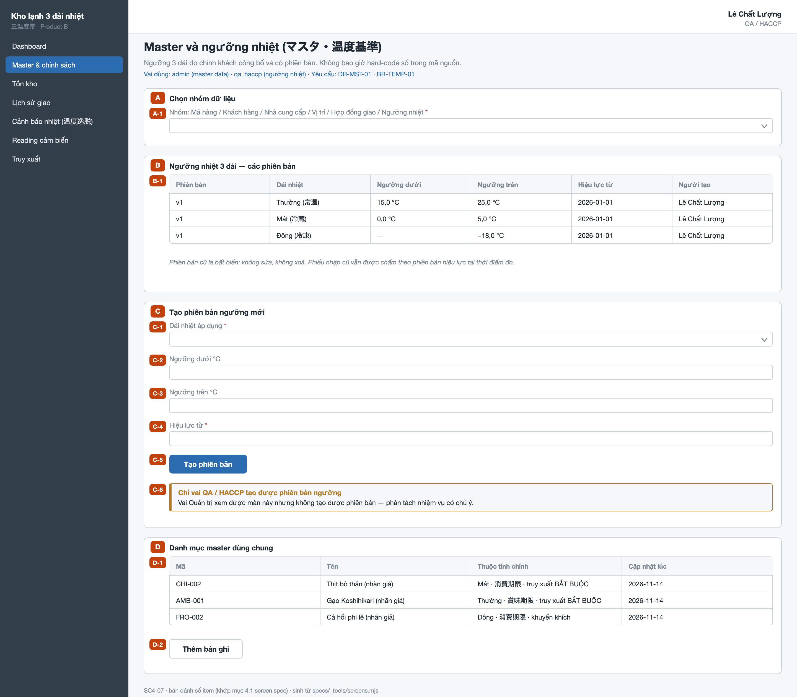

# SC4-07 — Master và ngưỡng nhiệt (マスタ・温度基準)

> Biểu mẫu: **BM-2-901-51 v2.1** — Screen Specification · SUN ASTERISK VIETNAM CO., LTD · ISO/IEC 27001:2013 & ISO 9001:2015

---

## 1. History of change

| No | Version | Action | Nội dung thay đổi | Ngày | Người sửa | Approve |
|---|---|---|---|---|---|---|
| 1 | 0.1.0 | Add New | Khởi tạo | 2026-11-16 | PL | |
| 2 | 0.2.0 | Updated | Sửa theo vòng review chéo: thêm bảng truy vết yêu cầu, sửa mã lỗi gán sai, sửa tên trường API | 2026-11-16 | PL | |

---

## 2. Layout

**Design:** wireframe dựng từ [`specs/_tools/screens.mjs`](../../_tools/screens.mjs) — sửa file đó
rồi chạy `node specs/_tools/render-wireframes.mjs`, đừng sửa tay file ảnh.

Ảnh hiện trạng prototype để đối chiếu: [`../assets/_prototype/SC4-07_current.png`](../assets/_prototype/SC4-07_current.png)

---

## 3. Description

Màn quản trị dữ liệu nền của hệ thống: danh mục dùng chung (mã hàng, khách hàng, nhà cung cấp, vị
trí, hợp đồng giao) và **ngưỡng nhiệt 3 dải**. Phủ `DR-MST-01`, `BR-TEMP-01`.

**Hai vai khác nhau làm hai việc khác nhau trên cùng một màn:**

| Vai | Ghi được | Không ghi được |
|---|---|---|
| `admin` — Quản trị | Danh mục master (section D) | Phiên bản ngưỡng nhiệt (section C) |
| `qa_haccp` — QA / HACCP | Phiên bản ngưỡng nhiệt (section C) | Danh mục master (section D) |

Đây là **phân tách nhiệm vụ có chủ ý**, không phải thiếu quyền: ngưỡng 3 dải là hồ sơ HACCP của
khách, người công bố phải là QA chứ không phải người quản trị hệ thống. Vai Quản trị **xem được**
cả bảng phiên bản ngưỡng — xem để đối chiếu, không tạo.

Điểm phải nắm trước khi làm màn này: **ngưỡng 3 dải do chính khách công bố, không có con số chuẩn
ngành nào để lấy sẵn.** Ngưỡng của Yuki hiện là `常温 15,0–25,0 °C` · `冷蔵 0,0–5,0 °C` ·
`冷凍 ≤ −18,0 °C`; công ty khác công bố khác. Ngưỡng là dữ liệu **có phiên bản**, mỗi lần đổi là
thêm một phiên bản mới, phiên bản cũ bất biến — xem
[`ADR-005`](../../architecture/ADR-005-versioned-temperature-policy.md).

Đi tới: từ menu "Master & chính sách". Hai vai còn lại (`dispatcher`, `warehouse_staff`) bị chặn ở
tầng định tuyến trước khi tới màn.

---

## 3bis. Yêu cầu màn này thực hiện

Mã yêu cầu lấy từ [`docs/01_requirements-extract.md`](../../../docs/01_requirements-extract.md).
Màn này gộp ba dòng của bảng màn ở [`docs/scope.md`](../../../docs/scope.md) mục 3: *quản trị
master data*, *hợp đồng khách–SKU* và phần ngưỡng nhiệt của *cấu hình chính sách theo phiên bản*.

| Mã yêu cầu | Nội dung (trích ngắn) | Màn đáp ứng ở mục nào |
|---|---|---|
| `DR-MST-01` | Dữ liệu master có ngày hiệu lực | 4.3 D-1/D-2 (`SER-17`, `SER-18`), 5 (D-1, D-2). **Một phần** — form thêm / sửa của 5 bảng master chưa đặc tả từng trường, và ba bảng `customers`, `suppliers`, `locations` chưa được định nghĩa ở [`COLDCHAIN_DATABASE.md`](../../database/COLDCHAIN_DATABASE.md) mục 4; vòng đời nháp → chờ duyệt → hiệu lực → `GAP-11` |
| `BR-TEMP-01` | Ngưỡng 3 dải nhiệt quản lý theo phiên bản; giao dịch quá khứ giữ phiên bản dùng lúc đánh giá | 4.2 C-1…C-4, 4.3 B-1/C-5, 5 (C-5, B-1), 6 |
| `BR-DELWIN-01` | Đánh giá cửa sổ giao theo cấu hình hợp đồng của **từng cặp khách–SKU**; không coi cấu hình đó là yêu cầu pháp định | 4.2 (dòng luật `ORD04`), 4.3 D-1 (`delivery_agreements`), 5 (D-1 nhóm Hợp đồng giao — để trống là dữ liệu thật). Lỗ hổng hợp đồng chồng kỳ hiệu lực → `GAP-05` |
| `NFR-SEC-02` | Quyền tối thiểu theo vai; tách người lập và người duyệt | 3 (bảng hai vai), 5 (C-5 khoá với `admin`, D-2 khoá với `qa_haccp`, và hai dòng gọi thẳng API bị 403) |

Bộ quy tắc giờ lái cũng quản lý theo phiên bản như ngưỡng nhiệt, nhưng `FR-SCH-02` **không thuộc
màn này**: A-1 chỉ có 6 nhóm, không có nhóm quy tắc giờ lái — phần đó nằm ở SC4-04, chỉ đọc một
phiên bản đã seed.

---

## 4. View

**Đánh ID:** section là chữ (`A`–`D`), item trong section là số. Tham chiếu dạng `{section}-{số}`.

### 4.1 Danh sách item

Bảng item sinh tự động cùng nguồn với ảnh annotated, nên số callout trên ảnh và ID ở đây không bao
giờ lệch: [`../assets/SC4-07_items.md`](../assets/SC4-07_items.md).

### 4.2 Validation

| ID | Type | Min | Max | Default | Ghi chú |
|---|---|---|---|---|---|
| C-1 | String | — | — | | Dải nhiệt: `AMBIENT` · `CHILLED` · `FROZEN`. Không chọn → `M_01`; giá trị ngoài ba cái này → `M_02` |
| C-2 | Number | −999,9 | 999,9 | *(trống)* | Ngưỡng dưới. **Trống là hợp lệ** = không giới hạn dưới. Tối đa 1 chữ số thập phân (cột `min_c` là `numeric(4,1)`) |
| C-3 | Number | −999,9 | 999,9 | *(trống)* | Ngưỡng trên. **Trống là hợp lệ** = không giới hạn trên (dùng cho 冷凍 chỉ có ngưỡng trên). C-2 lớn hơn C-3 → `M_71` |
| C-2 + C-3 | — | 1 biên | — | | Cả hai cùng trống thì không tạo được phiên bản → `M_01`. Ràng buộc bảng: cần ít nhất một biên |
| C-4 | Date | ngày mai | — | | Hiệu lực từ. Hôm nay hoặc quá khứ → `M_70` (**không có phiên bản hồi tố**). Trùng ngày hiệu lực đã có của cùng dải → `M_02` |

**Không validate ở màn — có chủ ý:** A-1 là danh sách đóng do màn tự dựng; B-1 và D-1 là bảng chỉ
đọc; C-5, C-6, D-2 không nhận nhập liệu. Form thêm / sửa bản ghi master mở từ D-2 kiểm theo đúng
ràng buộc cột của từng bảng trong
[`COLDCHAIN_DATABASE.md`](../../database/COLDCHAIN_DATABASE.md) mục 4, nên không chép lại ở đây.

**Validation ở tầng dữ liệu — không phải ở màn, nhưng màn phải hiển thị được kết quả:**

| Luật | Mã lỗi CSDL | Thông báo trên màn |
|---|---|---|
| Không tạo được phiên bản ngưỡng hồi tố — ngày hiệu lực phải **sau** hôm nay | `TMP01` | `M_70` |
| Ngưỡng dưới không được lớn hơn ngưỡng trên | `TMP02` | `M_71` |
| Phiên bản cũ bất biến: không có đường `update` hay `delete` cho người dùng trên `temp_policies` | — (RLS từ chối) | `M_72` |
| Hợp đồng để trống quy tắc cửa sổ giao là dữ liệu thật, không điền mặc định — đơn theo hợp đồng đó **bắt buộc** ở `business_review` | `ORD04` (hiện ở SC4-03) | — |

Hai mã dễ gán ngược nhau, lấy ranh giới theo
`supabase/migrations/0014_order_created_by_and_read_scoping.sql`: `ORD04` là đơn **có** hợp đồng
nhưng trạng thái không khớp luật (gồm đúng trường hợp hợp đồng chưa chốt quy tắc cửa sổ giao),
còn `ORD06` là đơn **không gắn hợp đồng nào**. Màn này sinh ra dữ liệu của vế thứ nhất.

**Mốc ngày hiệu lực lệch nhau một ngày giữa hai tầng.** Trigger `TMP01`
(`supabase/migrations/0012_policy_and_alarm_integrity.sql`) chặn `effective_from <= current_date`,
tức **chặn cả ngày hôm nay** và sớm nhất là ngày mai — đó là mốc mà mục 4.2 (C-4) và mục 5 của màn
này viết theo. Hàm kiểm ở tầng biên hiện chỉ chặn ngày quá khứ, **cho qua ngày hôm nay**, nên người
dùng điền hôm nay sẽ qua được tầng biên rồi mới bị CSDL từ chối. Chỗ lệch này là `GAP-15` trong
[sổ gap](../../database/gap-list.md); cho tới khi hai tầng dùng chung một mốc, màn vẫn phải chặn
theo mốc chặt hơn của tầng bảng.

### 4.3 Data Mapping

| ID | Data Source | API ID | API URL | Key / Param | Ghi chú |
|---|---|---|---|---|---|
| A-1 | — | — | — | — | Danh sách đóng 6 nhóm, màn tự dựng. Năm nhóm đầu là năm bảng master; nhóm thứ sáu là ngưỡng nhiệt, đi đường API riêng |
| B-1 | CSDL | — | — | `temp_policies` | Đọc bằng phiên người dùng, RLS lọc. Cột hiển thị: `version`, `band`, `min_c`, `max_c`, `effective_from`, `created_by` |
| C-5 | API | `SER-16` | `POST /api/temp-policies` | thân yêu cầu: `band`, `minC`, `maxC`, `effectiveFrom` | **Chỉ bốn trường này.** Số hiệu phiên bản và người tạo do máy chủ cấp — gửi lên cũng bị bỏ qua. Tên trường API là camelCase, khác tên cột CSDL (`min_c`, `max_c`) |
| D-1 | CSDL | — | — | `skus` · `customers` · `suppliers` · `locations` · `delivery_agreements` | Bảng nào tuỳ nhóm đang chọn ở A-1 |
| D-2 | API | `SER-17` | `POST /api/master/{entity}` | `{entity}` thuộc **danh sách trắng 5 bảng**: `skus`, `customers`, `suppliers`, `locations`, `delivery_agreements`. Thân yêu cầu dùng **đúng tên cột CSDL (snake_case)** | Tên bảng có thật nhưng ngoài danh sách trắng cũng bị từ chối |
| D-1 | API | `SER-18` | `PATCH /api/master/{entity}/{id}` | như trên; `{id}` là khoá chính của bảng đó | Khoá chính và cột định danh không sửa được: `skus` → `sku_id`; `delivery_agreements` → `agreement_id`, `customer_id`, `sku_id`, `effective_from` |

Mã API tra ở [`../../_common/api-list.md`](../../_common/api-list.md) — không tự khai API mới ở đây.

---

## 5. Event

| ID | Given (Pre-condition) | When (Trigger/Action) | Then (Result) | Note |
|---|---|---|---|---|
| **Initializing Process（初期処理）** | | | | |
| - | Vai là `admin` hoặc `qa_haccp` | Mở màn hình | 1. Đọc `temp_policies` dựng B-1, xếp theo dải rồi theo số hiệu phiên bản giảm dần 2. Đọc bảng master của nhóm đang chọn dựng D-1 3. Vai `qa_haccp` vào thẳng nhóm Ngưỡng nhiệt | Vai `dispatcher` và `warehouse_staff` bị chặn ở tầng định tuyến, không tới được màn |
| - | Vai là `admin` | Mở màn hình | C-5 khoá, C-6 nói rõ **vì sao** khoá | Xem được B-1 để đối chiếu. Phân tách nhiệm vụ, không phải thiếu quyền |
| - | Vai là `qa_haccp` | Mở màn hình | D-2 khoá, D-1 chỉ đọc | |
| **Standard Process（通常処理）** | | | | |
| A-1 | - | Chọn nhóm dữ liệu | 1. Chọn Ngưỡng nhiệt → hiện B và C 2. Chọn một trong 5 nhóm master → hiện D với bảng tương ứng | |
| B-1 | Có ít nhất một phiên bản | Xem bảng phiên bản | Mỗi dòng hiện **số hiệu phiên bản và ngày hiệu lực kèm con số ngưỡng** — màn không bao giờ in ngưỡng rời khỏi phiên bản. Không có nút sửa, không có nút xoá | `ADR-005`. Dòng 冷凍 có ngưỡng dưới trống — đó là dữ liệu đúng, không phải thiếu |
| C-5 | Vai `qa_haccp`; đã điền C-1, C-4 và ít nhất một trong C-2 / C-3 | Bấm "Tạo phiên bản" | 1. Gọi `SER-16` 2. Máy chủ cấp `version` = số lớn nhất của **cùng dải** + 1, ghi `created_by` từ phiên 3. Thêm dòng mới vào B-1, **các dòng cũ giữ nguyên** 4. Báo đã tạo phiên bản mới, nói rõ phiên bản cũ không đổi | Phiếu nhập cũ vẫn được chấm theo phiên bản hiệu lực tại **thời điểm đo** (`receipt_lines.measured_at`), không chấm lại theo phiên bản mới |
| D-2 | Vai `admin`; A-1 đang ở một trong 5 nhóm master | Bấm "Thêm bản ghi" rồi lưu | Gọi `SER-17`, thêm dòng vào D-1 | Thân yêu cầu dùng tên cột snake_case |
| D-1 | Vai `admin` | Sửa một bản ghi | Gọi `SER-18`. Khoá chính và cột định danh không gửi lên, gửi thì bị từ chối | |
| D-1 | Nhóm đang chọn là Hợp đồng giao | Để trống quy tắc cửa sổ giao khi thêm hoặc sửa | Lưu `delivery_window_rule` = NULL. Hệ thống **không** điền mặc định `ONE_THIRD` hay bất kỳ giá trị nào | Hệ quả ở SC4-03: đơn của cặp khách–SKU đó vào chờ duyệt tay kèm `M_30` |
| **Error Handling（エラー制御）** | | | | |
| C-4 | Ngày hiệu lực là hôm nay hoặc trong quá khứ | Bấm C-5 | 1. Hiện `M_70` 2. Không tạo phiên bản | Tầng bảng chặn bằng `TMP01`, nên gọi thẳng PostgREST cũng không qua |
| C-2, C-3 | Ngưỡng dưới lớn hơn ngưỡng trên | Bấm C-5 | Hiện `M_71`, không tạo phiên bản | Tầng bảng chặn bằng `TMP02` |
| C-2, C-3 | Cả hai biên cùng để trống | Bấm C-5 | Hiện `M_01` — phiên bản phải có ít nhất một biên | Để trống **một** biên là hợp lệ |
| C-4 | Dải đó đã có phiên bản cùng ngày hiệu lực | Bấm C-5 | Hiện `M_02`, không tạo phiên bản | |
| B-1 | Vai bất kỳ | Thử sửa hoặc xoá một phiên bản cũ | Hiện `M_72`, hướng người dùng sang C để tạo phiên bản mới | Không có policy `update` / `delete` trên `temp_policies` — cả màn lẫn API đều không có đường này |
| C-5 | Vai là `admin` | Gọi thẳng `SER-16` bỏ qua giao diện | Máy chủ trả 403, màn hiện `M_04` | `requireRole()` là câu lệnh đầu tiên của route |
| D-2 | Vai là `qa_haccp` | Gọi thẳng `SER-17` / `SER-18` | Máy chủ trả 403, màn hiện `M_04` | |
| D-2 | Tên bảng nằm ngoài danh sách trắng 5 bảng | Gọi `SER-17` / `SER-18` | Máy chủ từ chối, màn hiện `M_02` | Tên bảng có thật trong CSDL cũng bị từ chối nếu không nằm trong danh sách trắng |
| B-1, D-1 | Không đọc được dữ liệu | Mở màn hình | Hiện `M_05`, giữ bảng trống thay vì hiện số cũ | |
| bất kỳ | Phiên hết hạn | Thao tác bất kỳ | Hiện `M_03`, đẩy về màn đăng nhập | |

Mã thông báo tra ở [`../../_common/error-codes.md`](../../_common/error-codes.md) — không tự chế mã mới ở đây.

---

## 6. Other Notes

**Ba cách hiểu sai phải tránh khi làm màn này:**

| Chỗ | Hiểu sai | Đúng phải là |
|---|---|---|
| Ngưỡng 3 dải | Chuẩn ngành, có sẵn con số, lấy mặc định cho xong | **Khách tự công bố** như một phần hồ sơ HACCP. Con số trong B-1 là của Yuki, công ty khác khác hẳn. Không hard-code số nào vào mã nguồn |
| Đổi ngưỡng | Sửa dòng ngưỡng đang dùng | **Thêm phiên bản mới.** Sửa tại chỗ thì hồ sơ HACCP cũ tự đổi kết luận — lỗi nặng nhất có thể mắc với tài liệu kiểm tra an toàn thực phẩm |
| Biên để trống | Thiếu dữ liệu, cần đi điền nốt | **Không giới hạn phía đó.** 冷凍 chỉ có ngưỡng trên `≤ −18,0 °C` là dữ liệu đủ và đúng |

**Giá trị đúng biên là đạt.** Đo được đúng `5,0 °C` ở kho mát thì không sinh cảnh báo — ngưỡng công
bố `0,0–5,0` nghĩa là bao gồm cả hai đầu.

**Chọn phiên bản theo thời điểm ĐO, không theo thời điểm bấm xác nhận.** Đây là lý do
`receipt_lines.measured_at` tồn tại tách khỏi `created_at`. Bỏ cột đó là sụp cả cơ chế ở `ADR-005`.

**Ba chỗ prototype làm khác thiết kế, liên quan trực tiếp tới màn này:**

| Mã | Nội dung | Vì sao đáng kể với màn này |
|---|---|---|
| `GAP-04` | Thời điểm đo nhiệt (`receipt_lines.measured_at`) do người dùng tự đặt và sửa được khi dòng còn nháp | Lùi thời điểm đo về trước ngày siết ngưỡng thì được chấm theo phiên bản cũ lỏng hơn. **Chưa khai thác được** vì CSDL mới có phiên bản 1 cho cả ba dải, nhưng là lỗ hổng **cấu trúc** — mở ra ngay khi màn này tạo ra phiên bản 2 |
| `GAP-05` | Hợp đồng giao chỉ duy nhất trên `(customer_id, sku_id, effective_from)` | Chưa chặn hai hợp đồng cùng cặp khách–SKU chồng kỳ hiệu lực. Tạo từ chính section D của màn này: một hợp đồng có quy tắc cửa sổ giao, một hợp đồng để trống → chọn cái không trống là **đi vòng qua bẫy ③** |
| `GAP-11` | Prototype bỏ vòng đời duyệt master data (nháp → chờ duyệt → hiệu lực) | Thêm sửa là có hiệu lực ngay. Nhưng **ngày hiệu lực của ngưỡng nhiệt và của hợp đồng vẫn giữ**, nên phần lõi của bẫy ① và bẫy ③ không mất |

Chi tiết ba gap ở [`../../database/gap-list.md`](../../database/gap-list.md).

**Điểm CẦN XÁC NHẬN với khách — ảnh hưởng trực tiếp tới màn này:**

| # | Điểm | Giả định đang dùng |
|---|---|---|
| 5 | Ngưỡng số ngày cảnh báo trước hạn 賞味期限 | Không đặt số. Cột `best_before_warning_days` trên mã hàng **để trống**, màn chỉ hiện số ngày còn lại. Đây là một ô nhập trên form thêm / sửa mã hàng ở section D — khách cho số thì điền, **không tự đoán** |
| 16 | Thời điểm đo nhiệt lấy mốc nào để chọn phiên bản ngưỡng | Theo thời điểm ĐO ghi trên phiếu, không theo lúc bấm xác nhận |
| 15 | SLA xác nhận cảnh báo nhiệt | Prototype để hằng số trong mã nguồn. Bản thật **nên chuyển thành cấu hình có phiên bản như ngưỡng nhiệt**, tức là thêm một nhóm nữa vào A-1 |

Danh mục đầy đủ 16 điểm ở `docs/scope.md` mục 6.

**Hai người cùng tạo phiên bản cho một dải thì người sau phải trượt có thông báo.** Ràng buộc duy
nhất `(band, version)` để người sau nhận HTTP 409; màn báo "có người vừa tạo phiên bản, tải lại rồi
thử lại" rồi nạp lại B-1, **không ghi đè phiên bản của người kia**. Câu thông báo này phải là một
mã trong [`error-codes.md`](../../_common/error-codes.md) — màn không tự chế mã, và cũng không mượn
`M_02` vì giá trị người dùng nhập vào không hề sai.
