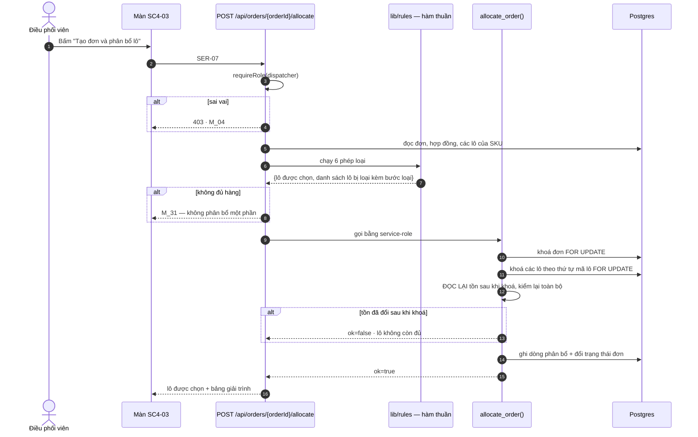

# DD-OUT-001 — Phân bổ lô cho đơn xuất

> Biểu mẫu: **BM-2-901-53 v01** — Detail Design (Chart + Description) · SUN ASTERISK VIETNAM CO., LTD · ISO/IEC 27001:2013 & ISO 9001:2015

---

## 1. History of change

| No | Version | Action | Mục / Bước | Nội dung thay đổi | Ngày | Người sửa | Approve |
|---|---|---|---|---|---|---|---|
| 1 | 0.1.0 | Add new | — | Khởi tạo | 2026-11-16 | PL | |

---

## 2. Sequence diagram



**Hai chi tiết trong sơ đồ không được bỏ:**

- **Khoá lô theo thứ tự mã lô.** Hai đơn cùng tranh hai lô mà khoá theo thứ tự khác nhau thì kẹt
  lẫn nhau. Sắp cùng một thứ tự là cách rẻ nhất để không bao giờ kẹt.
- **Đọc lại sau khi khoá.** Các phép loại chạy trên ảnh chụp dữ liệu *trước* khi khoá. Giữa lúc đọc
  và lúc khoá, một đơn khác có thể đã lấy mất lô. Không đọc lại là bán vượt tồn.

---

## 3. Description

Nhận một đơn xuất đã tạo, chọn (các) lô để giao, và trả về **cả lý do loại từng lô không được chọn**.

Phần trả về lý do không phải để cho đẹp: FEFO là bước cuối trong sáu bước, nên hệ thống thường
xuyên bỏ qua lô hạn sớm nhất. Không giải thích thì người dùng kết luận hệ thống sai.

**Nguyên tắc: phân bổ toàn phần hoặc không.** Thiếu hàng thì báo thiếu, đơn giữ nguyên trạng thái,
không phân bổ một phần.

---

## 4. Detail function

### 4.1. Sáu phép loại — thứ tự cố định

| Thứ tự | Bước | Loại lô khi | Mã thông báo |
|---|---|---|---|
| 1 | **Hạn an toàn** | Mã hàng dùng 消費期限 **và** hạn đã chạm mốc an toàn | `M_20` |
| 2 | **Dải nhiệt** | Dải nhiệt của lô không khớp dải nhiệt của mã hàng | — |
| 3 | **Cách ly** | Trạng thái lô không phải khả dụng | — |
| 4 | **Cửa sổ giao** | Quá mốc theo quy tắc của hợp đồng | `M_33` |
| 5 | **日付逆転** | Hạn sớm hơn hạn đã giao gần nhất cho **đúng cặp khách–SKU** | `M_32` |
| 6 | **FEFO** | — chọn hạn sớm nhất trong số còn lại | — |

| No | Nội dung xử lý |
|---|---|
| 1 | Đọc mã hàng để biết dải nhiệt, loại hạn và diện truy xuất |
| 2 | Đọc hợp đồng của cặp khách–mã hàng còn hiệu lực tại ngày giao yêu cầu |
| 3 | Hợp đồng không có, hoặc có mà quy tắc cửa sổ giao để trống → **dừng tại đây**, đơn vào trạng thái chờ duyệt tay, trả `M_30`. **Không suy ra quy tắc mặc định** |
| 4 | Đọc toàn bộ lô của mã hàng đó, chạy lần lượt sáu phép loại ở trên |
| 5 | Mỗi lô bị loại ghi lại **bước loại** và **dữ liệu để dựng câu giải thích** (hạn của lô, hạn đã giao trước, mốc cửa sổ giao) |
| 6 | Cộng dồn số lượng các lô còn lại. Không đủ → trả `M_31` kèm số thiếu, **không phân bổ một phần** |
| 7 | Đủ → chọn theo FEFO cho tới khi đủ số lượng |

### 4.2. Bước 4 — cửa sổ giao theo hợp đồng

| Giá trị quy tắc | Phép kiểm |
|---|---|
| `ONE_THIRD` | `ngày giao yêu cầu ≤ ngày sản xuất + floor((hạn − ngày sản xuất) × 1/3)` |
| `ONE_HALF` | như trên với tỷ lệ 1/2 |
| `LABEL_DATE_ONLY` | `hạn ≥ ngày giao yêu cầu` — chỉ so nhãn, không áp tập quán |
| *(để trống)* | Không chạy bước này; đơn đã vào chờ duyệt tay ở mục 4.1 bước 3 |

| No | Nội dung xử lý |
|---|---|
| 1 | Mốc tính là **ngày sản xuất của lô**, không phải ngày hôm nay. Cùng một lô phải cho ra cùng kết quả bất kể hôm nay là ngày nào |
| 2 | Làm tròn **xuống** theo ngày (`floor`) |
| 3 | Lưu lại bằng chứng: số ngày tuổi thọ, mốc hạn giao tính ra, và ngày phán định |

**Đây là điểm CHẶN BÁO GIÁ.** Ba thứ chưa được khách xác nhận: mốc bắt đầu tính, thời điểm phán
định, và cách làm tròn. Sai công thức là sai toàn bộ màn.

### 4.3. Bước 5 — 日付逆転

| No | Nội dung xử lý |
|---|---|
| 1 | Đọc bảng `shipment_history`, lọc đúng **cả hai** điều kiện `customer_id` và `sku_id` của đơn này |
| 2 | Sắp theo `completed_at` **giảm dần**, cùng mốc thì `expiry_date` **tăng dần**, lấy dòng đầu — tức lần giao gần nhất, và trong lần đó là **hạn nhỏ nhất**. Hai vế đều bắt buộc: bỏ vế sau thì một chuyến giao nhiều lô sẽ lấy phải lô ghi sau cùng chứ không phải lô hạn ngắn nhất, và tầng bảng sẽ chặn đúng thứ mà tầng phân bổ vừa cho qua |
| 3 | Chưa có dòng nào → khách này chưa từng nhận mã hàng này → **bước này bỏ qua**, không loại lô nào |
| 4 | Có → so `expiry_date` của lô với `expiry_date` của dòng đó. **Sớm hơn thì loại**; **bằng nhau thì cho qua** |
| 5 | Lô bị loại ghi lại cả hạn của lô và hạn đã giao trước, để màn dựng được `M_32` |

**Ba cách hiểu sai phải tránh:**

| Hiểu sai | Hậu quả |
|---|---|
| So với **ngày hôm nay** | Chặn nhầm hàng còn tốt, bỏ lọt đúng trường hợp cần chặn |
| So với lần giao gần nhất của **bất kỳ khách nào** | Khách A bị chặn vì lịch sử của khách B |
| So với lần giao gần nhất của **bất kỳ mã hàng nào** cho khách đó | Gạo bị chặn vì lịch sử giao thịt bò |

**Phép kiểm này chạy hai lần, ở hai thời điểm:** tại đây (lúc phân bổ, để loại lô và giải thích),
và một lần nữa ở **trigger tầng bảng** lúc xác nhận giao (mã lỗi `SHP01`). Chỉ kiểm tại đây là chưa
đủ — hai đơn cùng cặp khách–SKU phân bổ xong trước khi đơn nào kịp giao thì cả hai đều qua. Xem
[ADR-003](../../architecture/ADR-003-date-reversal-at-table-level.md).

### 4.4. Chống đua khi hai người cùng phân bổ

| No | Nội dung xử lý |
|---|---|
| 1 | Toàn bộ thao tác ghi nằm trong **một giao dịch** của hàm RPC chạy bằng service-role |
| 2 | Khoá dòng đơn trước, rồi khoá các lô **theo thứ tự mã lô** — cùng một thứ tự ở mọi lời gọi, nên không kẹt lẫn nhau |
| 3 | **Đọc lại tồn sau khi khoá** và chạy lại phép kiểm số lượng. Các phép loại ở mục 4.1 chạy trên ảnh chụp trước khi khoá |
| 4 | Tồn đã đổi → huỷ giao dịch, trả về không phân bổ được. Không ghi một phần |
| 5 | Chặn lô trùng trong cùng một đơn |

Kiểm chứng: `npm run verify:allocation-race` — bắn song song nhiều lời gọi cho cùng một lô, xác nhận
tổng đã phân bổ đúng bằng tồn thật, không bán vượt.

---

## 5. Other Notes

**Thứ tự sáu bước là một phần của đặc tả, không phải chi tiết cài đặt.** Đổi thứ tự là đổi kết quả.
Ví dụ FEFO chạy trước bước 5 thì hệ thống chọn lô hạn sớm nhất rồi mới phát hiện nó vi phạm đảo
ngày — người dùng không hiểu vì sao đơn bị từ chối.

**Luật nghiệp vụ nằm trong hàm thuần** (`lib/rules/lot-allocation-pipeline.ts` và các hàm nó gọi):
nhận dữ liệu vào, trả quyết định ra, không chạm CSDL và không chạm mạng. Nhờ vậy đổi công thức cửa
sổ giao hay đổi cách so đảo ngày chỉ phải sửa một hàm và các bài kiểm của nó.

**Điểm CẦN XÁC NHẬN với khách:**

| # | Điểm | Giả định đang dùng |
|---|---|---|
| 1 | Công thức 1/3 – 1/2 | `ngày sản xuất + floor((hạn − ngày sản xuất) × tỷ lệ)`. **CHẶN BÁO GIÁ** |
| 3 | Hạn **bằng** lần giao trước | Cho phép; chỉ chặn khi sớm hơn |
| *(ngoài 16 điểm)* | Chuyến trước giao nhiều hạn khác nhau thì lấy hạn nào làm mốc | Lấy hạn **nhỏ nhất** của chuyến gần nhất — đã viết thành luật sắp xếp ở mục 4.3 bước 2, khớp với trigger `0011` (`order by completed_at desc, expiry_date asc limit 1`). **Còn một điều kiện chưa được bảo đảm:** luật này chỉ đúng khi mọi lô của *cùng một lần giao* mang **cùng một `completed_at`**; nếu mỗi dòng lô ghi một mốc lệch nhau vài giây thì vế sắp theo hạn không bao giờ chạy. **Câu hỏi này chưa nằm trong 16 điểm CẦN XÁC NHẬN của `scope.md`** — phải bổ sung vào danh sách hỏi khách |
| 11 | Phân bổ một phần khi thiếu hàng | Không phân bổ một phần |

**Kiểm chứng logic này:**

```bash
npm run verify:allocation        # 78 phép, kịch bản S1–S7 trên CSDL thật
npm run verify:allocation-race   # 12 phép, hai người cùng phân bổ một lô
npm run verify:delivery-reversal # 7 phép, chặn đảo ngày lúc giao
npm run verify:delivery-race     # 2 phép, hai đơn cùng cặp giao đồng thời
```
