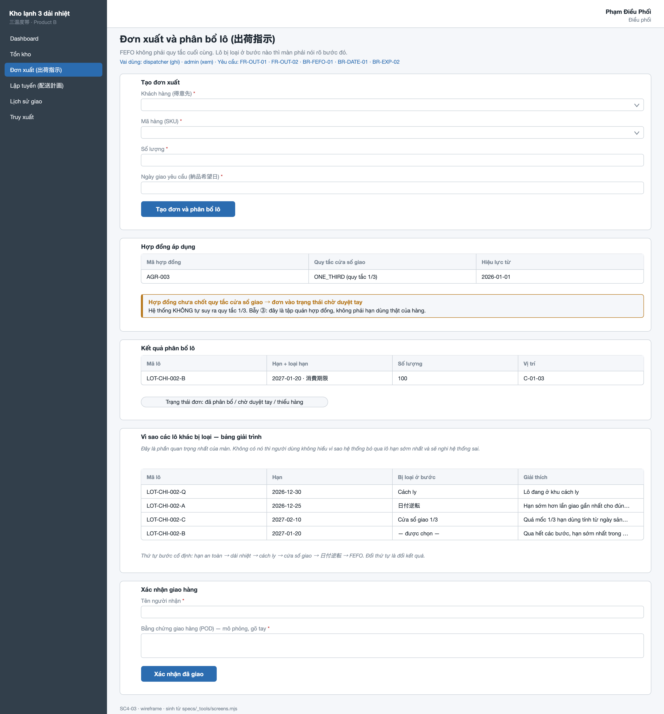
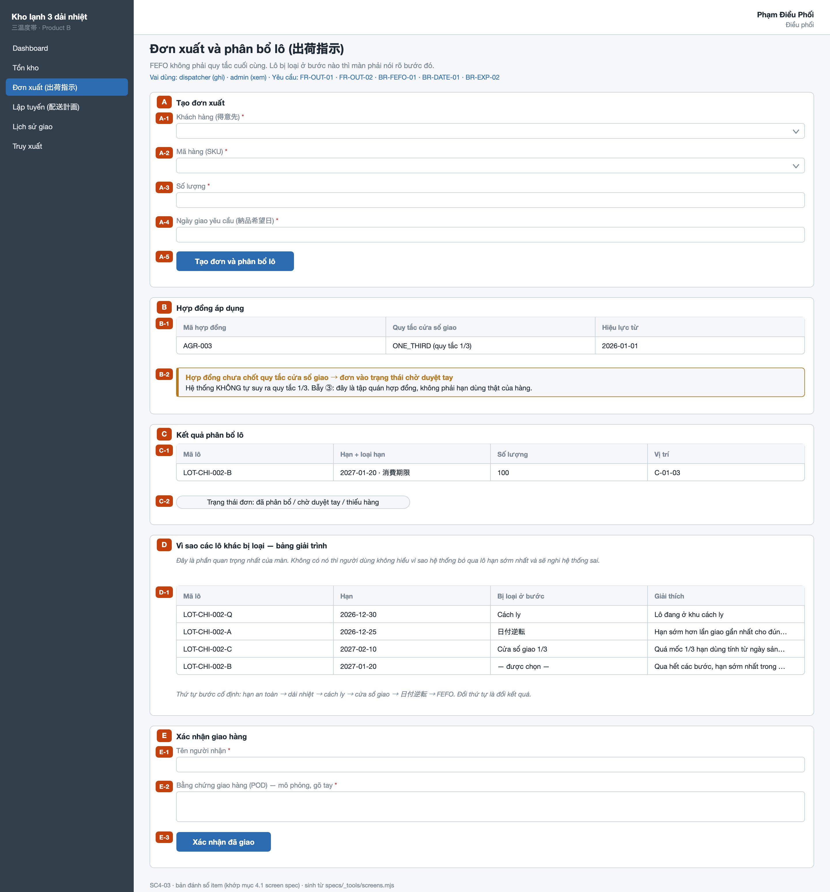

# SC4-03 — Đơn xuất và phân bổ lô (出荷指示)

> Biểu mẫu: **BM-2-901-51 v2.1** — Screen Specification · SUN ASTERISK VIETNAM CO., LTD · ISO/IEC 27001:2013 & ISO 9001:2015

---

## 1. History of change

| No | Version | Action | Nội dung thay đổi | Ngày | Người sửa | Approve |
|---|---|---|---|---|---|---|
| 1 | 0.1.0 | Add New | Khởi tạo | 2026-11-16 | PL | |
| 2 | 0.2.0 | Modify | Sửa theo review LAB-4: mã lỗi cửa sổ giao `ORD06` → `ORD04` và tách đủ sáu mã `ORD` (B2); thêm máy trạng thái đơn và hai đường ra còn thiếu (B6); thêm mục 3bis bảng truy vết yêu cầu (B1); bổ sung chế độ chỉ xem cho vai quản trị (C4) | 2026-11-16 | PL | |

---

## 2. Layout

**Design:** wireframe dựng từ [`specs/_tools/screens.mjs`](../../_tools/screens.mjs) — sửa file đó
rồi chạy `node specs/_tools/render-wireframes.mjs`, đừng sửa tay file ảnh.





Ảnh hiện trạng prototype để đối chiếu: [`../assets/_prototype/SC4-03_current.png`](../assets/_prototype/SC4-03_current.png)

---

## 3. Description

Màn để **điều phối viên** tạo đơn xuất cho một khách và một mã hàng, rồi xem hệ thống phân bổ lô.

Đây là màn mang nhiều bẫy nghiệp vụ nhất của cả hệ thống. Điểm phải nắm: **FEFO không phải quy tắc
đầu tiên, cũng không phải quy tắc duy nhất.** Nó là bước cuối, chạy trên phần còn lại sau năm phép
loại trước đó. Vì vậy màn bắt buộc phải có **bảng giải trình** (section D) nói rõ lô nào bị loại ở
bước nào — không có nó thì người dùng thấy hệ thống bỏ qua lô hạn sớm nhất và sẽ nghi hệ thống sai.

Đi tới: từ Dashboard và từ menu. Đi ra: màn Lập tuyến (SC4-04) để gắn đơn đã phân bổ vào tuyến.

---

## 3bis. Yêu cầu màn này thực hiện

Mã lấy từ [`docs/01_requirements-extract.md`](../../../docs/01_requirements-extract.md) — không mã nào
ở đây được tự đặt. Cột cuối trỏ tới đúng mục của spec này, để LAB-5 bẻ task mà không phải đoán.

| Mã yêu cầu | Nội dung (trích ngắn) | Màn đáp ứng ở mục nào |
|---|---|---|
| `FR-OUT-01` | Tạo dòng đơn: khách, SKU, số lượng, ngày yêu cầu, điều kiện giao, tham chiếu; xử lý được lỗi master chưa định nghĩa và **trùng tham chiếu** | 4.2 (A-1…A-4), 4.3 (A-5), 5 Standard. **Một phần:** `reference` là trường bắt buộc của `SER-06` và trùng thì trả `409`, nhưng 4.2 chưa có dòng validation nào cho nó |
| `FR-OUT-02` | Allocation **nguyên tử** theo hạn, an toàn, cửa sổ khách, 日付逆転禁止, FEFO; request song song không over-allocate cùng lô | 4.3 (C-1, C-2, D-1), 5 (A-5 và D-1), 6 (thứ tự sáu phép loại) |
| `FR-OUT-06` | Xác nhận giao có POD theo điều kiện: thời điểm, vị trí, người nhận, chữ ký/ảnh, mã ngoại lệ; hàng đợi offline | 4.2 (E-1, E-2), 4.3 (E-3), 5 (E-3). **Một phần:** POD là mô phỏng gõ tay — chưa có chữ ký/ảnh, chưa có hàng đợi offline (`NFR-AVL-02`); dữ liệu nằm chung bảng đơn → `GAP-06` |
| `BR-FEFO-01` | Chọn lô hạn sớm nhất; cùng hạn theo thứ tự giờ nhập (FIFO); lô cách ly không đủ điều kiện dù hạn sớm | 6 (bước cuối của chuỗi loại), 4.3 (D-1) |
| `BR-DATE-01` | 日付逆転禁止: so hạn đề xuất với lần giao đã chấp nhận gần nhất của **đúng cặp khách–SKU** | 4.2 (`SHP01`), 5 (E-3 và Error Handling), 6 (bảng ba cách hiểu sai) |
| `BR-DELWIN-01` | Đánh giá cửa sổ giao theo cấu hình hợp đồng từng cặp khách–SKU; không coi cấu hình là yêu cầu pháp định | 4.2 (`ORD04`), 4.3 (B-1, B-2), 5 (A-1/A-2), 6 (bảng ba cách hiểu sai). Rủi ro còn mở: hai hợp đồng cùng cặp cùng hiệu lực → `GAP-05` |
| `BR-EXP-02` | Lô chạm/quá 消費期限: chặn cả allocation lẫn giao, **ghi exception event bất biến** — không ngoại lệ | 5 (A-5 → `M_20`), 6 (bước đầu của chuỗi loại). **Một phần:** vế "ghi exception event bất biến" chưa màn nào làm và **chưa có dòng nào trong sổ gap** — phải chốt trước khi bẻ task |
| `BR-POD-01` | Phân nhánh xác nhận giao theo điều kiện 車上渡し / 軒先渡し; thiếu bằng chứng bắt buộc theo điều kiện đã cấu hình thì không hoàn tất được | **Chưa làm.** 4.2 chỉ có một luật bằng chứng duy nhất (E-2 cần ≥ 1 mục), không phân nhánh theo `delivery_term` của đơn. Chưa có dòng nào trong sổ gap |

Ba dòng "Một phần" và một dòng "Chưa làm" ở trên là việc LAB-5 phải bẻ task, không phải chỗ để im lặng.

---

## 4. View

**Đánh ID:** section là chữ (`A`–`E`), item trong section là số. Tham chiếu dạng `{section}-{số}`.

### 4.1 Danh sách item

Bảng item sinh tự động cùng nguồn với ảnh annotated, nên số callout trên ảnh và ID ở đây không bao
giờ lệch: [`../assets/SC4-03_items.md`](../assets/SC4-03_items.md).

### 4.2 Validation

| ID | Type | Min | Max | Default | Ghi chú |
|---|---|---|---|---|---|
| A-1 | String | — | — | | Phải là khách có thật trong master. Không có → `M_02` |
| A-2 | String | — | — | | Phải là mã hàng có thật. Không có → `M_02` |
| A-3 | Number | > 0 | — | | Không nhập hoặc ≤ 0 → `M_01` / `M_02`. Lớn hơn tồn khả dụng → `M_31`, **không phân bổ một phần** |
| A-4 | Date | hôm nay | — | | Ngày giao yêu cầu. Quá khứ → `M_02`. *(Prototype hiện chưa chặn ngày quá khứ → `GAP-19`)* |
| E-1 | String | 1 | 200 | | Tên người nhận. Trống → `M_01` |
| E-2 | String | 1 phần tử | — | | Cần ít nhất một mục bằng chứng → `M_34` |

**Validation ở tầng dữ liệu — không phải ở màn, nhưng màn phải hiển thị được kết quả:**

| Luật | Mã lỗi CSDL | Thông báo trên màn |
|---|---|---|
| Hợp đồng ghi trên đơn **không tồn tại** | `ORD01` | `M_02` |
| Hợp đồng **không thuộc đúng cặp** khách–mã hàng của đơn | `ORD02` | `M_02` |
| Hợp đồng **không còn hiệu lực** tại ngày giao yêu cầu | `ORD03` | `M_02` |
| Đơn **có** hợp đồng nhưng hợp đồng chưa chốt quy tắc cửa sổ giao → trạng thái bắt buộc là `business_review` (chờ duyệt tay) | `ORD04` | `M_30` |
| **Điều khoản giao** của đơn khác điều khoản ghi trong hợp đồng | `ORD05` | `M_02` |
| Đơn **không gắn hợp đồng nào** → bắt buộc ở `business_review` | `ORD06` | `M_02` |
| Khi xác nhận giao: hạn không được sớm hơn lần giao gần nhất của đúng cặp khách–SKU | `SHP01` | `M_34b` |

**`ORD04` và `ORD06` là hai tình huống khác hẳn nhau, đừng đổi chỗ:**

| | `ORD04` | `ORD06` |
|---|---|---|
| Đơn có hợp đồng không | **Có** | **Không** |
| Vì sao chặn | `delivery_window_rule` của hợp đồng để trống, mà trạng thái đơn lại không phải `business_review` | Đơn không gắn hợp đồng nào mà trạng thái lại không phải `business_review` |
| Màn này gặp không | **Có** — đây là bẫy ③, thấy ở B-2 và `M_30` | **Không** — xem dưới |

**Hai mã là lớp chặn cuối, không phải thông báo người dùng gặp trên màn:**

- `ORD06`: màn **không tạo được đơn không hợp đồng.** `SER-06` tra hợp đồng hiệu lực tại **ngày giao
  yêu cầu** (không phải hôm nay); không thấy thì trả `422` và không ghi gì, nên đường ghi của màn
  không bao giờ chạm tới `ORD06`. Mã này giữ cho các đường ghi khác (gọi thẳng vào CSDL) không lách
  được bẫy ③.
- `ORD05`: màn **không có ô nhập điều khoản giao.** `SER-06` lấy thẳng `delivery_term` từ hợp đồng,
  nên mã này cũng chỉ chặn đường ghi ngoài màn.

Cả hai vẫn phải nằm trong spec: QA dựng kịch bản ghi thẳng vào CSDL thì phải biết mã nào đúng.

### 4.3 Data Mapping

| ID | Data Source | API ID | API URL | Key / Param | Ghi chú |
|---|---|---|---|---|---|
| A-1 | CSDL | — | — | `customers` | Đọc bằng phiên người dùng, RLS lọc |
| A-2 | CSDL | — | — | `skus` | |
| A-5 | API | `SER-06` → `SER-07` | `POST /api/orders` rồi `POST /api/orders/{orderId}/allocate` | thân yêu cầu: `reference`, `customerId`, `skuId`, `qty`, `requestedDate` | Hai lời gọi: tạo đơn rồi phân bổ. Tên trường là camelCase, khác tên cột CSDL |
| B-1 | CSDL | — | — | `delivery_agreements` | Khoá theo `(customer_id, sku_id)` và ngày hiệu lực |
| B-2 | Suy ra | — | — | `delivery_agreements.delivery_window_rule` | Trống → hiện `M_30` |
| C-1 | API | `SER-07` | `POST /api/orders/{orderId}/allocate` | `picks[]` | Lô được chọn |
| C-2 | API | `SER-07` | như trên | `status` | Máy chủ suy ra, client không gửi lên |
| D-1 | API | `SER-07` | như trên | `rejections[]` | **Mỗi phần tử mang mã bước loại và dữ liệu để dựng câu giải thích** |
| E-3 | API | `SER-08` | `POST /api/orders/{orderId}/deliver` | thân yêu cầu: `recipientName`, `evidence[]` | |

Mã API tra ở [`../../_common/api-list.md`](../../_common/api-list.md) — không tự khai API mới ở đây.

---

## 5. Event

| ID | Given (Pre-condition) | When (Trigger/Action) | Then (Result) | Note |
|---|---|---|---|---|
| **Initializing Process（初期処理）** | | | | |
| - | Vai là điều phối | Mở màn hình | 1. Nạp danh sách khách và mã hàng<br/>2. Bảng section B, C, D để trống | Vai đầy đủ: đọc và ghi |
| - | Vai là **quản trị** | Mở màn hình | 1. Màn mở ở **chế độ chỉ xem**: A-1…A-4, E-1, E-2 hiển thị ở trạng thái vô hiệu hoá, nút A-5 và E-3 vô hiệu hoá<br/>2. Bảng B, C, D vẫn đọc được bình thường | Route `/orders` cho **cả** điều phối và quản trị vào. Hai vai còn lại (kho, QA) bị proxy chặn trước khi tới màn |
| **Standard Process（通常処理）** | | | | |
| A-1, A-2 | - | Chọn đủ khách và mã hàng | 1. Nạp hợp đồng của đúng cặp đó vào B-1<br/>2. Hợp đồng không có quy tắc cửa sổ giao → hiện `M_30` ở B-2 | Không tự suy ra quy tắc 1/3 |
| A-5 | Đã điền đủ A-1…A-4 | Bấm "Tạo đơn và phân bổ lô" | 1. Gọi `SER-06` tạo đơn<br/>2. Gọi `SER-07` phân bổ<br/>3. Điền C-1, C-2 và **D-1**<br/>4. Hợp đồng chưa chốt quy tắc → đơn vào chờ duyệt tay, C-1 để trống | |
| D-1 | Đã phân bổ xong | Xem bảng giải trình | Mỗi lô bị loại hiện **tên bước loại** và câu giải thích dựng từ dữ liệu thật: `M_32` cho bước đảo ngày, `M_33` cho bước cửa sổ giao | **Mục quan trọng nhất của màn** |
| E-3 | Đơn đang ở trạng thái đã phân bổ | Bấm "Xác nhận đã giao" | 1. Gọi `SER-08`<br/>2. Ghi vào lịch sử giao<br/>3. Đơn chuyển trạng thái đã giao | Luật đảo ngày **kiểm lại** ở tầng bảng tại đây |
| **Error Handling（エラー制御）** | | | | |
| A-3 | Tồn khả dụng ít hơn số lượng yêu cầu | Bấm A-5 | 1. Hiện `M_31` kèm số còn thiếu<br/>2. Đơn **giữ nguyên**, không phân bổ một phần | |
| A-5 | Mọi lô đều bị loại ở bước hạn an toàn | Bấm A-5 | Hiện `M_20`, D-1 liệt kê đủ lý do từng lô | |
| E-3 | Hạn lô định giao sớm hơn hạn đã giao gần nhất cho đúng cặp khách–SKU | Bấm E-3 | 1. CSDL ném `SHP01`, giao dịch bị huỷ<br/>2. Màn hiện `M_34b` kèm **hạn của lần giao trước** để người dùng đối chiếu | Xảy ra cả khi hai đơn cùng cặp được giao đồng thời |
| bất kỳ | Vai **quản trị**, hoặc vai bất kỳ không phải điều phối | Thao tác ghi bất kỳ (A-5, E-3) | Hiện `M_04`, không ghi gì | Quản trị **xem** được, không có đường tạo đơn hay xác nhận giao. `SER-06`, `SER-07`, `SER-08` đều chỉ nhận vai điều phối; RLS trên bảng đơn là lớp chặn cuối |
| bất kỳ | Phiên hết hạn | Thao tác bất kỳ | Hiện `M_03`, đẩy về màn đăng nhập | |

Mã thông báo tra ở [`../../_common/error-codes.md`](../../_common/error-codes.md) — không tự chế mã mới ở đây.

---

## 6bis. Trường do máy sinh — luật sinh

| Trường | Luật sinh |
|---|---|
| Mã đơn | `ORD-YYYYMMDD-XXXXXX`. Phần ngày theo **JST** để mã khớp ngày làm việc của kho; sáu ký tự cuối sinh ngẫu nhiên, viết hoa. Mã đoán được nhưng không sao: quyền ở đây theo **vai**, biết mã đơn không thêm quyền gì |
| `status` | Máy chủ suy ra từ dữ liệu, xem máy trạng thái ở mục 6.1. Client gửi lên bị bỏ qua |
| `delivery_term` | Chép từ hợp đồng áp dụng, **không** nhận từ client (`ORD05` chặn ở tầng bảng nếu lệch) |
| `qty_accepted` *(thiết kế)* | `qty_reported − qty_rejected − qty_held`. **Prototype hiện nhận từ client** → `GAP-20` |

---

## 6. Other Notes

### 6.1 Máy trạng thái đơn

Enum `order_status` có **đúng 5 giá trị**: `created`, `business_review`, `allocated`, `delivered`,
`cancelled`. Trạng thái **luôn do máy chủ đặt** — không đường ghi nào của client đặt được trực tiếp.

| Từ trạng thái | Sang trạng thái | Ai làm | Qua API nào | Điều kiện |
|---|---|---|---|---|
| — (chưa có đơn) | `created` | Điều phối | `SER-06` | Có hợp đồng đúng cặp khách–SKU, còn hiệu lực tại **ngày giao yêu cầu**, và đã chốt quy tắc cửa sổ giao |
| — (chưa có đơn) | `business_review` | Điều phối | `SER-06` | Có hợp đồng nhưng quy tắc cửa sổ giao để trống → máy chủ **ép** trạng thái này. Không đoán tỷ lệ 1/3 (bẫy ③, mã `ORD04`) |
| `created` | `allocated` | Điều phối | `SER-07` | Chạy đủ sáu phép loại và chọn đủ số lượng yêu cầu |
| `created` | `created` (giữ nguyên) | Điều phối | `SER-07` | Không chọn được lô nào — thiếu hàng hoặc mọi lô bị loại. Đơn **không đổi trạng thái**, màn hiện `M_31` hoặc `M_20` |
| `allocated` | `delivered` | Điều phối | `SER-08` | Kiểm lại 日付逆転 ở tầng bảng. Vi phạm thì `SHP01` huỷ cả giao dịch, đơn giữ nguyên `allocated` |
| `business_review` | `created` / `allocated` | **chưa chốt** | **chưa có API** | **CHƯA LÀM** — xem 6.2 |
| `created` / `business_review` / `allocated` | `cancelled` | **chưa chốt** | **chưa có API** | **CHƯA LÀM** — xem 6.2 |

Hai chặn phụ phải nói rõ vì chúng quyết định thứ tự thao tác:

- `SER-07` **chỉ nhận đơn ở `created`.** Đơn ở trạng thái khác bị từ chối với mã `ORDER_NOT_ALLOCATABLE`.
- `SER-08` **chỉ nhận đơn ở `allocated`.** Trạng thái khác bị từ chối với mã `ORDER_NOT_DELIVERABLE`.
- Gắn đơn vào tuyến ở SC4-04 cũng chỉ nhận đơn ở `allocated`.

Bảng item 4.1 (sinh tự động) mới liệt kê ba nhãn trạng thái — `cancelled` chưa có nhãn ở đó vì chưa
có đường ghi nào đặt được. Khi làm luồng huỷ, sửa dòng SC4-03 trong `specs/_tools/screens.mjs` rồi
chạy lại lệnh render, đừng sửa tay bảng item.

### 6.2 Hai đường ra còn thiếu — đánh dấu cho LAB-5

| Chuyển trạng thái | Vì sao hiện tại là ngõ cụt | Cần gì để làm được |
|---|---|---|
| `business_review` → đi tiếp | Đơn vào được nhưng **không ra được bằng bất cứ đường nào trong hệ**: `SER-07` từ chối mọi đơn không ở `created`; không có API nào đổi trạng thái đơn ngoài hai RPC phân bổ và giao hàng; và không vai nào có quyền sửa trực tiếp bảng đơn | ① Một **màn duyệt đơn chờ** (chưa có trong danh sách màn) — người duyệt phải khác người lập đơn theo `NFR-SEC-02`; ② một **API duyệt mới**, hiện chưa có trong danh mục API; ③ chốt với khách: ai duyệt, duyệt xong thì quy tắc cửa sổ giao lấy ở đâu — **chưa có trong RFP → cần hỏi khách** |
| bất kỳ → `cancelled` | Enum có giá trị này và màn đã biết hiển thị nhãn "Đã huỷ", nhưng **không đường ghi nào đặt được**. Không spec nào tả luồng huỷ đơn → `GAP-17` | ① Chốt trạng thái nào huỷ được, và lô đã phân bổ có trả lại tồn khả dụng không; ② một **API huỷ mới**; ③ ghi lý do huỷ thành sự kiện chỉ-ghi-thêm theo `NFR-AUD-01` |

**Mức của hai chỗ này không ngang nhau.** Đường ra của `business_review` là **nửa sau** của cách xử
lý bẫy ③: nửa đầu (không đoán quy tắc 1/3, đẩy đơn sang chờ duyệt tay) đã làm xong, nửa sau chưa có
thì bẫy mới chặn được một nửa — người dùng sẽ tự tìm đường vòng. Theo
[`PREMISE.md`](../../PREMISE.md) mục 1, chỗ chạm bẫy nghiệp vụ là **chưa làm**, mức Cao, không được
xếp thành một lựa chọn phạm vi. Luồng huỷ đơn không chạm bẫy nào, mức Trung bình.

### 6.3 Thứ tự sáu phép loại

**Thứ tự sáu phép loại là cố định, đổi thứ tự là đổi kết quả:**

```
hạn an toàn → dải nhiệt → cách ly → cửa sổ giao → 日付逆転 → FEFO
```

Ví dụ nếu để FEFO chạy trước bước đảo ngày, hệ thống sẽ chọn lô hạn sớm nhất rồi mới phát hiện nó
vi phạm — và người dùng không hiểu vì sao đơn bị từ chối. Sơ đồ đầy đủ ở
[`../../architecture/architecture.md`](../../architecture/architecture.md) mục 3.1.

**Ba cách hiểu sai phải tránh khi làm màn này:**

| Chỗ | Hiểu sai | Đúng phải là |
|---|---|---|
| Quy tắc 1/3 – 1/2 | Coi là hạn dùng thật của hàng | **Tập quán hợp đồng**, tính từ ngày sản xuất. Một lô còn hạn ba tháng vẫn có thể bị từ chối |
| 日付逆転 | So hạn với **ngày hôm nay** | So với hạn của **lần giao gần nhất cho đúng cặp khách–SKU**. Không mượn lịch sử của khách khác hay mã hàng khác |
| Hợp đồng chưa chốt quy tắc | Lấy mặc định 1/3 cho xong | **Không đoán.** Đơn vào chờ duyệt tay |

**Hạn bằng nhau thì cho phép.** Chỉ chặn khi sớm hơn. Đây là quyết định đọc từ chữ "hạn cũ hơn"
trong RFP — nếu khách hiểu khác thì đây là một dấu `<` hay `≤` trong luật trung tâm của hệ thống.

**Điểm CẦN XÁC NHẬN với khách — ảnh hưởng trực tiếp tới màn này:**

| # | Điểm | Giả định đang dùng |
|---|---|---|
| 1 | Công thức 1/3 – 1/2: mốc bắt đầu, thời điểm phán định, làm tròn | `ngày sản xuất + floor((hạn − ngày sản xuất) × tỷ lệ)`. **CHẶN BÁO GIÁ** |
| 3 | Hạn **bằng** lần giao trước có được không | Bằng thì cho phép |
| 11 | Có phân bổ một phần khi thiếu hàng không | Không phân bổ một phần |
| 13 | So đảo ngày theo khách hay theo điểm giao | Theo khách |

**Chỗ prototype làm khác thiết kế:** A-4 chưa chặn ngày giao trong quá khứ. Mức Thấp, không chạm
bẫy nghiệp vụ nào, nhưng cho tạo đơn giao lùi ngày thì ảnh hưởng tới phép tính cửa sổ giao →
`GAP-19` trong [`../../database/gap-list.md`](../../database/gap-list.md).

**Chứng từ giao hàng (E-2) là mô phỏng** — gõ tay, chưa có chữ ký số hay ảnh thật. Dữ liệu này hiện
nằm chung bảng đơn và chứa tên người nhận, nên cả bốn vai đọc được → `GAP-06`.
