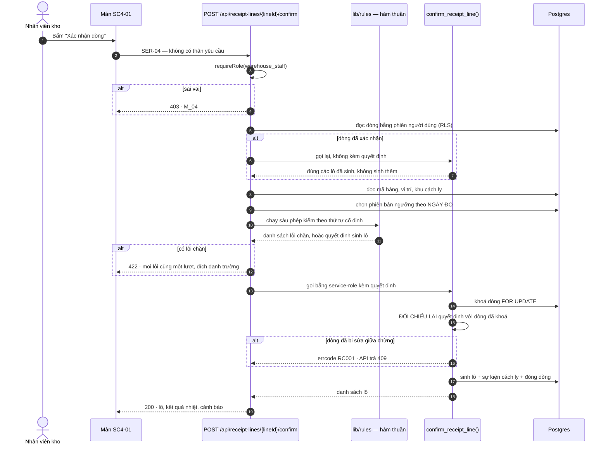

# DD-RCV-001 — Xác nhận dòng phiếu nhập

> Biểu mẫu: **BM-2-901-53 v01** — Detail Design (Chart + Description) · SUN ASTERISK VIETNAM CO., LTD · ISO/IEC 27001:2013 & ISO 9001:2015

---

## 1. History of change

| No | Version | Action | Mục / Bước | Nội dung thay đổi | Ngày | Người sửa | Approve |
|---|---|---|---|---|---|---|---|
| 1 | 0.1.0 | Add new | — | Khởi tạo | 2026-11-16 | PL | |

---

## 2. Sequence diagram



**Ba chi tiết trong sơ đồ không được bỏ:** `SER-04` **không có thân yêu cầu** — quyết định do máy chủ
tính, nhận kết quả chấm từ client là để người kiểm tự quyết lô của mình vào tồn khả dụng hay vào cách
ly. Ngưỡng chọn theo **ngày đo**, không theo lúc bấm xác nhận (bẫy ①). Và phải **đối chiếu lại sau
khi khoá**: sáu phép kiểm chạy trên ảnh chụp dữ liệu *trước* khi khoá.

---

## 3. Description

Đóng một dòng kiểm hàng nhập: chấm kết quả đo nhiệt theo đúng phiên bản ngưỡng hiệu lực **lúc đo**,
kiểm dữ liệu nhãn và trường truy xuất pháp định, rồi sinh lô trong **một giao dịch**. Chạy xong thì
dòng ở trạng thái `confirmed`, mang theo `temp_result` và `temp_policy_id` của phiên bản đã dùng, và
mọi lô của dòng đã tồn tại. Đây là cửa vào của toàn bộ dữ liệu tồn kho — mọi lô trong hệ thống đều
sinh ra ở đây (`FR-REC-04`, `DR-LOT-01`).

**Hai nhóm kết quả, không được trộn:**

```
CHẶN xác nhận  : thiếu trường P0 · loại hạn lệch · dải nhiệt lệch · thiếu trường truy xuất · thiếu phiên bản ngưỡng
KHÔNG chặn     : nhiệt ngoài ngưỡng → lô ra đời ở khu cách ly, không vào tồn khả dụng
```

Nhiệt ngoài ngưỡng là **sự thật đã xảy ra** của chuyến hàng, phải ghi đúng như đo được rồi cách ly
để QA phán định (`FR-REC-05`). Chặn nó đi thì người kiểm sẽ sửa con số cho qua, và hồ sơ HACCP mất
giá trị. Bốn trường hợp kia là **dữ liệu sai**, ghi vào là hỏng dữ liệu gốc.

---

## 4. Detail function

### 4.1. Kiểm vai, đọc dòng, chặn sinh lô trùng

| Trường | Giá trị |
|---|---|
| Input | `lineId` trên đường dẫn + phiên đăng nhập. **Không có thân yêu cầu** |
| Output | Dòng `receipt_lines` → bước 4.2; hoặc trả thẳng các lô đã sinh |

**Error**

| Điều kiện lỗi | Xử lý | Status code |
|---|---|---|
| Chưa đăng nhập hoặc phiên hết hạn | dừng, không đọc gì | 401 · `M_03` |
| Vai không phải `warehouse_staff` | dừng, không ghi gì | 403 · `M_04` |
| `lineId` không đúng dạng UUID | dừng trước khi chạm CSDL | 400 · `M_02` |
| Không tìm thấy dòng (không tồn tại, hoặc RLS lọc mất) | dừng; màn quay về danh sách phiếu | 404 |

**Detail**

| No | Nội dung xử lý |
|---|---|
| 1 | Kiểm vai là **câu lệnh đầu tiên**, trước mọi thao tác dữ liệu. Vai `admin` chỉ xem, không xác nhận được |
| 2 | Đọc dòng bằng client **theo phiên người dùng** để RLS áp dụng — không dùng service-role ở bước đọc |
| 3 | Dòng đã `confirmed` → gọi RPC **không kèm quyết định**, trả về đúng các lô đã sinh kèm cờ đã xác nhận. Không đánh giá lại, không sinh lô mới (`FR-REC-04`) |
| 4 | Dòng còn `draft` → đi tiếp bước 4.2. Người thao tác lấy từ phiên máy chủ, truyền xuống RPC làm `p_actor` |

### 4.2. Chọn phiên bản ngưỡng theo **thời điểm đo** — bẫy ①

Ngưỡng ba dải nhiệt là **chính sách do khách tự công bố, có phiên bản** (`BR-TEMP-01`). Con số
15–25 / 0–5 / ≤ −18 °C trong RFP là ví dụ mô tả, **không phải hằng số của hệ thống**.

| Trường | Giá trị |
|---|---|
| Input | `receipt_lines.measured_at`, `skus.temperature_band`, toàn bộ `temp_policies` của dải đó |
| Output | Một bản ghi ngưỡng (`min_c`, `max_c`, `version`) hoặc rỗng → bước 4.3 |

**Error**

| Điều kiện lỗi | Xử lý | Status code |
|---|---|---|
| Không có phiên bản hiệu lực cho dải tại ngày đo | dừng, **không lấy ngưỡng mặc định** | 422 · `M_16` |
| `measured_at` không đọc được thành mốc thời gian | dừng, **không đoán ngày thay cho dữ liệu hỏng** | 500 · `M_05` |
| Mã hàng của dòng không còn trong master | dừng | 500 · `M_05` |

**Detail**

| No | Nội dung xử lý |
|---|---|
| 1 | Mốc chọn là **ngày JST của `measured_at`**. Cùng một phiếu 3,0 °C phải cho cùng kết luận bất kể bấm xác nhận lúc nào; lấy ngưỡng của hôm nay là chấm lại quá khứ |
| 2 | Chọn bản có `effective_from` lớn nhất mà không muộn hơn ngày đo, `effective_to` trống hoặc sau ngày đo. Cùng `effective_from` thì lấy `version` lớn hơn |
| 3 | Phiếu cũ **giữ nguyên kết luận** khi ngưỡng lên phiên bản mới — đó là lý do mốc là `measured_at` chứ không phải `confirmed_at` |
| 4 | Phiên bản đã dùng ghi vào `receipt_lines.temp_policy_id` ở bước 4.5, nên về sau truy ngược được vì sao dòng này PASS hay FAIL |
| 5 | Tầng bảng chặn nốt chiều ngược: trigger `temp_policies_integrity` không cho tạo phiên bản hồi tố (`TMP01`), nên không ai viết lại được ngưỡng của một ngày đã qua |
| 6 | Thời điểm đo hiện do người kiểm tự đặt → [GAP-04](../../database/gap-list.md) |

### 4.3. Sáu phép kiểm chặn — thứ tự cố định, trả hết một lượt

| Thứ tự | Phép kiểm | Chặn khi | Mã thông báo |
|---|---|---|---|
| 1 | **Trường bắt buộc P0** | Thiếu một trong tám trường: `qty_reported`, `supplier_lot`, `declared_expiry_type`, `production_date`, `expiry_date`, `measured_temp_c`, `photo_ref`, `location_id` | `M_01` |
| 2 | **Loại hạn và ngày** | `declared_expiry_type` khác `skus.expiry_type`; hạn sớm hơn ngày sản xuất; ngày sai định dạng | `M_11` · `M_02` |
| 3 | **Số lượng** | `qty_accepted + qty_rejected + qty_held` khác `qty_reported`; có từ chối hoặc giữ lại mà trống `reason_code` | `M_02` · `M_01` |
| 4 | **Vị trí** | Vị trí không có thật; vị trí thuộc khu cách ly; dải nhiệt vị trí khác dải nhiệt mã hàng (`BR-TEMP-02`) | `M_02` · `M_12` |
| 5 | **Truy xuất pháp định** | Thiếu trường bắt buộc của luồng gạo hoặc luồng thịt bò | `M_14` · `M_13` |
| 6 | **Phiên bản ngưỡng** | Không có bản hiệu lực (kết quả bước 4.2) | `M_16` |

**Error**

| Điều kiện lỗi | Xử lý | Status code |
|---|---|---|
| Có ít nhất một phép kiểm trên không đạt | **Dừng, không ghi gì.** Trả **toàn bộ** lỗi cùng một lượt, mỗi lỗi đích danh một trường | 422 |
| Dòng, mã hàng hoặc vị trí truyền vào tự mâu thuẫn nhau | Ném lỗi lập trình, không coi là lỗi nhập liệu | 500 · `M_05` |

**Detail**

| No | Nội dung xử lý |
|---|---|
| 1 | **Không dừng ở lỗi đầu tiên.** Sáu phép chạy hết rồi mới trả, để người kiểm sửa một lượt thay vì bấm sáu lần (`FR-REC-02`) |
| 2 | Thứ tự là **một phần của đặc tả**: trường thiếu phải báo trước lỗi dẫn xuất từ chính trường đó, nếu không người dùng đọc được một câu lỗi vô nghĩa |
| 3 | Ô trống, chuỗi toàn khoảng trắng tính là **thiếu**; 0 °C là giá trị đo hợp lệ, không phải thiếu. Số lượng so bằng số thập phân làm tròn ba chữ số, để 0,1 + 0,2 = 0,3 không bị chặn oan |
| 4 | Lệch tổng số lượng cần **người có thẩm quyền duyệt** theo `FR-REC-03`; chưa có vai duyệt nên chặn hẳn bằng `M_02` |
| 5 | `qty_accepted` là giá trị **máy chủ suy ra** `qty_reported − qty_rejected − qty_held`, không phải giá trị khai báo → [GAP-20](../../database/gap-list.md) |

**Bẫy ② — 賞味期限 (hạn ngon nhất) ≠ 消費期限 (hạn tiêu thụ an toàn):**

| Chỗ | Đúng phải là |
|---|---|
| Loại hạn của mặt hàng | Cột `expiry_type` trên bảng `skus`. **Bảng `lots` không có cột loại hạn** — đó là thuộc tính của mặt hàng, không phải của từng lô. Nhân bản xuống lô là tạo nguồn sự thật thứ hai |
| Loại hạn trên nhãn | Cột `declared_expiry_type` của `receipt_lines` — thứ người kiểm **đọc từ nhãn**. Hai cột tách riêng, không ghi đè lẫn nhau; lệch nhau là **chặn cứng** `M_11`, nêu cả hai giá trị, không có đường ghi đè (`BR-EXP-01`) |
| Hệ quả về sau | 消費期限 chạm hạn là **chặn** phân bổ và chặn giao (`BR-EXP-02`, `M_20`); 賞味期限 chỉ **cảnh báo**, lô vẫn phân bổ được (`M_21`). Hai nhánh đó đọc loại hạn qua `sku_id` của lô — xem [DD-OUT-001](../../outbound/detail-design/OUT_ALLOCATION_DETAIL.md) |

Bước xác nhận **không** tính số ngày còn lại của hạn: điểm phán định nằm ở lúc phân bổ và lúc giao.

**Bẫy ⑤ — truy xuất pháp định chỉ bắt buộc với gạo và thịt bò:**

| Diện truy xuất (`skus.traceability_lane`) | Trường bắt buộc | Thiếu thì |
|---|---|---|
| Gạo | `rice_transaction_id` **và** `rice_origin` (`BR-TRACE-01`) | Chặn `M_14`, chỉ đúng trường thiếu |
| Thịt bò | `beef_individual_id` — **đúng 10 chữ số 0–9** (`BR-TRACE-02`) | Trống → `M_14`; sai số ký tự hoặc lẫn ký tự khác → `M_13` |
| Nội bộ | Không đòi trường nào | Không chặn, không hiện ô trống |

Số cá thể bò **giữ nguyên số 0 đầu**, hệ thống không tự đệm và không cắt cho đủ 10 số — nói thẳng câu
đó trong thông báo lỗi. Cột `beef_individual_id` có ràng buộc `check` 10 chữ số ngay trên bảng nên số
sai **không lưu nổi cả bản nháp**. Lô chỉ mang trường của **đúng luồng** mã hàng; luồng nội bộ ghi
rỗng cả ba cột truy xuất, kể cả khi dòng lỡ có giá trị — vẫn truy ngược được lô → khách, nhưng đó là
chính sách nội bộ, không phải nghĩa vụ luật.

### 4.4. Quyết định sinh lô — nhiệt không chặn, nó đổi nơi lô ra đời

| Trường | Giá trị |
|---|---|
| Input | Nhiệt đo, phiên bản ngưỡng (4.2), vị trí đã chọn, danh sách khu cách ly |
| Output | `temp_result`, danh sách lô cần sinh, danh sách cảnh báo → bước 4.5 |

| Tình huống | `temp_result` | Lô sinh ra |
|---|---|---|
| Nhiệt trong ngưỡng — **đúng biên là ĐẠT** (`min_c ≤ t ≤ max_c`) | PASS | Phần nhận → lô `available` tại vị trí đã chọn, không có lý do |
| Nhiệt ngoài ngưỡng | FAIL | **Toàn bộ** phần nhận → lô `quarantine` tại khu cách ly cùng dải, kèm lý do có số đo, khoảng ngưỡng và số hiệu phiên bản. Hiện `M_10` — **vẫn xác nhận được** |
| `qty_held` > 0 | theo nhiệt | Luôn thêm một lô `quarantine`, lý do bắt đầu bằng `reason_code` của dòng |
| `qty_rejected` > 0 | theo nhiệt | **Không sinh lô** — hàng từ chối không vào kho |
| Dải chưa có khu cách ly | theo nhiệt | Lô vẫn `quarantine` nhưng **giữ vị trí đã chọn**, kèm cảnh báo `M_15` |

**Error**

`N/A — bước này không sinh lỗi chặn: nhiệt ngoài ngưỡng là kết quả nghiệp vụ, không phải lỗi dữ liệu.`

**Detail**

| No | Nội dung xử lý |
|---|---|
| 1 | Biên thuộc ngưỡng: phiên bản ngưỡng 冷蔵 khách công bố là 0,0–5,0 °C thì 5,0 ĐẠT, 5,1 mới ngoài ngưỡng. Một dấu `<` hay `≤` ở đây đổi kết quả của cả kho |
| 2 | Nhiệt độ nhận tối đa một chữ số thập phân; làm tròn ngầm 25,04 → 25,0 là lặng lẽ đổi PASS/FAIL nên bị từ chối ngay ở biên API |
| 3 | Khu cách ly chọn trong các vị trí `is_quarantine` **cùng `temperature_band`**, lấy `location_id` nhỏ nhất — ổn định, không phụ thuộc thứ tự đọc dữ liệu |
| 4 | Lý do cách ly ghi đủ số liệu để đọc lại sau nhiều tháng vẫn hiểu: nhiệt đo, khoảng ngưỡng, tên dải, số hiệu phiên bản |
| 5 | Một dòng sinh **tối đa hai lô**, phân biệt bằng `source_kind` (phần nhận / phần giữ lại) — trục khác với `status`, không trộn. Lô cách ly không vào tồn khả dụng, không phân bổ được ở SC4-03 (`FR-REC-05`) |

### 4.5. Ghi atomic và chống đua khi hai người cùng xác nhận một dòng

| Trường | Giá trị |
|---|---|
| Input | Quyết định của bước 4.4, `p_line_id`, `p_actor` |
| Output | Danh sách lô của dòng → phản hồi `SER-04` |

**Error**

| Điều kiện lỗi | Xử lý | Status code |
|---|---|---|
| Dòng bị sửa giữa lúc đánh giá và lúc ghi (lệch số lượng, thiếu lô) | Huỷ giao dịch, errcode `RC001`. Người dùng tải lại dòng rồi xác nhận lại | 409 |
| Dòng biến mất trước khi khoá | Huỷ giao dịch, errcode `P0002` | 404 |
| Quyết định truyền xuống sai hình dạng | Huỷ giao dịch — phòng thủ ở biên hàm, không tin dữ liệu vào | 500 · `M_05` |

**Detail**

| No | Nội dung xử lý |
|---|---|
| 1 | Toàn bộ thao tác ghi nằm trong **một giao dịch** của hàm RPC `confirm_receipt_line`, gọi bằng service-role. Người dùng có phiên **không gọi thẳng được** hàm này để lách rule |
| 2 | Khoá dòng `FOR UPDATE` ngay sau khi vào hàm: hai lần xác nhận song song cùng một dòng **xếp hàng** tại đây |
| 3 | Lớp chống trùng 1 — dòng đã `confirmed` thì trả các lô đã có và dừng, không ghi gì thêm |
| 4 | **Đối chiếu lại** quyết định với dòng **đã khoá**: `qty_accepted` và `qty_held` phải khớp, lô phần giữ lại luôn `quarantine`, mỗi `source_kind` đúng một lô. Lệch → `RC001` |
| 5 | Lớp chống trùng 2 — ràng buộc duy nhất `(receipt_line_id, source_kind)` trên `lots`: chèn trùng thì bỏ qua, không sinh lô thứ hai (`FR-REC-04`) |
| 6 | Lô `quarantine` **vừa thật sự được chèn** mới ghi kèm một dòng `lot_status_events` (`to_status` cách ly, lý do, người thao tác) — gọi lại không nhân đôi sổ sự kiện |
| 7 | Đóng dòng: `status` = `confirmed`, `confirmed_at`, `temp_policy_id`, `temp_result`. `receipts.inspected_by` lấy từ phiên máy chủ và chỉ ghi khi còn trống — không nhận giá trị từ client |

Kiểm chứng: `npm run verify:receipt` — gọi lại nhiều lần trên cùng một dòng, xác nhận số lô không tăng
và khoá lô không trùng.

---

## 5. Other Notes

**Tiền đề trước khi gọi:** dòng đã tồn tại ở trạng thái `draft`, mọi trường đã lưu qua `SER-02` /
`SER-03`. `SER-04` **không nhận thân yêu cầu**. **Xử lý này KHÔNG làm gì:** không sửa dữ liệu của
dòng (dòng đã xác nhận là bất biến), không tính số ngày còn lại của hạn, không phân bổ lô, không kiểm
nhiệt chiều xuất — `FR-OUT-05` và vế xuất của `BR-TEMP-02` nằm ngoài xử lý này.

**Đường ra khi dữ liệu thiếu — mỗi loại thiếu một lối khác nhau:**

| Thiếu cái gì | Đường ra |
|---|---|
| Trường P0 của dòng | Chặn `M_01`, nêu **đích danh từng trường**, giữ nguyên dòng ở `draft` |
| Phiên bản ngưỡng của dải tại ngày đo | Chặn `M_16`, chuyển QA tạo phiên bản ở SC4-07. **Không bao giờ lấy số mặc định** |
| Trường truy xuất gạo / thịt bò | Chặn `M_14` (hoặc `M_13` khi số cá thể sai dạng) — không cho vào cách ly thay cho việc chặn |
| Khu cách ly của dải | **Không chặn**: lô vẫn `quarantine`, giữ vị trí đã chọn, cảnh báo `M_15` |
| Mã hàng hoặc thời điểm đo hỏng ở tầng dữ liệu | Dừng với lỗi hệ thống. Không đoán thay cho dữ liệu hỏng |

**Chỗ prototype làm khác thiết kế** — chi tiết ở [`gap-list.md`](../../database/gap-list.md):

- Thời điểm đo do người kiểm tự đặt và sửa được khi dòng còn nháp → GAP-04
- Số lượng nhận do client gửi lên thay vì máy chủ suy ra → GAP-20
- Mọi nhân viên kho sửa được mọi phiếu → GAP-09

**Điểm CẦN XÁC NHẬN với khách** (`docs/scope.md` mục 6), ảnh hưởng trực tiếp tới xử lý này:

| # | Điểm | Giả định đang dùng |
|---|---|---|
| 6 | Nhiệt ngoài ngưỡng: chặn hay nhận vào cách ly | Nhận vào cách ly; lệch dải mã hàng ↔ vị trí thì chặn hẳn |
| 7 | Dải chưa có khu cách ly | Lô giữ vị trí đã chọn, hiện `M_15` |
| 7b | Thiếu trường truy xuất gạo / bò | Chặn xác nhận, chỉ rõ trường thiếu |
| 7c | Loại hạn trên nhãn khác mã hàng master | Chặn, chưa có quyền ghi đè |
| 8 | Số cá thể bò 9 chữ số | Chặn, nói rõ không tự đệm thành 10 số |
| 16 | Mốc chọn phiên bản ngưỡng | **Thời điểm đo** ghi trên phiếu |

**Hai câu hỏi còn treo, chưa có căn cứ trong RFP:**

- Hàng vào kho khi **đã quá 消費期限** thì chặn ngay tại cửa nhập, hay vẫn nhận rồi cách ly? `BR-EXP-02`
  chỉ nói tới lúc phân bổ và lúc giao. Hiện xử lý này không chặn — **cần hỏi khách**.
- Hai người cùng xác nhận một dòng thì màn hiện câu gì? Máy chủ trả 409 kèm `RC001`, nhưng
  [`error-codes.md`](../../_common/error-codes.md) **chưa có mã `M_xx`** cho tình huống này ở SC4-01
  — phải bổ sung vào danh mục chung, không tự chế tại đây.

**Luật nghiệp vụ nằm trong hàm thuần** (`lib/rules/`): nhận dữ liệu vào, trả quyết định ra, không
chạm CSDL và không chạm mạng; RPC chỉ **ghi lại** quyết định đó. Đổi cách chấm nhiệt hay đổi quy tắc
truy xuất chỉ phải sửa một hàm và các bài kiểm của nó; còn bất biến phải đúng với **mọi** đường ghi
thì đặt ở tầng bảng ([ADR-001](../../architecture/ADR-001-business-rules-at-table-level.md)).
