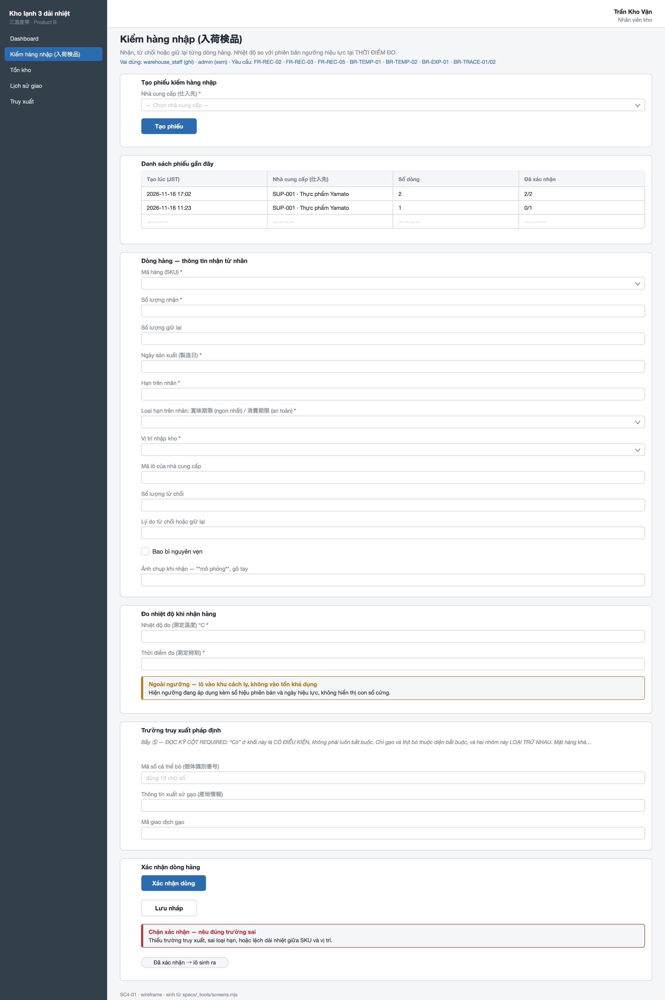
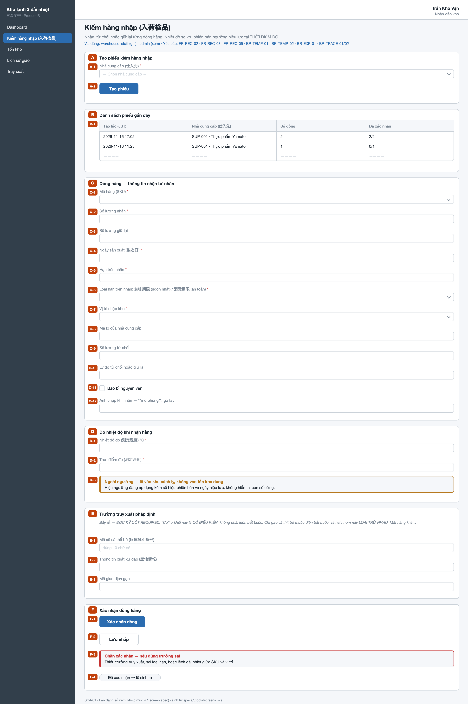

# SC4-01 — Kiểm hàng nhập (入荷検品)

> Biểu mẫu: **BM-2-901-51 v2.1** — Screen Specification · SUN ASTERISK VIETNAM CO., LTD · ISO/IEC 27001:2013 & ISO 9001:2015

---

## 1. History of change

| No | Version | Action | Nội dung thay đổi | Ngày | Người sửa | Approve |
|---|---|---|---|---|---|---|
| 1 | 0.1.0 | Add New | Khởi tạo | 2026-11-16 | PL | |
| 2 | 0.2.0 | Updated | Sửa theo vòng review chéo: thêm bảng truy vết yêu cầu, sửa mã lỗi gán sai, sửa tên trường API | 2026-11-16 | PL | |

---

## 2. Layout

**Design:** wireframe dựng từ [`specs/_tools/screens.mjs`](../../_tools/screens.mjs) — sửa file đó
rồi chạy `node specs/_tools/render-wireframes.mjs`, đừng sửa tay file ảnh.





Ảnh hiện trạng prototype để đối chiếu: [`../assets/_prototype/SC4-01_current.png`](../assets/_prototype/SC4-01_current.png)

---

## 3. Description

Màn để **nhân viên kho** (`warehouse_staff`) ghi kết quả kiểm từng dòng hàng khi xe giao tới, rồi
xác nhận dòng để sinh lô. Vai `admin` chỉ xem.

Đây là cửa vào của toàn bộ dữ liệu tồn kho: mọi lô trong hệ thống đều sinh ra ở màn này. Vì vậy ba
bẫy nghiệp vụ phải chặn **ngay tại đây**, không để trôi xuống các màn sau — ngưỡng nhiệt có phiên
bản (bẫy ①), hai loại hạn không được gộp (bẫy ②), truy xuất pháp định chỉ với gạo và thịt bò
(bẫy ⑤). Sai ở đây thì màn Tồn kho và màn Đơn xuất chỉ đang tính toán trên dữ liệu đã sai.

Điểm phải nắm: **nhiệt độ ngoài ngưỡng KHÔNG chặn xác nhận** — nó quyết định lô sinh ra ở khu cách
ly thay vì tồn khả dụng. Thứ chặn là loại hạn lệch, dải nhiệt lệch, và thiếu trường truy xuất.
Hai nhóm này khác nhau về bản chất, trộn vào nhau là hỏng cả màn.

Đi tới: từ Dashboard và từ menu. Đi ra: màn Tồn kho (SC4-02) để QA xử lý lô cách ly.

---

## 3bis. Yêu cầu màn này thực hiện

Mã yêu cầu tra ở [`docs/01_requirements-extract.md`](../../../docs/01_requirements-extract.md) —
**không tự chế mã mới ở đây**. Màn nào chỉ làm một phần thì ghi rõ phần thiếu ngay trong cột cuối.

| Mã yêu cầu | Nội dung (trích ngắn) | Màn đáp ứng ở mục nào |
|---|---|---|
| `FR-REC-02` | Ghi kiểm từng dòng hàng: tình trạng bao gói, số lượng, lô, loại hạn, hạn, nhiệt thực đo, ảnh. Thiếu trường P0 thì chặn xác nhận và chỉ rõ trường thiếu | 4.1 (C-1…C-12, D-1, D-2), 4.2 toàn bảng, 5 — F-1 trả mọi lỗi chặn **cùng một lượt**, đích danh từng trường |
| `FR-REC-03` | Ghi số lượng chấp nhận / từ chối / giữ lại kèm mã lý do; tổng của dòng phải khớp số khai báo | 4.2 — bảng bốn cột số lượng và ràng buộc tổng; C-10 bắt buộc mã lý do khi có từ chối hoặc giữ lại. **Một phần**: nhánh "lệch tổng thì cần phê duyệt có thẩm quyền" chưa đặc tả — màn đang chặn hẳn bằng `M_02`, không có đường duyệt |
| `FR-REC-04` | Tạo lô bất biến từ phần hàng đã nhận; gọi lại cùng một yêu cầu không sinh trùng khoá lô | 5 — F-1 sinh lô trong **một giao dịch** và bấm lại không sinh thêm lô; F-4 liệt kê lô vừa sinh kèm `source_kind` và `status` |
| `FR-REC-05` | Chuyển hàng vào cách ly khi trượt kiểm nhiệt hoặc thiếu trường truy xuất; hàng cách ly không được phân bổ | 5 — F-4 và dòng D-1 ở Error Handling; 6 — khối "hai nhóm kết quả". **Khác yêu cầu có chủ ý**: thiếu trường truy xuất thì màn **chặn** chứ không cho vào cách ly — điểm CẦN XÁC NHẬN 7b ở mục 6, chờ khách chốt |
| `BR-TEMP-01` | Ngưỡng 3 dải nhiệt quản lý theo phiên bản; giao dịch quá khứ giữ phiên bản đã dùng lúc đánh giá | 4.2 (D-2 là mốc chọn phiên bản), 4.3 (D-3), 5 — D-1/D-2 và F-1 ghi lại đúng phiên bản đã chấm; 6 — bảng hiểu sai, dòng "Ngưỡng 3 dải nhiệt". **Một phần** → [`GAP-04`](../../database/gap-list.md): thời điểm đo do người dùng tự đặt |
| `BR-TEMP-02` | So dải nhiệt mã hàng ↔ dải nhiệt vị trí ↔ nhiệt thực đo tại **mọi** lần nhập và xuất | 4.2 (C-7, D-1), 5 — C-7 chặn `M_12`, D-1 ngoài ngưỡng thì cách ly. **Chỉ nửa chiều nhập**: nửa chiều xuất chưa màn nào đặc tả — mục B10 của [`../../review-report.md`](../../review-report.md), đang chờ PM quyết |
| `BR-EXP-01` | Mỗi mã hàng tuyên bố 賞味期限 hoặc 消費期限, hai đường quyết định khác nhau | 4.2 (C-6), 5 — C-6 chặn `M_11` và không có đường ghi đè; 6 — bảng hiểu sai, dòng "Loại hạn" |
| `BR-TRACE-01` | Luồng gạo: giữ mã giao dịch, số lượng, ngày, đối tác, thông tin xuất xứ; thiếu trường bắt buộc thì chặn xác nhận | 4.2 (E-2, E-3), 4.3, 5 — E-1/E-2 chặn `M_14`. **Một phần**: màn giữ mã giao dịch và xuất xứ; số lượng, ngày và đối tác lấy từ chính dòng phiếu (C-2, C-4, A-1), không có ô riêng |
| `BR-TRACE-02` | Luồng bò: số định danh cá thể **đúng 10 chữ số** xuyên suốt nhập–tồn–xuất–thu hồi; sai thì chặn | 4.2 (E-1), 4.2 bảng tầng dữ liệu (ràng buộc `check` ngay trên cột), 5 — E-1 chặn `M_13`, nói rõ hệ thống không tự đệm số 0 |
| `DR-LOT-01` | Dữ liệu lô: số lô nhà cung cấp, hạn, loại hạn, mã định danh pháp định | 4.3 — C-5, C-6, C-8 và cả khối E ghi vào `receipt_lines`, mang sang lô khi xác nhận ở F-1 |

---

## 4. View

**Đánh ID:** section là chữ (`A`–`F`), item trong section là số. Tham chiếu dạng `{section}-{số}`.

### 4.1 Danh sách item

Bảng item sinh tự động cùng nguồn với ảnh annotated, nên số callout trên ảnh và ID ở đây không bao
giờ lệch: [`../assets/SC4-01_items.md`](../assets/SC4-01_items.md).

### 4.2 Validation

| ID | Type | Min | Max | Default | Ghi chú |
|---|---|---|---|---|---|
| A-1 | String | — | — | | Phải là nhà cung cấp có thật trong master. Trống → `M_01`; không có → `M_02` |
| C-1 | String | — | — | | Phải là mã hàng có thật. Trống → `M_01`. Quyết định dải nhiệt, loại hạn và luồng truy xuất của cả dòng |
| C-2 | Number | > 0 | — | | Số lượng khai báo trên chứng từ. Trống → `M_01`; ≤ 0 → `M_02` |
| C-3 | Number | 0 | giá trị C-2 | 0 | Lớn hơn C-2 → `M_02`. Lớn hơn 0 thì bắt buộc có mã lý do → `M_01` |
| C-4 | Date | — | — | | `YYYY-MM-DD` hợp lệ. Sai dạng → `M_02` |
| C-5 | Date | giá trị C-4 | — | | Sớm hơn ngày sản xuất → `M_02` |
| C-6 | String | — | — | | Hai giá trị: 賞味期限 · 消費期限. **Khác loại hạn khai trong mã hàng → `M_11`, CHẶN xác nhận, không có quyền ghi đè** |
| C-7 | String | — | — | | Phải là vị trí có thật. **Dải nhiệt vị trí khác dải nhiệt mã hàng → `M_12`, chặn hẳn.** Vị trí thuộc khu cách ly không chọn trực tiếp → `M_02` |
| D-1 | Number | — | — | | Trống → `M_01`. Ngoài ngưỡng → `M_10` — **cảnh báo, không chặn** |
| D-2 | Datetime | — | — | lúc mở form (JST) | Trống → `M_01`; sai dạng → `M_02`. Là mốc chọn phiên bản ngưỡng, không phải lúc bấm xác nhận |
| E-1 | String | 10 | 10 | | Chỉ hiện khi mã hàng thuộc luồng thịt bò. Đúng 10 chữ số `0`–`9`. Trống → `M_14`; sai số ký tự hoặc có ký tự khác → `M_13` |
| E-2 | String | 1 | — | | Chỉ hiện khi mã hàng thuộc luồng gạo. Trống → `M_14` |
| C-8 | String | 1 | — | | Mã lô của nhà cung cấp. **Bắt buộc** — cột `supplier_lot` là NOT NULL và biên API đòi ngay từ lúc lưu nháp. Trống → `M_01` |
| C-9 | Number | 0 | giá trị C-2 | 0 | Số lượng từ chối. Ràng buộc tổng ở ngay dưới bảng này |
| C-10 | String | — | — | | Lý do từ chối hoặc giữ lại. **Bắt buộc khi C-9 > 0 hoặc C-3 > 0** → `M_01` |
| C-11 | Boolean | — | — | | Bao bì nguyên vẹn. Không tick thì nên có lý do ở C-10 |
| C-12 | String | — | — | | Ảnh chụp khi nhận — **mô phỏng**, ô nhập tay thay cho camera |
| E-3 | String | 1 | — | | Mã giao dịch gạo. Chỉ hiện với luồng gạo. Trống → `M_14`. **BR-TRACE-01 đòi cả mã giao dịch, không chỉ xuất xứ** |

**Ràng buộc tổng số lượng — một chỗ duy nhất, bốn cột:**

`receipt_lines` có bốn cột số lượng. Màn chỉ cho nhập **ba** ô; cột thứ tư do máy chủ tính.

| Cột CSDL | Nguồn | Nghĩa |
|---|---|---|
| `qty_reported` | ô C-2 | Số lượng **khai báo trên chứng từ** của nhà cung cấp |
| `qty_rejected` | ô C-9 | Phần từ chối, không nhận vào kho |
| `qty_held` | ô C-3 | Phần giữ lại, vào khu cách ly |
| `qty_accepted` | **máy chủ tính** | `qty_reported − qty_rejected − qty_held` |

Ràng buộc: `qty_rejected + qty_held ≤ qty_reported`. Vượt → `M_02`.
`qty_accepted` **không có ô nhập** và client gửi lên cũng bị bỏ qua — đây là giá trị suy ra,
không phải giá trị khai báo.

**Validation ở tầng dữ liệu — không phải ở màn, nhưng màn phải hiển thị được kết quả:**

| Luật | Chỗ chặn | Thông báo trên màn |
|---|---|---|
| `beef_individual_id` đúng 10 chữ số — ràng buộc `check` ngay trên cột, nên số sai **không lưu được cả bản nháp** | Cột `receipt_lines.beef_individual_id` | `M_13` |
| Không có phiên bản ngưỡng hiệu lực cho dải nhiệt tại ngày đo → chặn xác nhận, **không lấy ngưỡng mặc định** | `SER-04` | `M_16` |
| Trạng thái dòng và trạng thái lô do máy chủ đặt; giá trị client gửi lên bị bỏ qua | `SER-02`, `SER-04` | — |

### 4.3 Data Mapping

**Quy ước tên:** cột ở đây là **tên trường trong thân yêu cầu API — camelCase**, khác tên cột CSDL
(snake_case). Hai tên này không được dùng lẫn: gửi `qty_reported` thay cho `qtyReported` là bị
`SER-02` từ chối 422. Việc đổi sang tên cột nằm ở phía máy chủ, sau khi kiểm dữ liệu.

| ID | Data Source | API ID | API URL | Key / Param | Ghi chú |
|---|---|---|---|---|---|
| A-1 | CSDL | — | — | bảng `suppliers` | Đọc bằng phiên người dùng, RLS lọc |
| A-2 | API | `SER-01` | `POST /api/receipts` | `supplierId` | `receipts.inspected_by` lấy từ phiên, không nhận từ client |
| B-1 | CSDL | — | — | bảng `receipts`, `receipt_lines` | Cột "Đã xác nhận" đếm theo `receipt_lines.status` |
| C-1 | CSDL + API | `SER-02` → `SER-03` | `POST /api/receipts/{id}/lines` rồi `PATCH /api/receipt-lines/{lineId}` | bảng `skus`; thân yêu cầu `skuId` | Đọc `temperature_band`, `expiry_type`, `traceability_lane` — ba thứ điều khiển cả màn |
| C-2 | API | `SER-02` → `SER-03` | như trên | `qtyReported` | Tạo dòng rồi sửa khi còn nháp. Cột CSDL là `qty_reported` |
| C-3 | API | `SER-02` → `SER-03` | như trên | `qtyHeld` | Xem ràng buộc tổng ở mục 4.2 |
| C-4 | API | `SER-02` → `SER-03` | như trên | `productionDate` | Mốc tính quy tắc 1/3 – 1/2 ở SC4-03 |
| C-5 | API | `SER-02` → `SER-03` | như trên | `expiryDate` | |
| C-6 | API | `SER-02` → `SER-03` | như trên | `declaredExpiryType` | Hai giá trị `BEST_BEFORE` / `USE_BY`. Đối chiếu với `skus.expiry_type`, **hai cột tách riêng, không ghi đè lẫn nhau** |
| C-7 | CSDL + API | `SER-02` → `SER-03` | như trên | bảng `locations`; thân yêu cầu `locationId` | Danh sách chọn lọc theo `temperature_band` của mã hàng và bỏ vị trí có `is_quarantine` |
| D-1 | API | `SER-02` → `SER-03` | như trên | `measuredTempC` | Tối đa 1 chữ số thập phân — cột CSDL `numeric(4,1)`, làm tròn ngầm là đổi kết quả đạt/vượt |
| D-2 | API | `SER-02` → `SER-03` | như trên | `measuredAt` | Mốc để resolve phiên bản ngưỡng. **Bắt buộc kèm múi giờ** (`+09:00` hoặc `Z`): thiếu offset là lệch ngày JST và chấm sai phiên bản |
| D-3 | Suy ra | — | — | bảng `temp_policies` | Bản có `effective_from` lớn nhất còn hiệu lực tại ngày JST của `measured_at`. Hiện `version`, `effective_from`, `min_c`, `max_c` — **không hiển thị con số cứng** |
| E-1 | API | `SER-02` → `SER-03` | như trên | `beefIndividualId` | Chỉ gửi khi mã hàng thuộc luồng thịt bò; luồng khác gửi rỗng |
| E-2 | API | `SER-02` → `SER-03` | như trên | `riceOrigin` | Chỉ gửi khi mã hàng thuộc luồng gạo |
| F-1 | API | `SER-04` | `POST /api/receipt-lines/{lineId}/confirm` | **không có thân yêu cầu** | Máy chủ tự dựng quyết định từ dữ liệu dòng trong CSDL rồi gọi RPC (`p_line_id`, `p_actor`, `p_decision`). Client **không** gửi kết quả chấm lên. Ghi `temp_result`, `temp_policy_id`, `confirmed_at` và sinh lô trong **một giao dịch** |
| F-4 | API | `SER-04` | như trên | phản hồi: danh sách lô | Hiện `source_kind` và `status` của từng lô vừa sinh |

**Sáu item bổ sung sau khi đối chiếu CSDL** (C-8 … C-12, E-3) đi cùng thân yêu cầu của
`SER-02`/`SER-03` dưới tên `supplierLot`, `qtyRejected`, `reasonCode`, `packagingOk`, `photoRef`,
`riceTransactionId` — máy chủ ghi xuống đúng sáu cột snake_case tương ứng của `receipt_lines`.
Thiếu `rice_transaction_id` là thiếu một nửa luồng truy xuất gạo mà BR-TRACE-01 đòi.

Mã API tra ở [`../../_common/api-list.md`](../../_common/api-list.md) — không tự khai API mới ở đây.

---

## 5. Event

| ID | Given (Pre-condition) | When (Trigger/Action) | Then (Result) | Note |
|---|---|---|---|---|
| **Initializing Process（初期処理）** | | | | |
| - | Vai là nhân viên kho hoặc quản trị | Mở màn hình | 1. Nạp danh sách nhà cung cấp vào A-1<br/>2. Nạp phiếu gần đây vào B-1<br/>3. Khối C, D, E, F chưa hiện | Vai khác bị proxy chặn trước khi tới màn |
| - | Đã mở một phiếu | Mở form dòng hàng | 1. D-2 mặc định là thời điểm hiện tại theo giờ Nhật<br/>2. Khối E **ẩn hoàn toàn** cho tới khi chọn xong C-1 | Không hiện ô trống chờ chọn mã hàng |
| **Standard Process（通常処理）** | | | | |
| A-2 | Đã chọn A-1 | Bấm "Tạo phiếu" | 1. Gọi `SER-01`<br/>2. Người lập phiếu lấy từ phiên<br/>3. Mở form dòng hàng | |
| C-1 | - | Chọn mã hàng | 1. Lọc danh sách C-7 còn đúng dải nhiệt của mã hàng<br/>2. Nạp loại hạn của mã hàng để đối chiếu C-6<br/>3. **Luồng truy xuất quyết định khối E**: thịt bò → chỉ hiện E-1; gạo → chỉ hiện E-2; mặt hàng khác → **ẩn cả khối, không hiện ô trống** | Bẫy ⑤: truy xuất pháp định chỉ bắt buộc với gạo và thịt bò |
| D-1, D-2 | Đã chọn C-1 | Nhập nhiệt độ và thời điểm đo | 1. Lấy phiên bản ngưỡng hiệu lực tại **ngày JST của D-2**<br/>2. D-3 hiện khoảng ngưỡng kèm số hiệu phiên bản và ngày hiệu lực<br/>3. Ngoài ngưỡng → hiện `M_10` | **Giá trị đúng biên là ĐẠT.** Đổi D-2 thì ngưỡng áp dụng đổi theo |
| F-2 | Form đang mở | Bấm "Lưu nháp" | 1. Dòng mới gọi `SER-02`, dòng cũ gọi `SER-03`<br/>2. Trạng thái dòng do máy chủ đặt là nháp | Dòng đã xác nhận không sửa được nữa |
| F-1 | Đã điền đủ trường bắt buộc | Bấm "Xác nhận dòng" | 1. Gọi `SER-04`<br/>2. Máy chủ kiểm theo thứ tự cố định: trường bắt buộc → loại hạn và ngày → số lượng → vị trí → truy xuất → phiên bản ngưỡng<br/>3. Đạt thì sinh lô, ghi kết quả kiểm nhiệt kèm đúng phiên bản ngưỡng đã dùng<br/>4. Điền F-4<br/>5. Bấm lại F-1 trên dòng **đã xác nhận** trả về đúng các lô đã sinh, **không sinh thêm lô mới** | Mọi lỗi chặn trả **cùng một lượt**, đích danh từng trường |
| F-4 | Đã xác nhận xong | Xem kết quả | 1. Nhiệt đạt → phần nhận vào tồn khả dụng tại vị trí đã chọn<br/>2. Nhiệt ngoài ngưỡng → **toàn bộ** phần nhận vào khu cách ly cùng dải (vị trí `-Q`), kèm lý do<br/>3. Phần giữ lại luôn vào khu cách ly | Lô cách ly không nằm trong tồn khả dụng, không phân bổ được ở SC4-03 |
| **Error Handling（エラー制御）** | | | | |
| C-6 | Loại hạn trên nhãn khác loại hạn khai trong mã hàng | Bấm F-1 | 1. Hiện `M_11` ở F-3, nêu cả hai giá trị<br/>2. **Chặn xác nhận, không có đường ghi đè** | Bẫy ②: 賞味期限 và 消費期限 là hai đường xử lý khác nhau |
| C-7 | Dải nhiệt vị trí khác dải nhiệt mã hàng | Bấm F-1 | 1. Hiện `M_12`<br/>2. **Chặn hẳn — không chuyển sang cách ly** | Khác hẳn trường hợp nhiệt ngoài ngưỡng |
| E-1 | Mã hàng thuộc luồng thịt bò, nhập 9 chữ số | Bấm F-1 hoặc F-2 | 1. Hiện `M_13`<br/>2. Chặn, nói rõ **hệ thống không tự đệm thêm số 0** | Chặn ở cả cột CSDL nên bản nháp cũng không lưu được |
| E-1, E-2 | Mã hàng thuộc diện truy xuất bắt buộc, trường truy xuất còn trống | Bấm F-1 | 1. Hiện `M_14`<br/>2. Chặn xác nhận, chỉ đúng trường thiếu | Không cho vào cách ly thay cho việc chặn |
| D-1 | Nhiệt độ ngoài ngưỡng của phiên bản đang áp dụng | Bấm F-1 | 1. Hiện `M_10`<br/>2. **Vẫn xác nhận được** — lô sinh ra ở khu cách ly | Ghi lại đúng phiên bản ngưỡng đã dùng để chấm |
| D-1 | Dải nhiệt chưa có khu cách ly | Bấm F-1 với nhiệt ngoài ngưỡng | 1. Hiện `M_15`<br/>2. Lô vẫn ở trạng thái cách ly, giữ vị trí đã chọn | Dải thường hiện chưa có khu `-Q` |
| D-2 | Không có phiên bản ngưỡng hiệu lực cho dải nhiệt tại ngày đo | Bấm F-1 | 1. Chặn xác nhận, hiện `M_16` kèm tên dải<br/>2. **Không dùng ngưỡng mặc định**, chuyển QA tạo phiên bản ở SC4-07 | Lấy đại một con số là đi thẳng vào bẫy ① |
| F-1 | Vai không phải nhân viên kho | Bấm F-1 | Hiện `M_04`, không ghi gì | Kiểm vai là câu lệnh đầu tiên của mọi API ghi |
| bất kỳ | Phiên hết hạn | Thao tác bất kỳ | Hiện `M_03`, đẩy về màn đăng nhập | |

Mã thông báo tra ở [`../../_common/error-codes.md`](../../_common/error-codes.md) — không tự chế mã mới ở đây.

---

## 6. Other Notes

**Hai nhóm kết quả, đừng trộn vào nhau:**

```
CHẶN xác nhận  : loại hạn lệch · dải nhiệt lệch · thiếu trường truy xuất · thiếu phiên bản ngưỡng
KHÔNG chặn     : nhiệt ngoài ngưỡng → lô vào khu cách ly, không vào tồn khả dụng
```

Lý do: nhiệt ngoài ngưỡng là **sự thật đã xảy ra** của chuyến hàng, phải ghi lại đúng như đo được
rồi cách ly để QA phán định. Chặn nó đi thì người kiểm sẽ sửa con số cho qua, và hồ sơ HACCP mất
giá trị. Ba trường hợp còn lại là **dữ liệu sai**, ghi vào là hỏng dữ liệu gốc.

**Ba cách hiểu sai phải tránh khi làm màn này:**

| Chỗ | Hiểu sai | Đúng phải là |
|---|---|---|
| Ngưỡng 3 dải nhiệt | Hằng số trong code (15–25 / 0–5 / ≤ −18 °C) | **Chính sách của khách, có phiên bản.** Màn đọc phiên bản hiệu lực tại **thời điểm đo**, không phải lúc bấm xác nhận — để phiếu cũ không bị chấm lại khi ngưỡng đổi. Không có phiên bản thì chặn, không lấy mặc định ([`ADR-005`](../../architecture/ADR-005-versioned-temperature-policy.md)) |
| Loại hạn | Một trường ngày là đủ, loại hạn chỉ để hiển thị | **Hai loại hạn, hai đường xử lý.** Nhãn lệch mã hàng là chặn cứng. Hạn trên nhãn và loại hạn là hai cột tách riêng ([`ADR-002`](../../architecture/ADR-002-two-expiry-types.md)) |
| Truy xuất nguồn gốc | Màn nào cũng hiện ô nguồn gốc, để trống thì thôi | **Chỉ gạo và thịt bò bắt buộc.** Mặt hàng khác ẩn hoàn toàn khối E. Hiện ô trống là mời người dùng điền bừa vào hồ sơ pháp định |

**Giá trị đúng biên là ĐẠT.** Ngưỡng dải mát 0,0–5,0 °C thì 5,0 °C đạt, 5,1 °C mới ngoài ngưỡng.
Đây là cách đọc chữ "閾値" của RFP — nếu khách hiểu khác thì đây là một dấu `<` hay `≤` ở cửa vào
của toàn bộ dữ liệu tồn kho.

**Điểm CẦN XÁC NHẬN với khách — ảnh hưởng trực tiếp tới màn này** (`docs/scope.md` mục 6):

| # | Điểm | Giả định đang dùng |
|---|---|---|
| 5 | Còn bao nhiêu ngày thì cảnh báo 賞味期限 | Không đặt số; cột ngưỡng cảnh báo trên mã hàng để trống, chỉ hiện số ngày còn lại |
| 6 | Nhiệt ngoài ngưỡng: chặn xác nhận hay nhận vào cách ly | Nhận vào cách ly, không vào tồn khả dụng. Lệch dải mã hàng ↔ vị trí thì chặn hẳn |
| 7 | Dải thường chưa có khu cách ly | Lô vẫn ở trạng thái cách ly, giữ vị trí đã chọn, hiện `M_15` |
| 7b | Thiếu trường truy xuất gạo/bò: chặn hay cho vào cách ly | **Chặn xác nhận**, chỉ rõ trường thiếu |
| 7c | Loại hạn trên nhãn khác mã hàng master | Chặn xác nhận, chưa có quyền ghi đè |
| 8 | Số cá thể bò 9 chữ số | Chặn, nói rõ không tự đệm thành 10 số |
| 16 | Lấy mốc nào để chọn phiên bản ngưỡng | **Thời điểm đo** ghi trên phiếu, không phải lúc bấm xác nhận |

**Chỗ prototype làm khác thiết kế:**

- Thời điểm đo (D-2) người dùng tự đặt và sửa được khi dòng còn nháp → `GAP-04`
- Mọi nhân viên kho sửa được mọi phiếu, không chỉ phiếu của mình → `GAP-09`

Hai dòng này ở [`../../database/gap-list.md`](../../database/gap-list.md). `GAP-04` chạm bẫy ① nên
là *chưa làm*, không phải *ngoài phạm vi*: lùi thời điểm đo về trước ngày siết ngưỡng thì được chấm
theo phiên bản cũ lỏng hơn.

**Hai chỗ màn này không tự quyết được, phải đi theo yêu cầu gốc:**

| Chỗ | Nội dung |
|---|---|
| Tổng số lượng lệch số khai báo | `FR-REC-03` cho phép một đường **phê duyệt có thẩm quyền** khi tổng của dòng không khớp số khai báo. Màn hiện chặn hẳn bằng `M_02`; chưa có vai duyệt, chưa có trạng thái chờ duyệt cho dòng phiếu. Xem mục 3bis |
| Kiểm nhiệt chiều xuất | `BR-TEMP-02` đòi so dải nhiệt tại **mọi** lần nhập và xuất. Màn này chỉ làm chiều nhập; chiều xuất (`FR-OUT-05`) chưa màn nào đặc tả — mục B10 của [`../../review-report.md`](../../review-report.md) |

Sơ đồ luồng và thứ tự kiểm đầy đủ ở [`../../architecture/architecture.md`](../../architecture/architecture.md).
