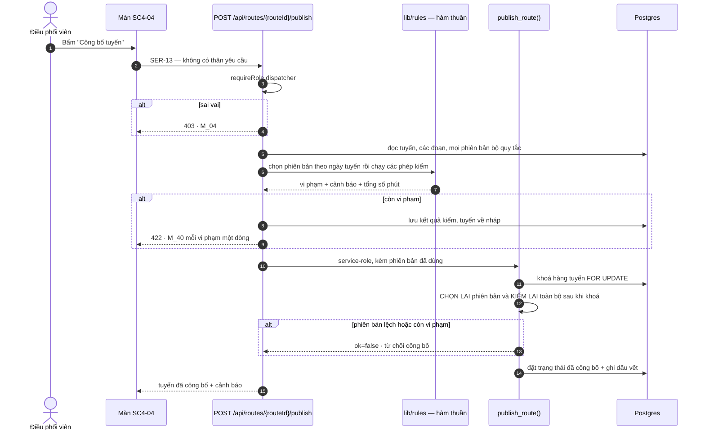

# DD-RTE-001 — Kiểm ràng buộc và công bố tuyến giao

> Biểu mẫu: **BM-2-901-53 v01** — Detail Design (Chart + Description) · SUN ASTERISK VIETNAM CO., LTD · ISO/IEC 27001:2013 & ISO 9001:2015

---

## 1. History of change

| No | Version | Action | Mục / Bước | Nội dung thay đổi | Ngày | Người sửa | Approve |
|---|---|---|---|---|---|---|---|
| 1 | 0.1.0 | Add new | — | Khởi tạo | 2026-11-16 | PL | |

---

## 2. Sequence diagram



**Hai chi tiết không được bỏ:** (1) **thân yêu cầu bị bỏ qua hoàn toàn** — máy chủ tải lại đoạn từ
CSDL và tự chọn phiên bản bộ quy tắc, vì nhận kết quả kiểm từ client là tin vào thứ mình không
kiểm soát; (2) **kiểm hai lần** — tầng API kiểm để trả khoảng vi phạm chính xác cho người dùng
sửa, hàm RPC kiểm lại **sau khi đã khoá hàng tuyến**, đó mới là lớp chặn cuối.

---

## 3. Description

Nhận một tuyến giao đã có đủ đoạn thời gian trong ngày, **kiểm các ràng buộc giờ lái của
改善基準告示**, và chỉ khi sạch mới chuyển tuyến sang trạng thái đã công bố.

Giờ lái là **ràng buộc cứng khoá việc công bố** (`FR-SCH-02`, [ADR-006](../../architecture/ADR-006-driver-hours-blocks-route-publish.md)):
tuyến còn vi phạm thì không công bố được, không có nút bỏ qua, không vai nào vượt được — kể cả
quản trị. Đây là quy định pháp luật (物流2024年問題), không phải chỉ tiêu nội bộ. Vì bị chặn nên mỗi
vi phạm phải nêu **ngưỡng nào, giá trị của tuyến, giới hạn, khoảng thời gian vi phạm**; báo "tuyến
không hợp lệ" là đẩy điều phối viên vào thế không biết sửa gì. Chạy xong, tuyến đã công bố **gắn
chặt với phiên bản bộ quy tắc tại ngày chạy**: luật đổi về sau không chấm lại tuyến cũ (`DR-ROUTE-01`).

---

## 4. Detail function

### 4.1. Thứ tự các phép kiểm — cố định, dừng ở phép đầu tiên không qua

*Input: `routeId` trên URL + phiên người dùng, **không đọc thân yêu cầu** → Output: tuyến đã công bố kèm cảnh báo, hoặc danh sách vi phạm.*

**Error**

| Điều kiện lỗi | Xử lý | Status code |
|---|---|---|
| Vai không phải điều phối | Ghi log, dừng, không ghi gì — `M_04` | 403 |
| Phiên hết hạn | Dừng, đẩy về màn đăng nhập — `M_03` | 401 |
| Mã tuyến sai dạng, hoặc tuyến không tồn tại | Dừng — `M_05` | 404 |
| Tuyến đã công bố | Dừng, không công bố lại — `M_41` | 409 |
| Tuyến chưa có đoạn nào | Dừng — `M_01`. Kiểm trên tập rỗng không chứng minh gì | 422 |
| Không có phiên bản bộ quy tắc hiệu lực tại ngày chạy tuyến | Dừng — `M_02`. **Không lùi về bộ ngưỡng mặc định** | 422 |
| Đoạn có thời điểm không đọc được, hoặc kết thúc không sau bắt đầu | Dừng — `M_02` | 422 |
| Còn ít nhất một vi phạm | Lưu kết quả kiểm, giữ tuyến ở nháp, trả về cả danh sách — `M_40` mỗi dòng | 422 |

**Detail**

| No | Nội dung xử lý |
|---|---|
| 1 | Kiểm vai **trước mọi thao tác đọc**: điều phối ghi được, quản trị chỉ xem |
| 2 | Đọc tuyến, các đoạn, và toàn bộ phiên bản bộ quy tắc trong một lượt |
| 3 | Chọn phiên bản có `effective_from` lớn nhất mà **không sau** `route_date`; cùng ngày thì lấy `version` lớn hơn. Không lấy "phiên bản mới nhất" — luật mới không chấm hồi tố tuyến cũ |
| 4 | Chạy các phép kiểm theo đúng thứ tự **chồng đoạn → lái liên tục → 拘束時間 trong ngày**. Thứ tự này là một phần của đặc tả: timeline chồng chéo làm mọi phép đếm phía sau vô nghĩa |
| 5 | Mỗi vi phạm ghi lại ngưỡng bị vượt, **mốc bắt đầu vượt** và **mốc kết thúc**, kèm câu giải thích có số phút |
| 6 | Sạch hoàn toàn → sang mục 4.5. Còn vi phạm → lưu `violations` và `checked_at`, trả về 422 |
| 7 | Lỗi khi lưu kết quả kiểm **không được che lỗi nghiệp vụ**: vẫn trả 422 kèm vi phạm |

### 4.2. Bộ ngưỡng 改善基準告示 — tả đủ, đánh dấu phần chưa làm

*Input: các đoạn của tuyến + một dòng `driver_rule_versions` → Output: vi phạm, cảnh báo, tổng số phút ràng buộc và số phút lái.*

**Error**

| Điều kiện lỗi | Xử lý | Status code |
|---|---|---|
| Ngưỡng không dương, hoặc mức chuẩn lớn hơn mức tối đa | Dừng, **không chấm bừa** bằng ngưỡng sai — `M_02` | 422 |

**Detail**

| No | Ngưỡng | Cột lưu | Trạng thái |
|---|---|---|---|
| 1 | Lái liên tục tối đa 4 giờ | `max_continuous_driving_minutes` | Có kiểm |
| 2 | Số phút nghỉ tối thiểu cắt chuỗi lái liên tục | `min_break_minutes` | Có kiểm — **RFP không ghi số**, CẦN XÁC NHẬN 9 |
| 3 | 拘束時間 ngày: mức chuẩn 13 giờ, mức tối đa 15 giờ | `standard_daily_duty_minutes` · `max_daily_duty_minutes` | Có kiểm |
| 4 | Quãng nghỉ giữa hai ngày làm việc: mục tiêu 11 giờ, tối thiểu 9 giờ | `target_rest_hours` · `min_rest_hours` | **Chưa làm** → `GAP-01` |
| 5 | Lái bình quân 9 giờ/ngày tính trên 2 ngày | `avg_driving_hours_2d` | **Chưa làm** → `GAP-01` |
| 6 | Lái bình quân 44 giờ/tuần tính trên 2 tuần | `weekly_driving_hours_2w` | **Chưa làm** → `GAP-01` |
| 7 | 拘束時間 tháng 284 giờ | `monthly_duty_hours` | **Chưa làm** → `GAP-01` |
| 8 | 拘束時間 năm 3.300 giờ | `annual_duty_hours` | **Chưa làm** → `GAP-01` |
| 9 | Giờ làm thêm 960 giờ/năm | `annual_overtime_hours` | **Chưa làm** → `GAP-01` |

Sáu ngưỡng cuối cần dữ liệu tích luỹ **nhiều ngày**, không suy ra được từ một tuyến. Thiết kế đúng
là một bước kiểm riêng đọc lịch sử tuyến của cùng tài xế trong cửa sổ tương ứng, chạy **trước** khi
công bố và chặn y như các ngưỡng trong ngày — vượt ngưỡng tuần cũng là vi phạm luật lao động. Số
liệu trong bảng là bản tóm tắt từ nguồn chính thức, **phải kiểm chứng lại** trước khi đóng băng
thiết kế và trước go-live (`OPS-LAW-01`).

### 4.3. Lái liên tục, đoạn 休憩 và 拘束時間 trong ngày

*Input: các đoạn đã sắp theo thời điểm bắt đầu → Output: tối đa một vi phạm cho mỗi **lượt lái** vượt ngưỡng, cộng kết luận 拘束時間 của ngày.*

**Error** — `N/A: bước này chỉ kết luận đạt / cảnh báo / vi phạm; dữ liệu sai đã bị chặn ở mục 4.1.`

**Detail**

| No | Nội dung xử lý |
|---|---|
| 1 | Bộ đếm lái liên tục **chỉ cộng thời gian của đoạn lái xe**. Đoạn 納品 và đoạn chờ không cộng và **cũng không reset** |
| 2 | Chỉ **một** đoạn 休憩 dài hơn hoặc bằng số phút nghỉ tối thiểu mới reset bộ đếm. Nhiều đoạn 休憩 ngắn liền nhau **không cộng gộp** — chọn cách chặt hơn vì đây là ràng buộc cứng (CẦN XÁC NHẬN 9) |
| 3 | Khoảng trống giữa hai đoạn **không** được ghi nhận là nghỉ: không reset bộ đếm, nhưng vẫn nằm trong 拘束時間 |
| 4 | Mốc bắt đầu vi phạm là **thời điểm bộ đếm chạm ngưỡng**, nằm trong lòng đoạn lái, không phải đầu đoạn. Một lượt vượt kéo dài qua nhiều đoạn chỉ báo **một** vi phạm, kết thúc ở cuối đoạn lái cuối của lượt |
| 5 | Đúng bằng ngưỡng thì **chưa vượt**: 4 giờ lái liền là đạt, 4 giờ 1 phút là vi phạm |
| 6 | 拘束時間 tính **từ đầu đoạn đầu tiên tới cuối đoạn cuối cùng**, kể cả khoảng trống ở giữa |
| 7 | Vượt **mức tối đa** → vi phạm, **khoá công bố**, hiện `M_40`. Vượt mức chuẩn mà còn trong mức tối đa → **chỉ cảnh báo** `M_42`, vẫn công bố được (CẦN XÁC NHẬN 10). Đã thành vi phạm thì không báo kèm cảnh báo cho cùng khoảng đó |
| 8 | Cách sửa trả về cho màn: chèn một đoạn 休憩 đủ dài để cắt chuỗi, rồi kiểm lại (`FR-SCH-03`). Hệ thống **kiểm** chứ không tự chèn; tối ưu tuyến ngoài phạm vi → `GAP-12` |

### 4.4. Thứ tự đoạn tuyến và thứ tự giao — do máy gán

*Input: mảng đoạn gửi qua `SER-10` → Output: các dòng `route_segments` đã đánh số thứ tự.*

**Error**

| Điều kiện lỗi | Xử lý | Status code |
|---|---|---|
| Thiếu múi giờ ở mốc thời gian | Từ chối tại biên — `M_02`. Chuỗi không offset bị hiểu theo múi giờ phiên làm việc, lệch 9 giờ là sai kết luận giờ lái | 422 |
| Tuyến đã công bố | Từ chối — `M_41` | 409 |
| Loại đoạn hoặc mốc thời gian không hợp lệ | Huỷ cả lượt ghi, **đoạn cũ không mất** — `M_02` | 422 |

**Detail**

| No | Nội dung xử lý |
|---|---|
| 1 | Client **không gửi số thứ tự**; gửi kèm cũng bị bỏ qua. Biên API sắp mảng theo **thời điểm bắt đầu**, trùng thì theo thời điểm kết thúc |
| 2 | Thao tác là **thay toàn bộ** đoạn của tuyến, không sửa từng dòng; xoá và chèn nằm trong một giao dịch có khoá hàng tuyến |
| 3 | Cột `seq` đánh theo thứ tự mảng đã sắp, duy nhất trong phạm vi một tuyến |
| 4 | Ghi đoạn xong, **kết quả kiểm cũ hết giá trị**: tuyến về nháp, `violations` và `checked_at` xoá trắng. Giữ kết quả cũ là đường ngắn nhất để công bố một tuyến chưa từng được kiểm |
| 5 | Thứ tự **giao hàng** của đơn trên tuyến là dữ liệu riêng, không suy từ thứ tự đoạn → `GAP-13` |

### 4.5. Khoá tuyến đã công bố và chống đua khi công bố

*Input: mọi thao tác ghi lên tuyến, kể cả hai lời gọi công bố đồng thời → Output: đúng **một** lần công bố thành công, các lượt ghi còn lại bị từ chối.*

**Error**

| Điều kiện lỗi | Xử lý | Status code |
|---|---|---|
| Sửa đoạn, gắn đơn hoặc kiểm lại trên tuyến đã công bố | Từ chối, không ghi gì — `M_41` | 409 |
| Tuyến được công bố **xen giữa** lúc đọc và lúc ghi của một thao tác khác | Tầng dữ liệu từ chối lượt ghi — `M_41` | 409 |
| Lời gọi công bố đến sau, tuyến đã bị lời gọi trước công bố | Từ chối — `M_41` | 409 |
| Phiên bản bộ quy tắc lúc kiểm khác phiên bản lúc ghi | Từ chối, yêu cầu kiểm lại rồi công bố — `M_02` | 409 |

**Detail**

| No | Nội dung xử lý |
|---|---|
| 1 | Khoá đặt ở **tầng dữ liệu**, không ở màn: chính sách hàng trên `routes` chỉ cho điều phối ghi khi tuyến chưa công bố |
| 2 | `route_segments` và `route_orders` bám theo trạng thái tuyến cha, nên không sửa vòng qua bảng con được |
| 3 | Không ai đặt thẳng được trạng thái đã công bố: `published_at`, `published_by`, `rule_version_id` chỉ do hàm RPC ghi |
| 4 | Toàn bộ phần ghi nằm **trong một giao dịch**; việc đầu tiên là **khoá hàng tuyến**, nên lời gọi thứ hai nằm chờ chứ không chạy song song |
| 5 | **Đọc lại trạng thái sau khi khoá**: lời gọi thứ hai thấy tuyến đã công bố và dừng tại đây |
| 6 | **Chọn lại phiên bản bộ quy tắc sau khi khoá** rồi đối chiếu với phiên bản tầng API đã dùng. Lệch là từ chối — phép kiểm **máy chủ với máy chủ**, client không gửi phiên bản nào lên |
| 7 | **Kiểm lại toàn bộ giờ lái sau khi khoá**, phản chiếu đúng các phép kiểm ở mục 4.3: ai gọi được RPC cũng không công bố được tuyến vi phạm |
| 8 | Cùng khoá đó nối đuôi việc công bố với việc thay đoạn — không thể công bố trên dữ liệu đang sửa dở |
| 9 | RPC thu hồi quyền gọi khỏi người dùng cuối, chỉ service-role gọi được; vai của người thao tác do tầng API kiểm → `GAP-08` |
| 10 | Thiết kế đúng: sửa sau công bố **phải nhập lý do và sinh phiên bản tuyến mới**, giữ bản cũ để truy vết (`FR-SCH-04`) → `GAP-03` |

---

## 5. Other Notes

**HACCP cũng là ràng buộc cứng, nhưng chặn ở cổng khác — không gộp vào đây.** RFP đặt nghĩa vụ
HACCP ở **xác nhận nhập/xuất** (`BR-TEMP-02`, `FR-OUT-05`) và ở **hàng đợi tính đầy đủ hồ sơ**
không tự đóng cho tới khi đủ bản ghi (`BR-HACCP-01`, `FR-TEMP-03`). RFP **không** gắn HACCP với
việc công bố tuyến; coi hai ràng buộc là một cơ chế là tả sai cả hai. Phần chưa làm: kiểm nhiệt khi
xuất hàng → `GAP-16`; hàng đợi completeness → `GAP-24`. Có chặn công bố tuyến khi hồ sơ HACCP của
ngày chưa đủ hay không — **chưa có trong RFP → cần hỏi khách**.

**Cảnh báo về từ ngữ — quan trọng với hồ sơ gửi khách Nhật:**

| Từ trên màn | Tiếng Nhật đúng | Tuyệt đối không dịch thành |
|---|---|---|
| "Nghỉ" — loại đoạn trong tuyến | **休憩**: quãng dừng giữa hai chặng lái, tính bằng phút | **休息期間** — khái niệm luật lao động tính theo ngày, là quãng nghỉ giữa hai **ngày làm việc** (mục 4.2 dòng 4). Sai từ là sai nghĩa |
| "Thời gian ràng buộc ngày" | **拘束時間** — khái niệm luật, theo ngày làm việc của tài xế | Không đồng nghĩa "tổng thời gian của tuyến" |

**Luật nghiệp vụ nằm trong hàm thuần**: nhận các đoạn và một bộ ngưỡng, trả quyết định ra, không
chạm CSDL và không chạm mạng. **Không có số phút nào viết cứng trong mã** — mọi ngưỡng đọc từ
`driver_rule_versions`. Logic trong hàm RPC là **bản phản chiếu** của hàm thuần đó; hai bên lệch
nhau là lỗi nặng, nên có bước đối chiếu trên các ca biên.

**Điểm CẦN XÁC NHẬN với khách** ([`PREMISE.md`](../../PREMISE.md) mục 4): điểm **9** — số phút nghỉ
tối thiểu để reset bộ đếm lái liên tục 4 giờ, đang dùng tham số có phiên bản với giá trị tạm vì RFP
chỉ ghi "lái liên tục tối đa 4 giờ"; điểm **10** — ngày làm việc 13–15 giờ, đang coi trên mức tối
đa là khoá công bố, trên mức chuẩn chỉ cảnh báo.

**Kiểm chứng logic này:**

```bash
npm run verify:routes   # đối chiếu hàm RPC với hàm thuần trên các ca biên, trên CSDL thật
npm run test            # ca biên của hàm thuần: 240/241 phút, 780/900/901 phút, chồng đoạn
```

Tài liệu liên quan: [SC4-04](../screen-specification/SC4-04_SPEC.md) · [ADR-006](../../architecture/ADR-006-driver-hours-blocks-route-publish.md) ·
[mã thông báo](../../_common/error-codes.md) · [danh sách API](../../_common/api-list.md) ·
[sổ gap](../../database/gap-list.md) · [sổ yêu cầu](../../../docs/01_requirements-extract.md)
