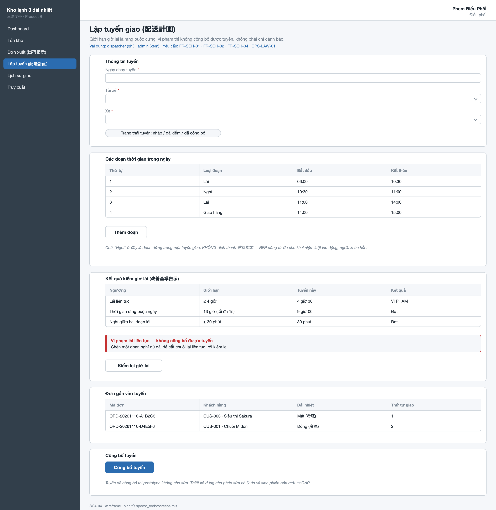
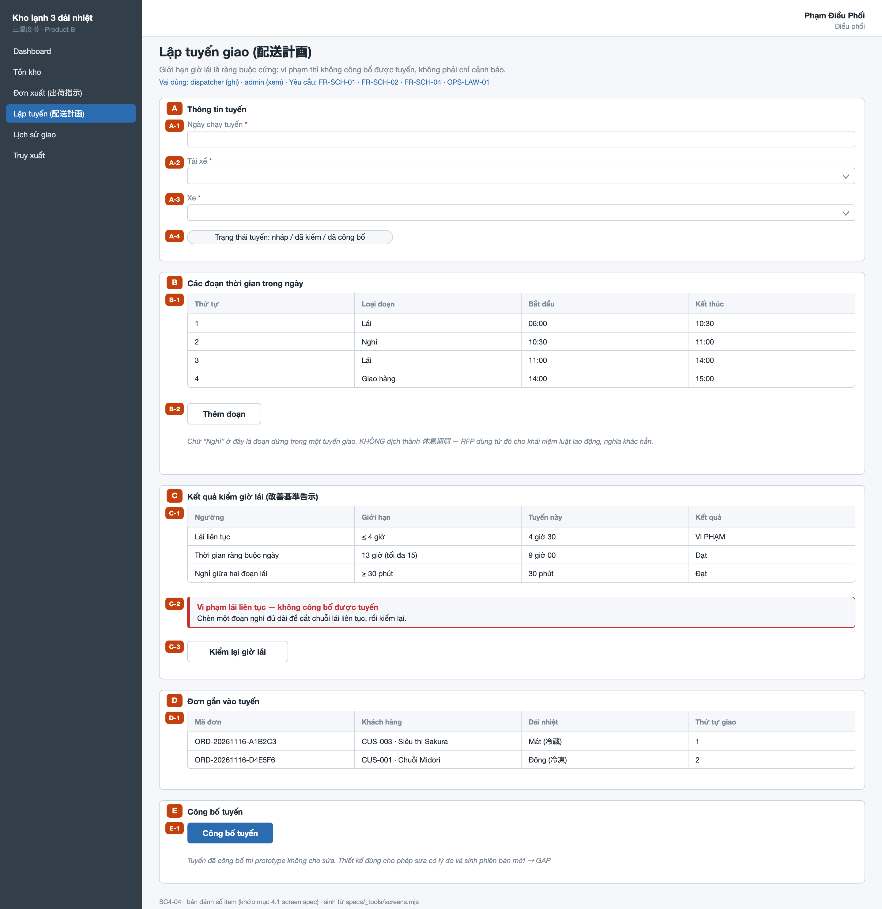

# SC4-04 — Lập tuyến giao (配送計画)

> Biểu mẫu: **BM-2-901-51 v2.1** — Screen Specification · SUN ASTERISK VIETNAM CO., LTD · ISO/IEC 27001:2013 & ISO 9001:2015

---

## 1. History of change

| No | Version | Action | Nội dung thay đổi | Ngày | Người sửa | Approve |
|---|---|---|---|---|---|---|
| 1 | 0.1.0 | Add New | Khởi tạo | 2026-11-16 | PL | |
| 2 | 0.2.0 | Updated | Sửa theo vòng review chéo: thêm bảng truy vết yêu cầu, sửa mã lỗi gán sai, sửa tên trường API | 2026-11-16 | PL | |

---

## 2. Layout

**Design:** wireframe dựng từ [`specs/_tools/screens.mjs`](../../_tools/screens.mjs) — sửa file đó
rồi chạy `node specs/_tools/render-wireframes.mjs`, đừng sửa tay file ảnh.

Ảnh hiện trạng prototype để đối chiếu: [`../assets/_prototype/SC4-04_current.png`](../assets/_prototype/SC4-04_current.png)

---

## 3. Description

Màn để **điều phối viên** lập một tuyến giao trong ngày: chọn ngày chạy, tài xế, xe; nhập các đoạn
thời gian trong ngày; gắn các đơn đã phân bổ lô vào tuyến; rồi công bố tuyến cho tài xế chạy. Vai
**quản trị** xem được, không ghi được.

Điểm phải nắm của màn này: **giới hạn giờ lái (改善基準告示, vấn đề logistics 2024) là ràng buộc
cứng, không phải cảnh báo.** Tuyến còn vi phạm thì **không công bố được** — không có nút bỏ qua,
không vai nào vượt được, kể cả quản trị. Vì vậy màn phải chỉ rõ **vi phạm ngưỡng nào và thiếu bao
nhiêu** (section C), không chỉ báo "tuyến không hợp lệ": điều phối viên cần biết phải sửa gì mới đi
tiếp được. Quyết định này và các phương án đã bỏ nằm ở
[`ADR-006`](../../architecture/ADR-006-driver-hours-blocks-route-publish.md).

Hệ thống **kiểm** tuyến do người lập, **không đề xuất** tuyến — tối ưu tuyến ngoài phạm vi (`GAP-12`).

Đi tới: từ Dashboard và từ menu Điều phối; đơn vào màn này đến từ màn Đơn xuất (SC4-03) sau khi đã
phân bổ lô. Đi ra: trang chi tiết tuyến đã công bố.

---

## 3bis. Yêu cầu màn này thực hiện

Mã yêu cầu tra ở [`docs/01_requirements-extract.md`](../../../docs/01_requirements-extract.md) —
**không tự chế mã mới ở đây**. Màn nào chỉ làm một phần thì ghi rõ phần thiếu ngay trong cột cuối.

| Mã yêu cầu | Nội dung (trích ngắn) | Màn đáp ứng ở mục nào |
|---|---|---|
| `FR-SCH-01` | Tạo tuyến từ đơn, dải nhiệt xe, khung giờ, thời gian bốc dỡ, giờ kho; đơn chưa gắn và lý do từ chối luôn hiển thị | 4.2 (A-1…A-3, B-1), 4.3 (A, B, D), 5 — khởi tạo nạp đơn đã phân bổ lô chưa gắn tuyến nào; D-1 gắn đơn và chặn khi lệch dải nhiệt xe. **Một phần**: thứ tự giao chưa có chỗ lưu → [`GAP-13`](../../database/gap-list.md); giờ kho và thời gian bốc dỡ không có trường riêng — điều phối nhập tay thành đoạn loại "giao / bốc dỡ" ở B-1 |
| `FR-SCH-02` | Kiểm theo **phiên bản quy tắc chính thức**: giờ làm thêm, tổng giờ, nghỉ, lái bình quân, lái liên tục. Tuyến vi phạm **cấm công bố**, hiện đúng khoảng thời gian vi phạm | 4.2 (bảng tầng dữ liệu), 4.3 (C-1…C-3, E-1), 5 — C-3 kiểm lại và E-1 từ chối công bố kèm ngưỡng, giá trị, giới hạn; 6 — ba quy ước diễn giải. **Một phần**: mới ba phép kiểm trong phạm vi một ngày tuyến → [`GAP-01`](../../database/gap-list.md) |
| `FR-SCH-03` | Chèn điểm nghỉ đủ dài trước khi lái liên tục vượt 4 giờ; vị trí và thời lượng nghỉ hiện trong lịch trình tài xế | 5 — E-1 chỉ rõ phải chèn đoạn nghỉ nào để cắt chuỗi lái liên tục; 6 — quy ước reset bộ đếm. **Một phần**: hệ thống **kiểm** chứ không tự chèn (mục 3), và lịch trình tài xế không thuộc bộ màn của LAB-4 |
| `FR-SCH-04` | Công bố tuyến có quản lý phiên bản; thay đổi sau công bố bắt buộc nhập lý do; tài xế nhận bản mới nhất, bản cũ audit được | 4.3 (A-4, E-1), 5 — E-1 ghi `published_at`, `published_by`, `rule_version_id`, `checked_at`. **Một phần**: sửa sau công bố đang bị chặn hẳn, chưa sinh phiên bản tuyến mới có lý do → [`GAP-03`](../../database/gap-list.md); đường tài xế nhận bản mới nhất chưa màn nào đặc tả |
| `DR-ROUTE-01` | Dữ liệu phiên bản tuyến | 4.2 (bảng tầng dữ liệu), 4.3 (A-4, E-1) — `routes` giữ `rule_version_id` và dấu vết công bố, nên về sau truy lại được tuyến đã chấm bằng bộ quy tắc nào. **Một phần** → [`GAP-03`](../../database/gap-list.md): chưa lưu được nhiều phiên bản của cùng một tuyến |
| `OPS-LAW-01` | Kiểm chứng lại nguồn chính thức trước khi đóng băng thiết kế và trước go-live | 6 — bộ ngưỡng 改善基準告示 ghi rõ là bản tóm tắt phải kiểm chứng lại, kèm hai điểm CẦN XÁC NHẬN 9 và 10 còn chờ khách. Việc kiểm chứng là công việc của quy trình dự án, màn chỉ có nghĩa vụ **không giấu** chỗ đang giả định |

---

## 4. View

**Đánh ID:** section là chữ (`A`–`E`), item trong section là số. Tham chiếu dạng `{section}-{số}`.

### 4.1 Danh sách item

Bảng item sinh tự động cùng nguồn với ảnh annotated, nên số callout trên ảnh và ID ở đây không bao
giờ lệch: [`../assets/SC4-04_items.md`](../assets/SC4-04_items.md).

### 4.2 Validation

| ID | Type | Min | Max | Default | Ghi chú |
|---|---|---|---|---|---|
| A-1 | Date | — | — | | Ngày chạy tuyến. Trống → `M_01`. **Quyết định phiên bản bộ quy tắc giờ lái được áp dụng** — không có phiên bản nào hiệu lực tại ngày đó thì không kiểm được, hiện `M_02` |
| A-2 | String | — | — | | Tài xế phải có thật trong master. Không có → `M_02` |
| A-3 | String | — | — | | Xe phải có thật trong master. Dải nhiệt của xe phải phủ được dải nhiệt của hàng gắn vào tuyến — lệch thì chặn ở bước gắn đơn (D-1), `M_02` |
| B-1 | — | 1 đoạn | — | | Mỗi dòng: loại đoạn ∈ { lái xe · giao / bốc dỡ (納品) · nghỉ · chờ }, giờ bắt đầu, giờ kết thúc. Kết thúc phải **sau** bắt đầu → `M_02`. Hai đoạn **không được chồng thời gian** → `M_02` lúc nhập; lọt xuống máy chủ thì thành vi phạm khoá công bố, hiện bằng `M_40`. Tuyến chưa có đoạn nào thì không kiểm và không công bố được → `M_01` |

**Validation ở tầng dữ liệu — không phải ở màn, nhưng màn phải hiển thị được kết quả:**

| Luật | Chặn ở đâu | Thông báo trên màn |
|---|---|---|
| Tuyến đã công bố thì không sửa đoạn, không gắn thêm đơn, không kiểm lại | RLS trên `routes` và `route_orders`, kiểm lại trong `replace_route_segments` | `M_41` |
| Không tạo thẳng được tuyến ở trạng thái `published`; `published_at`, `published_by`, `rule_version_id` do máy chủ ghi | RLS trên `routes` + RPC `publish_route` | — (client gửi lên cũng bị bỏ qua) |
| Công bố khi còn vi phạm giờ lái | `publish_route` kiểm lại trong giao dịch có khoá hàng tuyến | `M_40` |
| Một đơn chỉ thuộc một tuyến | Ràng buộc duy nhất trên `route_orders` | `M_02` |

> Nhóm tuyến chưa có mã lỗi nghiệp vụ tầng CSDL trong
> [`../../_common/error-codes.md`](../../_common/error-codes.md) — luật nằm ở RLS và ở hai hàm RPC,
> nên cột trên ghi nơi chặn thay vì mã lỗi. Không tự chế mã mới ở đây.

### 4.3 Data Mapping

**Quy ước tên:** cột ở đây là **tên trường trong thân yêu cầu API — camelCase**, khác tên cột CSDL
(snake_case). Hai tên này không được dùng lẫn: gửi `route_date` thay cho `routeDate` là bị `SER-09`
từ chối 422. Việc đổi sang tên cột nằm ở phía máy chủ, sau khi kiểm dữ liệu.

| ID | Data Source | API ID | API URL | Key / Param | Ghi chú |
|---|---|---|---|---|---|
| A-1 | API | `SER-09` | `POST /api/routes` | `routeDate` | Dạng `YYYY-MM-DD`. Cũng là khoá chọn phiên bản bộ quy tắc giờ lái. Cột CSDL là `route_date` |
| A-2 | CSDL → API | `SER-09` | như trên | `driverId` | Danh sách đọc bằng phiên người dùng, RLS lọc |
| A-3 | CSDL → API | `SER-09` | như trên | `vehicleId` | Dải nhiệt lấy từ `temperature_band` của xe |
| A-4 | API | `SER-09` → `SER-11` → `SER-13` | như trên | phản hồi: trạng thái tuyến | `draft` → `checked` → `published`. **Máy chủ suy ra, client không gửi lên** |
| B-1 | API | `SER-10` | `POST /api/routes/{routeId}/segments` | `segments[]`, mỗi phần tử `kind`, `startAt`, `endAt` | Thay **toàn bộ** đoạn của tuyến, không sửa từng dòng. `startAt` / `endAt` bắt buộc kèm múi giờ (`+09:00` hoặc `Z`) — thiếu offset là lệch 9 giờ và sai kết luận giờ lái. **Không có trường thứ tự đoạn**: máy chủ xếp các đoạn theo thời điểm bắt đầu rồi tự đánh số thứ tự `route_segments.seq` theo thứ tự mảng. Client gửi kèm cũng bị bỏ qua |
| C-1 | API | `SER-11` | `POST /api/routes/{routeId}/check` | **không có thân yêu cầu**; phản hồi: kết quả từng ngưỡng | Giới hạn đọc từ `driver_rule_versions`, bản chọn theo `route_date`; màn hiện kèm số hiệu `version` |
| C-2 | API | `SER-11` | như trên | phản hồi: danh sách vi phạm | Mỗi vi phạm mang **ngưỡng bị vượt, giá trị của tuyến, khoảng thời gian vi phạm** |
| C-3 | API | `SER-11` | như trên | — | Kết quả lưu vào `violations` và `checked_at` của tuyến |
| D-1 | API | `SER-12` | `POST /api/routes/{routeId}/assign-order` | `orderId` | Chỉ nhận đơn đã phân bổ lô và chưa thuộc tuyến nào. Máy chủ ghi vào `route_orders` |
| E-1 | API | `SER-13` | `POST /api/routes/{routeId}/publish` | **không có thân yêu cầu** | Máy chủ **bỏ qua hoàn toàn thân yêu cầu**: tự tải lại đoạn từ CSDL, tự chọn phiên bản bộ quy tắc theo `route_date`, tự kiểm lại rồi mới công bố. Client không gửi kết quả kiểm và cũng không gửi số hiệu phiên bản lên |

Mã API tra ở [`../../_common/api-list.md`](../../_common/api-list.md) — không tự khai API mới ở đây.

---

## 5. Event

| ID | Given (Pre-condition) | When (Trigger/Action) | Then (Result) | Note |
|---|---|---|---|---|
| **Initializing Process（初期処理）** | | | | |
| - | Vai là điều phối | Mở màn hình | 1. Nạp danh sách tài xế và xe 2. Nạp đơn đã phân bổ lô, chưa gắn tuyến nào 3. Bảng section C để trống cho tới khi bấm kiểm | Vai quản trị mở được ở chế độ chỉ xem; vai khác bị chặn trước khi tới màn |
| - | Tuyến đã có sẵn | Mở màn hình | 1. Hiện trạng thái tuyến ở A-4 2. Hiện lại kết quả kiểm đã lưu, kèm số hiệu phiên bản bộ quy tắc đã dùng | Tuyến đã công bố thì mọi nút ghi khoá lại |
| **Standard Process（通常処理）** | | | | |
| A-1 | - | Chọn ngày chạy tuyến | Chọn phiên bản bộ quy tắc giờ lái có `effective_from` lớn nhất mà **không sau** ngày chạy tuyến, hiện số hiệu lên màn | Không lấy "phiên bản mới nhất" — quy định mới hiệu lực sau ngày tuyến **không** được chấm hồi tố |
| A-1, A-2, A-3 | Đã điền đủ | Lưu thông tin tuyến | 1. Gọi `SER-09` 2. Tuyến sinh ra ở trạng thái nháp | |
| B-2 | Tuyến chưa công bố | Thêm / sửa đoạn rồi lưu | 1. Gọi `SER-10` thay toàn bộ đoạn 2. **Kết quả kiểm cũ hết giá trị**: tuyến quay về nháp, bảng C xoá trắng | Sửa đoạn mà giữ kết quả kiểm cũ là cách dễ nhất để công bố một tuyến chưa từng được kiểm |
| C-3 | Tuyến có ít nhất một đoạn | Bấm "Kiểm lại giờ lái" | 1. Gọi `SER-11`, **máy chủ tính lại từ đoạn trong CSDL** 2. Điền C-1: mỗi ngưỡng một dòng gồm giới hạn, giá trị của tuyến này, kết quả đạt / vi phạm 3. Không vi phạm → trạng thái chuyển sang đã kiểm | Màn không tự kết luận; con số hiển thị là con số máy chủ trả về |
| D-1 | Đơn đã phân bổ lô, dải nhiệt trùng dải nhiệt của xe | Gắn đơn vào tuyến | 1. Gọi `SER-12` 2. Đơn hiện trong bảng D-1 kèm thứ tự giao | Gắn đơn không đổi kết quả kiểm giờ lái |
| E-1 | Tuyến **không còn vi phạm nào** | Bấm "Công bố tuyến" | 1. Gọi `SER-13` 2. Máy chủ **kiểm lại lần nữa trong CSDL** rồi mới đặt trạng thái đã công bố 3. Ghi `published_at`, `published_by`, `rule_version_id`, `checked_at` | Đây là đường duy nhất đặt được trạng thái đã công bố |
| **Error Handling（エラー制御）** | | | | |
| E-1 | Tuyến còn ít nhất một vi phạm | Bấm E-1 | 1. **Từ chối công bố**, trạng thái giữ nguyên 2. Mỗi vi phạm hiện một dòng `M_40` nêu **ngưỡng nào, giá trị của tuyến, giới hạn** — ví dụ lái liên tục 4h30 so với giới hạn 4h00 3. C-2 hiện cách sửa: chèn một đoạn nghỉ đủ dài để cắt chuỗi lái liên tục, rồi kiểm lại | **Bẫy ⑥.** Không có nút bỏ qua. Quản trị cũng không vượt được |
| C-1 | Thời gian ràng buộc ngày (拘束時間) vượt mức tiêu chuẩn nhưng chưa vượt mức tối đa | Bấm C-3 hoặc E-1 | 1. Hiện `M_42` 2. **Vẫn công bố được** — đây là cảnh báo, không phải vi phạm | Phân biệt mức tiêu chuẩn / mức tối đa là điểm CẦN XÁC NHẬN 10, xem mục 6 |
| B-2, D-1, C-3 | Tuyến đã công bố | Lưu đoạn / gắn đơn / kiểm lại | Từ chối thao tác, hiện `M_41` | Prototype chặn hẳn — thiết kế đúng cho sửa có lý do, xem `GAP-03` ở mục 6 |
| C-3, E-1 | Tuyến chưa có đoạn nào | Bấm C-3 hoặc E-1 | Từ chối, hiện `M_01` kèm yêu cầu nhập các đoạn trong ngày trước | |
| A-1 | Không có phiên bản bộ quy tắc nào hiệu lực tại ngày chạy tuyến | Bấm C-3 hoặc E-1 | Từ chối, hiện `M_02` | Không lùi về một bộ ngưỡng mặc định — chấm bằng ngưỡng sai là chấm sai |
| E-1 | Bộ quy tắc có phiên bản mới chen vào **giữa lúc máy chủ kiểm và lúc ghi công bố** | Bấm E-1 | 1. Từ chối công bố 2. Hiện `M_02` kèm yêu cầu bấm C-3 kiểm lại trước khi công bố | Đây là phép kiểm **máy chủ với máy chủ** (`RULE_VERSION_MISMATCH`): tầng API chọn một phiên bản, RPC khoá hàng tuyến rồi chọn lại, hai số phải trùng. Client không gửi phiên bản nào lên nên không có luồng "client gửi số cũ" |
| bất kỳ | Vai không phải điều phối (kể cả quản trị) | Thao tác ghi bất kỳ | Hiện `M_04`, không ghi gì | Quản trị **xem** được, không có đường vượt vi phạm giờ lái |
| bất kỳ | Phiên hết hạn | Thao tác bất kỳ | Hiện `M_03`, đẩy về màn đăng nhập | |
| bất kỳ | Không đọc được dữ liệu tuyến | Mở màn / bấm C-3 | Hiện `M_05`, không hiện kết quả kiểm cũ như thể vừa kiểm | |

Mã thông báo tra ở [`../../_common/error-codes.md`](../../_common/error-codes.md) — không tự chế mã mới ở đây.

---

## 6bis. Trường do máy sinh — luật sinh

| Trường | Luật sinh |
|---|---|
| Thứ tự đoạn (`route_segments.seq`) | **Máy chủ tự đánh**, không nhận từ client. Biên API sắp mảng đoạn theo **thời điểm bắt đầu** rồi RPC đánh số theo thứ tự mảng đó |
| Phiên bản bộ quy tắc giờ lái | Máy chủ tự chọn theo **ngày chạy tuyến**. Thân yêu cầu của `SER-13` bị bỏ qua hoàn toàn |
| `violations` · `checked_at` | Kết quả kiểm giờ lái do máy chủ tính lại trong CSDL lúc công bố, không tin kết quả client gửi lên |
| Thứ tự giao của đơn trên tuyến | **Chưa có chỗ lưu** — `route_orders` chỉ có mã tuyến và mã đơn → `GAP-13` |

---

## 6. Other Notes

**Vì sao giờ lái không được làm thành cảnh báo:**

| Cách đối xử | Hệ quả |
|---|---|
| Chỉ tiêu tối ưu, vi phạm thì cảnh báo | Dưới áp lực giao hàng, nút "vẫn công bố" sẽ luôn được bấm. Hệ thống thành công cụ tạo bằng chứng vi phạm luật lao động |
| **Ràng buộc cứng khoá việc công bố** | Tuyến vi phạm không công bố được. Phải sửa tuyến mới đi tiếp. **Đây là cách đã chốt** |

Các ngưỡng nằm trong 改善基準告示 và là **quy định pháp luật**, không phải chỉ tiêu nội bộ. Vì thế
không vai nào được miễn trừ: vi phạm giờ lái là vi phạm luật lao động, không phải vấn đề phân quyền.

**Ba điểm kỹ thuật đi kèm, không được bỏ:**

| Điểm | Nội dung |
|---|---|
| Máy chủ tự kiểm lại | Khi công bố, **thân yêu cầu bị bỏ qua hoàn toàn**: máy chủ tải lại đoạn từ CSDL, tự chọn phiên bản bộ quy tắc theo ngày chạy tuyến và tính lại từ đầu. Không có đường nào để client nói mình đã kiểm rồi, hay đã kiểm bằng phiên bản nào — tin kết quả kiểm của client là tin vào thứ mình không kiểm soát |
| Bộ ngưỡng có phiên bản | `driver_rule_versions` chọn theo `route_date`, giống cách ngưỡng nhiệt chọn theo thời điểm đo. Quy định thay đổi được, và tuyến cũ phải giữ nguyên cách chấm |
| Sửa đoạn là huỷ kết quả kiểm | Thay đoạn đưa tuyến về nháp. Không có đường nào công bố một tuyến mà kết quả kiểm không thuộc về chính các đoạn đang lưu |

**Ba quy ước diễn giải đã chốt — đổi một quy ước là đổi kết quả chấm:**

| Chỗ | Quy ước |
|---|---|
| Bộ đếm lái liên tục | Chỉ cộng thời gian của đoạn **lái xe**. Đoạn giao / bốc dỡ và đoạn chờ **không cộng và cũng không reset** |
| Reset bộ đếm | Chỉ **một** đoạn nghỉ dài hơn hoặc bằng `min_break_minutes` mới reset. Nhiều đoạn nghỉ ngắn liền nhau **không cộng gộp** — chọn cách chặt hơn vì đây là ràng buộc cứng |
| Khoảng trống giữa hai đoạn | Không ghi nhận là nghỉ: không reset bộ đếm, nhưng vẫn nằm trong thời gian ràng buộc ngày |

**CẢNH BÁO VỀ TỪ NGỮ — quan trọng với hồ sơ gửi khách Nhật:**

| Từ trên màn | Nghĩa đúng ở đây | Tuyệt đối không dịch thành |
|---|---|---|
| "Nghỉ" (loại đoạn trong B-1) | **Đoạn dừng trong một tuyến giao**, tính bằng phút, dùng để cắt chuỗi lái liên tục | **休息期間** — RFP dùng từ đó cho **khái niệm luật lao động tính theo ngày** (quãng nghỉ giữa hai ngày làm việc). Nghĩa khác hẳn, mà ở hồ sơ pháp lý thì sai từ là sai nghĩa |
| "Thời gian ràng buộc ngày" (dòng trong C-1) | **拘束時間** — khái niệm luật, tính theo **ngày làm việc của tài xế** | Không đồng nghĩa "tổng thời gian của tuyến". Prototype mới tính trong phạm vi một ngày tuyến — xem `GAP-01` |

**Điểm CẦN XÁC NHẬN với khách — ảnh hưởng trực tiếp tới màn này** (`docs/scope.md` mục 6):

| # | Điểm | Giả định đang dùng |
|---|---|---|
| 9 | Phút nghỉ tối thiểu để reset bộ đếm lái liên tục 4 giờ | Tham số `min_break_minutes`, seed giá trị tạm, gắn nhãn CẦN XÁC NHẬN trên màn. **RFP chỉ ghi "lái liên tục tối đa 4 giờ", không ghi số phút nghỉ** |
| 10 | Ngày làm việc 13h–15h: khi nào được kéo dài tới 15h | Trên mức tối đa = vi phạm, khoá công bố. Trên mức tiêu chuẩn và còn trong mức tối đa = cảnh báo `M_42`, không khoá. Bằng đúng ngưỡng thì chưa vượt |

**Chỗ prototype làm khác thiết kế:**

| Mã | Mức | Nội dung |
|---|---|---|
| [`GAP-01`](../../database/gap-list.md) | **Cao** | Prototype mới kiểm trong phạm vi **một ngày tuyến**: lái liên tục, thời gian ràng buộc ngày, nghỉ tối thiểu. Các ngưỡng tuần, tháng, năm, lái bình quân 2 ngày và quãng nghỉ giữa hai ngày làm việc **chưa làm**. Bảng `driver_rule_versions` đã lưu đủ số (`weekly_driving_hours_2w`, `monthly_duty_hours`, `annual_duty_hours`, `annual_overtime_hours`, `avg_driving_hours_2d`, `min_rest_hours`, `target_rest_hours`), chỉ thiếu logic. **Đây là *chưa làm*, không phải *ngoài phạm vi*** — giờ lái là ràng buộc cứng, không được đẩy vào sổ gap như một lựa chọn phạm vi ([`PREMISE.md`](../../PREMISE.md) mục 3). Rủi ro: tuyến hợp lệ trong ngày vẫn có thể vi phạm ngưỡng tuần hoặc tháng, hệ thống báo đạt trong khi thực tế vi phạm luật |
| [`GAP-03`](../../database/gap-list.md) | Trung bình | Tuyến đã công bố prototype chặn hẳn mọi thao tác sửa. Thiết kế đúng cho **sửa có lý do và sinh phiên bản tuyến mới**, giữ lại bản cũ. Thực tế vận hành phải đổi tuyến sau khi công bố (xe hỏng, khách dời giờ); hiện phải xoá và lập lại, mất dấu vết |
