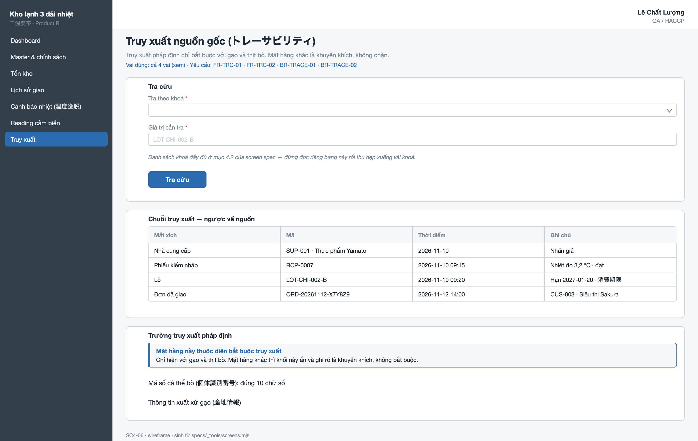
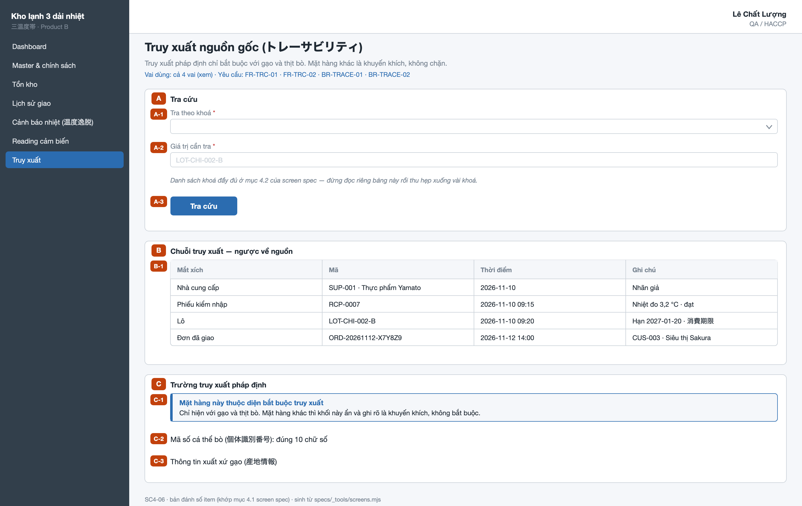

# SC4-06 — Truy xuất nguồn gốc (トレーサビリティ)

> Biểu mẫu: **BM-2-901-51 v2.1** — Screen Specification · SUN ASTERISK VIETNAM CO., LTD · ISO/IEC 27001:2013 & ISO 9001:2015

---

## 1. History of change

| No | Version | Action | Nội dung thay đổi | Ngày | Người sửa | Approve |
|---|---|---|---|---|---|---|
| 1 | 0.1.0 | Add New | Khởi tạo | 2026-11-16 | PL | |
| 2 | 0.2.0 | Modify | Sửa theo review LAB-4: mở lại đủ khoá tra cứu theo `FR-TRC-01`, bỏ cách gọi phần tuân thủ là "mở rộng" (B9); thêm mục 3bis bảng truy vết yêu cầu (B1); trỏ thẳng `GAP-14` thay vì hẹn đưa vào sổ gap ở Bước 7 (C2) | 2026-11-16 | PL | |

---

## 2. Layout

**Design:** wireframe dựng từ [`specs/_tools/screens.mjs`](../../_tools/screens.mjs) — sửa file đó
rồi chạy `node specs/_tools/render-wireframes.mjs`, đừng sửa tay file ảnh.

Ảnh hiện trạng prototype để đối chiếu: [`../assets/_prototype/SC4-06_current.png`](../assets/_prototype/SC4-06_current.png)

---

## 3. Description

Màn để tra một mã và nhìn lại **toàn bộ đường đi của hàng, ngược về nguồn**: nhà cung cấp → phiếu
kiểm nhập → lô → đơn đã giao. Tra được theo **nhiều loại khoá**, cả chiều xuôi (từ nguồn ra khách)
lẫn chiều ngược (từ khách về lô) — danh sách đầy đủ ở mục 4.2.

**Cả bốn vai đều xem được, không vai nào ghi.** Màn không sinh, không sửa, không xoá dữ liệu — mọi
mắt xích đã được ghi ở các màn khác (SC4-01 kiểm nhập, SC4-03 đơn xuất), màn này chỉ nối lại và
trình bày.

Điểm phải nắm: **nghĩa vụ truy xuất pháp định chỉ bắt buộc với gạo và thịt bò.** Mặt hàng còn lại
vẫn tra được, vẫn hiện đủ chuỗi, nhưng đó là **theo dõi nội bộ của Yuki — khuyến khích, không bắt
buộc**, và màn phải nói thẳng điều đó thay vì bày ra một khối trường trống (mục 6, bẫy ⑤).

Đi tới: từ menu trái, mục "Truy xuất". Màn không điều hướng sang màn khác — mọi mắt xích hiện ngay
trên bảng B-1.

---

## 3bis. Yêu cầu màn này thực hiện

Mã lấy từ [`docs/01_requirements-extract.md`](../../../docs/01_requirements-extract.md) — không mã nào
ở đây được tự đặt. Cột cuối trỏ tới đúng mục của spec này, để LAB-5 bẻ task mà không phải đoán.

| Mã yêu cầu | Nội dung (trích ngắn) | Màn đáp ứng ở mục nào |
|---|---|---|
| `FR-TRC-01` | Tìm tồn kho/giao hàng liên quan từ **lô / SKU / NCC / xuất xứ gạo / số định danh cá thể bò**; kết quả có timestamp, nguồn, quan hệ, **chỉ rõ điểm kết thúc của liên kết đã ghi** | 4.2 (bảng loại khoá), 4.3 (A-3, B-1), 5 (A-3, B-1). **Một phần:** hai khoá RFP nêu đích danh — **mã hàng (SKU)** và **nhà cung cấp** — chưa có, xem 4.2 |
| `BR-TRACE-01` | Lane gạo: giữ transaction ID, số lượng, ngày, đối tác, thông tin xuất xứ | 4.2 (luật hiển thị khối C), 4.3 (C-3), 5 (C-3). Việc **chặn khi thiếu** nằm ở SC4-01, màn này chỉ đọc |
| `BR-TRACE-02` | Lane bò: số định danh cá thể **đúng 10 chữ số** xuyên suốt nhập/tồn/allocation/xuất/recall | 4.2 (validation khoá bò), 4.3 (C-2), 5 (C-2), 6 (bảng hiểu sai). **Một phần:** vế "xuyên suốt tới recall" không làm được vì hồ sơ thu hồi ngoài phạm vi |
| `BR-TRACE-03` | Lane nội bộ (P1): lô nội bộ + liên kết supplier/customer là **dữ liệu có cấu trúc**, không phải ghi chú tự do | 4.2 (dòng "theo dõi nội bộ"), 5 (C-1 trong Error Handling), 6 (bẫy ⑤). Chuỗi B-1 vẫn dựng đủ cho lane nội bộ |
| `FR-TRC-02` | Mở recall case: phạm vi, lô ảnh hưởng, khách, số lượng, đầu mối, task, hạn; dashboard đối soát | **Ngoài phạm vi** theo `docs/scope.md` mục 5 ý 10 (FT-041) — xem mục 6. Màn này chỉ dựng dữ liệu nền |
| `NFR-PERF-02` | Truy vết lô 3 năm hoàn tất ≤ 60 giây | **Chưa đo.** Màn có chặn số lô hiển thị một lần (5, Error Handling) nhưng chưa có số đo trên dữ liệu 300.000 dòng xuất như yêu cầu quy định |

Hai dòng "Một phần" và dòng "Chưa đo" ở trên là việc LAB-5 phải bẻ task, không phải chỗ để im lặng.

---

## 4. View

**Đánh ID:** section là chữ (`A`–`C`), item trong section là số. Tham chiếu dạng `{section}-{số}`.

### 4.1 Danh sách item

Bảng item sinh tự động cùng nguồn với ảnh annotated, nên số callout trên ảnh và ID ở đây không bao
giờ lệch: [`../assets/SC4-06_items.md`](../assets/SC4-06_items.md).

### 4.2 Validation

| ID | Type | Min | Max | Default | Ghi chú |
|---|---|---|---|---|---|
| A-1 | String | — | — | mã lô | Một trong các loại khoá ở bảng ngay dưới. Ngoài danh sách → `M_02` |
| A-2 | String | 1 | 100 | | Trống hoặc chỉ khoảng trắng → `M_01`. Dài quá 100 ký tự → `M_02`. Cắt khoảng trắng hai đầu rồi **khớp tuyệt đối, phân biệt hoa thường** — không khớp một phần, không khớp gần đúng. **Riêng khoá số cá thể bò:** phải đúng **10 chữ số**, sai → `M_02`. Hệ thống không tự đệm số 0, không cắt bớt (`BR-TRACE-02`) |

**Các loại khoá tra cứu — `FR-TRC-01` đòi tra được theo lô, SKU, nhà cung cấp, xuất xứ gạo và số
định danh cá thể bò, nên đây là yêu cầu, không phải tuỳ chọn:**

| # | Loại khoá | Tra trên | Chiều | Căn cứ | Prototype |
|---|---|---|---|---|---|
| 1 | Mã lô | `lots.lot_id` | xuôi: lô → khách | `FR-TRC-01` ("lô") | ✔ có |
| 2 | **Mã hàng (SKU)** | `lots.sku_id` | xuôi | `FR-TRC-01` ("SKU") | **✘ thiếu** |
| 3 | **Nhà cung cấp** | `lots.supplier_id` | xuôi | `FR-TRC-01` ("NCC") | **✘ thiếu** |
| 4 | Số lô nhà cung cấp | `lots.supplier_lot` | xuôi | hẹp hơn #3: một lô cụ thể của một nhà cung cấp | ✔ có |
| 5 | Xuất xứ gạo (産地) | `lots.rice_origin` | xuôi | `FR-TRC-01` ("xuất xứ gạo"), `BR-TRACE-01` | ✔ có |
| 6 | Mã giao dịch gạo (取引記録) | `lots.rice_transaction_id` | xuôi | `BR-TRACE-01` (transaction ID là trường pháp định lane gạo) | ✔ có |
| 7 | Số cá thể bò (牛個体識別番号) | `lots.beef_individual_id` | xuôi | `FR-TRC-01` ("số định danh cá thể bò"), `BR-TRACE-02` | ✔ có |
| 8 | Mã khách hàng | `orders.customer_id` | **ngược**: khách → lô đã nhận | `FR-TRC-01` ("giao hàng liên quan") | ✔ có |
| 9 | Mã đơn / số tham chiếu | `orders.order_id` hoặc `orders.reference` | **ngược** | như trên | ✔ có |

**Hai khoá thiếu (#2 và #3) là yêu cầu RFP nêu đích danh, không phải ý tưởng thêm vào.** Chúng không
chạm bẫy nghiệp vụ nào nên xếp được vào sổ gap, nhưng [`../../database/gap-list.md`](../../database/gap-list.md)
**chưa có dòng nào** cho chúng — phải có dòng gap (hoặc task LAB-5) trước khi bẻ task.

**Chiều xuôi và chiều ngược cho ra hai dạng kết quả khác nhau** (xem mục 5): khoá #1–#7 tìm ra các
lô khớp rồi dựng chuỗi đầy đủ cho từng lô; khoá #8–#9 đi từ đơn và lịch sử giao ngược về lô.

Bảng item 4.1 sinh tự động từ `specs/_tools/screens.mjs` và **hiện còn ghi ba loại khoá** — sửa dòng
SC4-06 trong file đó cho khớp bảng trên rồi chạy lại lệnh render, đừng sửa tay bảng item.

Kiểm khoá chạy **ở máy chủ**, không chỉ ở trình duyệt: gõ thẳng khoá vào URL vẫn phải bị chặn như
khi bấm nút.

**Luật hiển thị khối C — không phải validate nhập liệu, nhưng là thứ quyết định khối nào hiện:**

| Diện truy xuất | Căn cứ | Khối C hiển thị thế nào |
|---|---|---|
| Gạo (米トレーサビリティ法) | cột `traceability_lane` của mã hàng = diện gạo | Hiện C-1 và **C-3**; C-2 ẩn |
| Thịt bò (牛個体識別番号) | cột `traceability_lane` = diện thịt bò | Hiện C-1 và **C-2**; C-3 ẩn |
| Mọi mặt hàng còn lại | cột `traceability_lane` = theo dõi nội bộ | **Ẩn hoàn toàn cả khối C** — không hiện ô trống, không hiện dấu gạch. Thay bằng `M_61` |

Diện truy xuất do **mã hàng** quyết định, không do người tra chọn và không suy ra từ tên hàng.

### 4.3 Data Mapping

| ID | Data Source | API ID | API URL | Key / Param | Ghi chú |
|---|---|---|---|---|---|
| A-1 | Suy ra | — | — | danh sách loại khoá ở 4.2 | Danh sách do hệ thống khai, người dùng không thêm được loại khoá mới |
| A-3 | API | `SER-19` | `GET /api/traceability` | tham số truy vấn: `keyType`, `value` | Màn **đọc hiếm hoi đi qua route API**, khác các màn đọc bằng Server Component. `keyType` nhận đúng một trong các loại khoá ở 4.2. Tên tham số là camelCase, khác tên cột CSDL |
| B-1 | API | `SER-19` | như trên | `result` | Chuỗi dựng từ `lots` nối `suppliers`, `receipt_lines`, `allocations`, `shipment_history`, `orders`, `customers`. Khoá chiều xuôi khớp thẳng vào cột tương ứng của `lots` (bảng 4.2); khoá chiều ngược đi vào `orders` rồi `shipment_history` |
| C-1 | Suy ra | `SER-19` | như trên | `legal.isLegalObligation` | Suy từ cột `traceability_lane` của bảng `skus` — xem bảng luật hiển thị ở 4.2 |
| C-2 | API | `SER-19` | như trên | `upstream.beefIndividualId` | Cột `beef_individual_id` của `lots`; bản ghi gốc nằm ở `receipt_lines` |
| C-3 | API | `SER-19` | như trên | `upstream.riceOrigin`, `upstream.riceTransactionId` | Cột `rice_origin` và `rice_transaction_id` của `lots`; bản ghi gốc ở `receipt_lines` |

**Tên trường trong thân JSON là camelCase, tên cột CSDL là snake_case.** Hai thứ khác nhau, đừng
lẫn: `beefIndividualId` là trường API, `beef_individual_id` là cột bảng.

Mã API tra ở [`../../_common/api-list.md`](../../_common/api-list.md) — không tự khai API mới ở đây.

---

## 5. Event

| ID | Given (Pre-condition) | When (Trigger/Action) | Then (Result) | Note |
|---|---|---|---|---|
| **Initializing Process（初期処理）** | | | | |
| - | Người dùng đã đăng nhập, vai bất kỳ trong bốn vai | Mở màn hình | 1. Hiện khối A, A-1 mặc định là mã lô 2. B-1 và cả khối C để trống, **không gọi `SER-19`** 3. Hiện dòng nhắc "nhập khoá tra cứu" | Chưa có khoá thì không nạp sẵn gì — màn không có danh sách mặc định |
| - | Khoá đã nằm sẵn trên URL (lần tra trước, link chia sẻ) | Mở màn hình | Nạp lại đúng kết quả của khoá đó, A-1 và A-2 điền sẵn | Khoá giữ trên URL để tra lại và in lại được |
| **Standard Process（通常処理）** | | | | |
| A-1 | - | Đổi loại khoá | Đổi gợi ý định dạng ở A-2, **không gọi API**, không xoá kết quả đang hiện | |
| A-3 | A-1 và A-2 đã điền | Bấm "Tra cứu" | 1. Gọi `SER-19` với `keyType` và `value` 2. Điền B-1 theo thứ tự ngược về nguồn: nhà cung cấp → phiếu kiểm nhập → lô → đơn đã giao 3. Hiện hoặc ẩn khối C theo bảng luật ở 4.2 | Một lần bấm, một lần gọi |
| B-1 | Tra theo **khoá chiều xuôi** (#1–#7 ở 4.2: mã lô, mã hàng, nhà cung cấp, số lô NCC, xuất xứ gạo, mã giao dịch gạo, số cá thể bò) | Có kết quả | 1. Tìm **mọi lô** khớp khoá 2. Mỗi lô khớp là một chuỗi: nhà cung cấp và số lô nhà cung cấp, phiếu kiểm nhập sinh ra lô, lô (hạn và **loại hạn** 賞味期限 / 消費期限), rồi các đơn đã phân bổ và đã giao | Chiều xuôi lô → khách. Khoá theo mã hàng hoặc nhà cung cấp thường ra **nhiều lô**, nên áp luật cắt kết quả ở Error Handling |
| B-1 | Tra theo **khoá chiều ngược** (#8–#9 ở 4.2: mã khách hàng, mã đơn / số tham chiếu) | Có kết quả | Liệt kê các lô đã giao cho đơn / khách đó, mỗi dòng ghi thời điểm giao và lô nguồn | Chiều ngược khách → lô |
| B-1 | Có kết quả, khoá bất kỳ | Xem bảng chuỗi | Nêu rõ **điểm kết thúc của liên kết đã ghi**: lô đã giao hết cho ai và lần cuối lúc nào, phần còn trong kho, phần đã phân bổ mà chưa giao | `FR-TRC-01` đòi đích danh vế này — không để người tra tự đoán chuỗi dừng ở đâu |
| B-1 | Có kết quả | Xem bảng chuỗi | Mỗi mắt xích ghi **mã, thời điểm và bảng nguồn**; mắt xích không có dữ liệu ghi "chưa ghi", không để ô trắng | Người đọc phải biết đang nhìn dữ liệu từ đâu |
| C-1 | Mặt hàng tra ra thuộc diện gạo hoặc thịt bò | Có kết quả | Hiện khối C kèm nhãn nói rõ đây là **nghĩa vụ pháp định** | |
| C-2 | Mặt hàng thuộc diện thịt bò | Có kết quả | Hiện mã số cá thể (個体識別番号) **đúng 10 chữ số như đã lưu, giữ nguyên số 0 đầu** | Hệ thống không tự đệm, không cắt, không làm tròn thành 10 số |
| C-3 | Mặt hàng thuộc diện gạo | Có kết quả | Hiện thông tin xuất xứ (産地情報) và mã giao dịch | |
| **Error Handling（エラー制御）** | | | | |
| A-2 | A-2 để trống | Bấm A-3 | Hiện `M_01`, **không gọi API** | |
| A-2 | Khoá quá 100 ký tự, hoặc loại khoá không nằm trong danh sách ở 4.2 | Bấm A-3 | `SER-19` trả `400` → màn hiện `M_02`, giữ nguyên giá trị đã gõ để sửa | Kiểm ở biên máy chủ |
| A-2 | Loại khoá là **số cá thể bò** nhưng giá trị không đúng 10 chữ số | Bấm A-3 | `SER-19` trả `400` → màn hiện `M_02`, giữ nguyên giá trị đã gõ | Không tự đệm số 0 rồi tra tiếp — 9 chữ số là **sai dữ liệu**, không phải thiếu ký tự (`BR-TRACE-02`) |
| B-1 | Khoá đúng định dạng nhưng không có liên kết nào đã ghi | Bấm A-3 | Hiện `M_60` kèm nhắc "khớp tuyệt đối, phân biệt hoa thường". **Không để bảng rỗng không một lời nào** | Phải phân biệt rõ "không tìm thấy" với "hệ thống lỗi" |
| C-1 | Mặt hàng tra ra **không** thuộc diện bắt buộc | Có kết quả | 1. **Ẩn hoàn toàn khối C** — không ô trống, không gạch ngang 2. Hiện `M_61`: đây là thông tin khuyến khích, không phải nghĩa vụ pháp định 3. B-1 vẫn hiện đủ chuỗi như thường | **Mục quan trọng nhất của màn** — bẫy ⑤ |
| C-2, C-3 | Lô thuộc diện bắt buộc nhưng trường pháp định còn trống | Có kết quả | Ghi "chưa ghi" và nêu đích danh trường thiếu, **không chặn và không báo lỗi** | Màn chỉ đọc. Việc chặn nằm ở màn kiểm nhập (SC4-01, `M_14`), không nhắc lại ở đây |
| B-1 | Số lô khớp vượt mức hiển thị một lần | Bấm A-3 | Hiện cảnh báo kết quả bị cắt và đề nghị thu hẹp khoá — không im lặng bỏ bớt dòng | |
| - | Lỗi đọc CSDL | Bấm A-3 | `SER-19` trả `500` → màn hiện `M_05`, không lộ chi tiết lỗi | |
| bất kỳ | Phiên hết hạn | Thao tác bất kỳ | Hiện `M_03`, đẩy về màn đăng nhập | |
| bất kỳ | Chưa đăng nhập hoặc tài khoản không có vai nào | Mở màn / bấm A-3 | Hiện `M_04` | Cả bốn vai đều đọc được, nên lỗi này chỉ xảy ra khi hồ sơ thiếu vai |

Mã thông báo tra ở [`../../_common/error-codes.md`](../../_common/error-codes.md) — không tự chế mã mới ở đây.

---

## 6. Other Notes

**Bẫy ⑤ — chỗ duy nhất của màn này bị làm sai nhiều nhất:**

| Chỗ | Hiểu sai | Đúng phải là |
|---|---|---|
| Phạm vi nghĩa vụ | Áp quy định truy xuất bắt buộc cho **toàn bộ** mặt hàng vì "kho thực phẩm thì phải truy xuất" | Pháp định **chỉ gạo và thịt bò**. Các mặt hàng khác là **khuyến khích**, không chặn, không đòi trường |
| Mặt hàng không thuộc diện | Vẫn hiện khối trường pháp định, để trống hoặc gạch ngang | **Ẩn hẳn khối đó** và nói rõ bằng `M_61` rằng đây là khuyến khích |
| Truy xuất được ≠ bắt buộc | Thấy hệ thống tra được chuỗi cho mọi mặt hàng nên kết luận mọi mặt hàng đều thuộc diện | Tra được là **chính sách nội bộ của Yuki**; nghĩa vụ pháp định là chuyện khác |
| Mã số cá thể bò | Nhận 9 chữ số rồi đệm thêm số 0 cho đủ 10 | **Đúng 10 chữ số**, giữ nguyên số 0 đầu. Không tự đệm, không cắt |

Suy diễn "thực phẩm thì phải truy xuất hết" là kiến thức phổ thông, không phải căn cứ trong RFP —
đúng thứ hồ sơ chào khách Nhật không được phép làm.

**Ngoài phạm vi — nói trước để khách không hiểu nhầm màn này là hệ thống thu hồi:**

| Chức năng | Trạng thái | Căn cứ |
|---|---|---|
| Hồ sơ thu hồi (recall case, đối soát số lượng ảnh hưởng) | **Ngoài phạm vi** | `docs/scope.md` mục 5 ý 10 (FT-041) |
| Thông báo thu hồi tới khách | **Ngoài phạm vi** | `docs/scope.md` mục 5 ý 10 |
| Xuất hồ sơ kiểm toán (audit export, nhật ký tra cứu) | **Ngoài phạm vi** | `docs/scope.md` mục 5 ý 10 (FT-044) |

Màn này **dựng dữ liệu nền** cho các chức năng đó, nhưng bản thân nó không thu hồi và không xuất hồ
sơ kiểm toán.

**Dòng lịch sử giao không gắn được lô:** lịch sử giao nạp từ hệ cũ có dòng không ghi lô. Những dòng
đó **không được gán bừa** cho lô nào; chuỗi phải nêu riêng để người tra biết còn một phần lịch sử
chưa loại trừ được. Cách xử lý phần lịch sử này khi khách cần truy vết đủ — **chưa có trong RFP →
cần hỏi khách**.

**Điểm CẦN XÁC NHẬN liên quan:** không điểm nào trong 16 điểm ở `docs/scope.md` mục 6 thuộc riêng
màn này. Hai điểm ảnh hưởng gián tiếp vì quyết định dữ liệu màn này đọc được: **#7b** (thiếu trường
pháp định thì chặn xác nhận hay cho vào cách ly — đang chọn *chặn*) và **#8** (bò 9 chữ số tại kiểm
nhập — đang chọn *chặn, không tự đệm*). Cả hai chốt ở SC4-01.

**Chỗ prototype làm khác thiết kế** — không chạm bẫy nghiệp vụ nào:

| # | Chỗ | Hiện trạng prototype | Mức | Sổ gap |
|---|---|---|---|---|
| 1 | B-1 thiếu mắt xích phiếu kiểm nhập | Chuỗi dừng ở nhà cung cấp và số lô nhà cung cấp; cột `receipt_line_id` của `lots` đã có nhưng chưa được đọc lên màn | Trung bình — đứt một mắt xích của chuỗi ngược về nguồn | → `GAP-14` |
| 2 | Thiếu hai loại khoá RFP nêu đích danh: **mã hàng (SKU)** và **nhà cung cấp** | Có 7 trong 9 loại khoá ở bảng 4.2 | Trung bình — thu hẹp `FR-TRC-01` | **chưa có dòng gap** |
| 3 | Nút "In / Lưu PDF" không có trong bảng item 4.1 | Prototype gọi lệnh in của trình duyệt; không có manifest SHA-256 nên **không phải bằng chứng kiểm toán** | Thấp — đã ghi là mock ở `docs/scope.md` mục 4 | — |

Chi tiết từng dòng tra ở [`../../database/gap-list.md`](../../database/gap-list.md); bảng trên chỉ
là con trỏ, không chép lại nội dung sổ gap.
